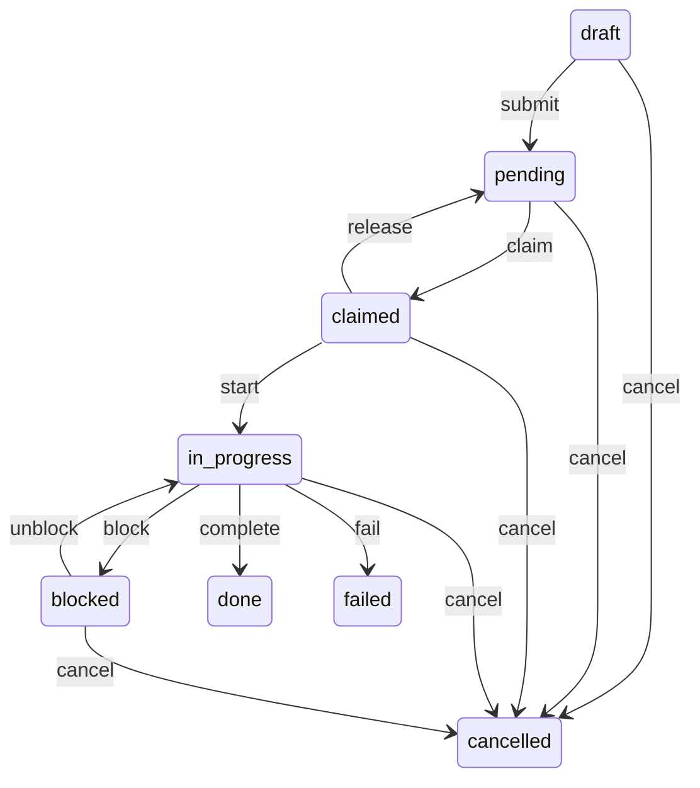

# AGENTS.md — AIDash Harness 契约

```yaml
contract_version: "4.11"
schema_version: "1.0"
aidash_version: "2.0.0"
updated: "2026-10-25"
```

> 把这份文件放在每个 harness 仓库的根目录。agent 每次开始工作前先读它。
> 字段级的真值以 `tools/list` 返回的 `inputSchema` 为准；本文件与它冲突时，以 schema 为准，并记一条待办去修文档。

---

## 1. 端点与认证

| 项 | 值 |
|---|---|
| MCP 端点 | `POST http://127.0.0.1:8787/mcp`（Streamable HTTP） |
| 认证 | `Authorization: Bearer $AIDASH_TOKEN` |
| 协议 | JSON-RPC 2.0；支持 `initialize`、`tools/list`、`tools/call` |
| 环境变量 | `AIDASH_URL`、`AIDASH_TOKEN` |

```bash
curl -s "$AIDASH_URL/mcp" \
  -H "Authorization: Bearer $AIDASH_TOKEN" \
  -H "Content-Type: application/json" \
  -d '{"jsonrpc":"2.0","id":1,"method":"tools/list","params":{}}'
```

规则：

- 令牌**只从环境变量读**。不要写进仓库、命令行历史、卡片正文或日志。
- 收到 `401` 立即停止，不要重试——重试只会把错误令牌刷进日志。
- AIDash 默认只监听 `127.0.0.1`。跨机访问是部署方的显式选择（TLS + 反代），不是 agent 该操心的事。

**Agent 侧接入**：项目级 MCP 配置在 `00-platform/config/mcp.json`（`type: http`，`url: http://127.0.0.1:8787/mcp`），`Authorization` 用 `${AIDASH_TOKEN}` 占位。因为它不再位于仓库根，Claude Code 不会自动发现；启动时加 `claude --mcp-config 00-platform/config/mcp.json`，或把这段配置并入用户级 MCP 设置。一次性设置：把启动 8787 用的令牌写进系统环境变量 `AIDASH_TOKEN`；仓库里不保存明文。若 `AIDASH_TOKEN` 没设置，Claude Code 不会报错，而是把字面量 `${AIDASH_TOKEN}` 发出去，表现是 401——先检查启动 Claude 的进程环境里有没有这个变量。

**第三方 LLM 密钥与 `AIDASH_TOKEN` 不是一回事**：`AIDASH_TOKEN` 是 AIDash 自己的访问令牌，仍然只从环境变量读。用户在“设置 → LLM 配置”里填写的模型 API Key 允许落盘，但服务端只写进 `~/.aidash/secrets.json`（AES-256-GCM，主密钥 `~/.aidash/master.key`），不进 SQLite、不进备份、不进日志、不在任何 API 响应里回显；读取优先级是“页面密钥 > `AIDASH_LLM_API_KEY` 环境变量”。agent 不要索取、转述或写入这张密钥；需要模型能力时，提示用户到页面配置。默认端点为 `https://api.deepseek.com/v1/chat/completions`，默认模型 `deepseek-flash`，默认模式 `max`（`max_tokens` 8192 / temperature 0.2）。

---

## 2. 工具清单（MCP-001~023）

| ID | 工具 | 用途 | 关键参数 |
|---|---|---|---|
| MCP-001 | `harness.register` | 注册/更新自己 | `harness_id`、`name`、`capabilities` |
| MCP-002 | `harness.heartbeat` | 心跳 | `harness_id`、`status_hint` |
| MCP-003 | `channel.upsert` | 建/更新通道 | `channel_key`、`title`、`workdir` |
| MCP-004 | `card.post` | 发卡（六类型） | `channel_key`、`type`、`task_id`（非 `question` 必填）、类型必填字段 |
| MCP-005 | `card.ask` | 发决策卡并有界等待（MCP 侧最多等 25 秒，超时返回 `pending`） | `channel_key`、`title`、`background_md`、`goal_md`、`research_md`、`decision_md`、`options`、`wait_seconds` |
| MCP-006 | `card.get` | 读单张卡 | `card_id` |
| MCP-007 | `card.wait` | 继续等答案 | `card_id`、`wait_seconds` |
| MCP-008 | `card.list` | 列卡/查重 | `channel_key`、`project`、`type`、`status` |
| MCP-009 | `task.create` | 建任务（draft） | `channel_key`、`title`、`parent_id`、`category` |
| MCP-010 | `task.update` | 状态事件 / 暂缓 / 隐患 / 改字段 | `task_id`、`event`、`claim_token`、`patch`、`reason`、`deferred_until` |
| MCP-011 | `task.list` | 列任务 | `channel_key`、`status`、`assignee`、`has_risk`、`risk_open`、`include_closed`（默认 false）、`include_description`（默认 false） |
| MCP-012 | `task.tree` | 取任务树 | `channel_key`、`depth`、`include_closed`（默认 false）、`include_description`（默认 false） |
| MCP-013 | `task.claim` | 原子认领 | `task_id`、`harness_id`、`lease_seconds` |
| MCP-014 | `task.release` | 释放任务 | `task_id`、`claim_token`、`reason` |
| MCP-015 | `task.move` | 移动节点 | `task_id`、`new_parent_id` |
| MCP-016 | `task.copy` | 复制子树 | `task_id`、`new_parent_id` |
| MCP-017 | `kb.search` | 搜知识库 | `query`、`type`、`tags`、`top_k` |
| MCP-018 | `kb.get` | 读知识库文章 | `path` |
| MCP-019 | `digest.get` | 取当前摘要 | `channel_key`、`since`、`limit` |
| MCP-020 | `memory.get` | 读主通道记忆全文 | `project` |
| MCP-021 | `memory.append` | 追加记忆行（默认去重） | `project`、`lines`、`dedupe` |
| MCP-022 | `memory.search` | 按 key 搜记忆行 | `project`、`query`、`limit` |
| MCP-023 | `memory.update` | 整体编辑记忆 | `project`、`content_md`、`expected_version` |

> 开场建议：先 `digest.get` 了解用户现在关心什么，再 `memory.search` / `memory.get` 读当前主通道的长期约束，最后决定发卡还是认领任务。

**查询默认忽略完成/取消**：`task.list` 与 `task.tree` 默认不返回 `done` / `cancelled`（`failed` 保留，失败不能被藏起来），避免历史任务灌满上下文。要看历史时显式传 `status=done|cancelled`（只对 `task.list` 有效）或 `include_closed=true`。**例外（仅 `task.list`）**：传 `has_risk=true` 或 `risk_open=true` 且未显式传 `status` 时自动包含终态——带隐患完成的任务大多已经 `done`/`cancelled`，否则复盘筛选会漏掉主要对象；显式 `status` 仍然优先。`task.tree` 过滤时会把已结束父节点下的未结束子代提升一级，不会连带藏掉仍在进行的子任务。

**查询默认省略描述**：`task.list` 与 `task.tree` 默认返回 `description_md: null`，因为描述里可能内嵌 base64 截图；需要正文时显式传 `include_description=true`。任务详情（REST `GET /api/tasks/{id}`）与写操作回执仍返回完整描述。

---

## 3. 发卡规则

### 3.1 先选类型，再写内容

| 你的处境 | 用哪种卡 | 为什么 |
|---|---|---|
| 需要用户在 2~10 个选项里拍板 | `question`（用 `card.ask`） | 有结构化的答案可回传 |
| 需要用户把一段话转给别人 | `handoff` | 生成可直接复制到微信/邮件的话术 |
| 只是告知一件事，不需要回复 | `info` | 不占用决策注意力 |
| 你有分析结论和建议 | **任务**（`kind="suggestion"`，不提交） | 建议进任务树挂起等批准，不再单独发通知卡 |
| 阶段状态变化、执行结果 | `status` | 作为任务完成的证据 |
| 产出物（报告、构建、截图） | `artifact` | 用链接指向已有存储 |

**信息归属（4.0 起强制）**：除 `question` 外的所有卡（`info` / `handoff` / `suggestion` / `status` / `artifact`）**必须带 `task_id`**，服务端对缺失直接返回 `INVALID_ARGUMENT`。原因：一条消息如果不在某个任务下，用户看到时不知道它属于哪件事、之前发生过什么；决策台也因此会被流水消息淹没。`question` 允许不挂任务（拍板本身可能先于任务存在），挂了就同时出现在任务信息流里。

信息流只在任务详情展示；任务树用 `unread_count` 显示未读红点，用户在详情里滚到卡片（可见比例 ≥60%）才标记已读，已读由服务端 `card_read` 记录、跨设备一致。**不要试图在决策台补发通知卡**——它现在只保留 `question` 拍板队列。

**决策卡（`question`）必须写四段**：议题背景（`background_md`）、达到目的或结果（`goal_md`）、调查参考（`research_md`）、决策项描述（`decision_md`）。每个选项还必须写优点（`pros_md`）和缺点（`cons_md`），并恰好给出 1 个主推荐（`recommendation_role="primary"`）和 1 个备选推荐（`recommendation_role="backup"`）。缺段或缺优缺点会被 `INVALID_ARGUMENT` 拒绝；完整模板见 §4.3。

### 3.2 必须发 `question` 的情形

- 需求有歧义，两种理解会导致不同实现；
- 即将执行破坏性操作（删数据、改生产配置、强推）；
- 依赖另一个人或另一台机器的确认；
- 超出当前授权范围（花钱、对外发送、改权限）。

**歧义不要猜。** 猜错的成本通常高于问一次的 90 秒。

### 3.3 不该发卡的情形

- 进度流水（“正在编译”“已读取 3 个文件”）；
- 没有信息量的完成通知（“任务已完成”，但没有结果摘要）；
- 自己能查到的信息（先 `kb.search` 或读代码）；
- 同一件事重复发卡（先 `card.list` 查重，或复用 `idempotency_key`）。
- **建议类内容**：不要发 `suggestion` 卡。用 `task.create(kind="suggestion")` 建一条**不提交**的任务（停在 `draft`），在任务树里等用户批准；批准后再 `submit → claim → start`。通知卡只用于“需要用户此刻知道”的事，建议不是。

### 3.4 通道约定

`channel_key` 用 `host/project/topic` 三段式，例如 `devhost/myproj/auth-bug`。

- `project` 是**主对话**（一个项目或一条主线），`topic` 是**子对话**（该项目下的一个具体话题）。Web 按 `project` 分组，显示为 `project / topic`，并展示该通道登记的 `workdir`。
- 新建通道时**必须登记 `workdir`**（项目根目录，≤500 字符）。历史通道允许为空，但下次 `channel.upsert` 应补上；`card.post` / `card.ask` 自动建通道不会带 `workdir`，需要时先调一次 `channel.upsert`。
- `workdir` 只填项目根目录，不要把令牌、私钥或凭据路径写进去。
- 同一话题的所有卡放同一通道，用户在网页上才不用来回切；
- 通道不存在时 `card.post` / `card.ask` 会自动创建；
- 归档通道再发卡会自动恢复，不需要你手动处理。
- **通道“在线”只由 MCP 调用决定**：任何一次 `tools/call`（含 `task.list` 这类读操作）都会刷新 `last_mcp_at`；通道树按 `now - last_mcp_at ≤ 阈值`（默认 180 秒，见 `AIDASH_OFFLINE_THRESHOLD_SECONDS`）显示“在线”，否则显示“已停止 · 最后活动 …”。它与未结束任务数、harness 心跳都无关——在线的意思是“agent 最近还在调 AIDash”，不代表任务有进展。

登记通道与工作目录：

```json
{
  "channel_key": "devhost/myproj/auth-bug",
  "title": "认证 500 排查",
  "workdir": "F:/work/myproj"
}
```

### 3.5 粒度

**一张卡只说一件事。** 把“登录 500 + 顺便问下部署时间 + 附上日志”拆成 question + info + artifact 三张卡，用户在网页上可以分别处理、分别转发。

### 3.6 主通道记忆（长期约束放这里）

“主通道”= `channel_key` 的 **project 段**（§3.4）。同一个项目的多个话题通道共用一份记忆；用户可在 Web 的任务树/通道页直接查看与编辑这份 Markdown。

**记忆只放三类内容**：

1. 跨会话仍需遵守的**约束**（用户明确说过的规矩、组织要求、不可逆操作的前置条件）；
2. 反复踩的**坑**（复现条件 + 规避方式）；
3. 稳定的**项目偏好**（命名、目录、发布节奏等）。

**不要放**：进度流水、临时状态、单次任务细节（那是任务）、卡片正文（那是卡）、知识库文档（那是 `kb.*`）、令牌/密码/私钥（敏感模式会直接拒绝）。

**开场与接手时先读**：

```text
digest.get()                                  # 用户此刻关心什么
memory.search(project, query="deploy")        # 先按 key 找相关几行
memory.get(project)                           # 只有需要全文时才读，节省上下文
```

会话被压缩后继续、或从别人手里接任务时，也要重读一次相关记忆——上下文会丢，记忆不会。

**什么时候写**：

- 用户纠正你，且这条纠正以后还会适用 → `memory.append` 一行；
- 发现一个会重复踩的坑（复现条件写清楚）→ `memory.append`；
- 某个决策形成了长期默认策略 → `memory.append`；
- 只是“这次怎么做”的临时信息 → 不要写。

**行的格式**（便于 `memory.search` 按 key 命中）：

```text
- [2026-10-24] [deploy] 发布前先**备份 db**，再跑迁移
- [auth] 网关白名单未放行时登录接口会 500，==先查白名单再查代码==
```

行内可以用 `**加粗**` 和 `==高亮==`，Web 按 Markdown 渲染；但 `[日期] [key]` 的格式不要改，`memory.search` 按 key 命中。写法仍按 §3.8：一行说清“以后遇到什么情况该怎么做”，不要写成一段流水账。

`memory.append` 默认按行去重：已经记过的行不会重复追加，返回 `unchanged=true` 时不必再报告。

**整体编辑只在两种情况下用**：整理/删除过期条目；用户在 Web 上改了、你要接着改。必须先 `memory.get` 拿最新 `version`，再带 `expected_version` 保存；返回 `MEMORY_VERSION_CONFLICT` 时重新读取并合并，**不要盲目重试覆盖**。

**边界**：记忆总长 64,000 字符、单次最多追加 50 行、单行 2,000 字符。超限说明该整理了，不是该拆成多个 project。

### 3.7 发出决策后不许干等

`card.ask` 是“把问题放进队列”，不是“原地阻塞”。返回 `pending` 时按下面的顺序继续：

1. **记下 `card_id`**，不要立刻反复 `card.wait` 空转；
2. **扫一遍排期**，挑一条**不依赖这个答案**的任务继续做（另一条任务线、另一个通道、调研、修复、测试都可以）；
3. 每推进一段（例如完成一个子项、一次构建/测试）后，用 `card.get` 查一次答案；`answered` 就按答案执行，不要再问一遍；
4. **只有当排期里确实没有别的可执行项时**，才回到这张卡：`card.wait` 短等，或把当前任务 `block` 并写清“等 `card_id` 的哪个决策、谁能推进”；
5. 决策 `expired` 时，下一轮重新发卡，并在 `background_md` 里写明“上次已到期”，不要静默丢弃。

为什么：用户在网页上拍板可能需要几分钟到几小时，agent 空等会把整条任务线冻住；先做旁支能把等待时间变成产出。**“我在等决策”不是结束回合的理由**——除非所有剩余项都卡在这个决策上，并且已经按 §5.6 报数。

### 3.8 内容写作规范（信息 / 记忆 / 汇报通用）

用户读卡片和记忆时是在**扫读**，不是在逐字读文档。所有给人看的内容按同一套写法：

1. **先说结论，再说依据**：第一句回答“发生了什么 / 要做什么”，细节放后面；
2. **说大白话**：能说“先备份，再迁移”，就不要写“执行前置数据保全流程”；缩写第一次出现要展开；
3. **两种强调分工**：
   - `**加粗**` 标关键结论、动作、数字（每段 1~3 处）；
   - `==高亮==` 标最需要用户注意的风险、推荐项或止损条件（整段最多 1~2 处）；
   - 行内代码只放命令、路径、字段名，不要用来强调普通词；
4. **控制长度**：`info` 正文 ≤ 300 字；`status` 的 `summary` 一句话、`detail_md` ≤ 500 字；记忆一行一条 ≤ 300 字；汇报 ≤ 800 字；
5. **不堆数据**：数字只用来支撑结论，不单独罗列；
6. **不写空话**：不用“如上 / 相关 / 酌情”这类词，写清谁、做什么、什么时候。

`info` 正文示例：

```json
{
  "body_md": "**部署完成**：v2.3.1 已上线，登录和支付两条主链路正常。\n\n==需要盯 30 分钟==：支付失败率从 0.4% 升到 0.9%，已开回滚开关，超过 1.5% 立即回滚。"
}
```

`question` 的四段背景、`status` 的 `detail_md` 同样遵守这几条，Web 会用 Markdown 渲染，`**` 和 `==` 都能显示出来。

`handoff` 的 `message_md` 也要说大白话，但它会被**复制到微信/邮件**，不要写 Markdown 强调符号（`**`、`==`），用完整句子和分点即可——否则对方会看到一堆星号。

---

## 4. 卡片模板（六类型最小 JSON）

### 4.1 `info`

```json
{
  "channel_key": "devhost/myproj/deploy",
  "type": "info",
  "priority": "P1",
  "title": "生产部署已完成",
  "body_md": "**部署完成**：v2.3.1 已上线，登录和支付两条主链路正常。\n\n==需要盯 30 分钟==：支付失败率从 0.4% 升到 0.9%，超过 1.5% 立即回滚。",
  "severity": "info",
  "task_id": "tk_01J9Z8",
  "links": [{ "label": "发布记录", "url": "https://example.com/release/231" }]
}
```

### 4.2 `handoff`

```json
{
  "channel_key": "devhost/myproj/auth-bug",
  "type": "handoff",
  "priority": "P1",
  "task_id": "tk_01J9Z8",
  "recipient": "运维-运维同学",
  "channel_kind": "wechat",
  "reason": "需要对方确认网关白名单",
  "message_md": "运维同学您好，登录接口 500 怀疑与网关白名单有关，麻烦帮忙确认 192.0.2.15 是否已放行。",
  "due_at": "2026-10-24T12:00:00.000Z"
}
```

`message_md` 必须是**能直接复制发送**的完整话术：有称呼、有背景、有具体请求、有截止时间。不要写“请确认一下”这种对方看不懂的句子。

### 4.3 `question`（用 `card.ask`）

```json
{
  "channel_key": "devhost/myproj/auth-bug",
  "title": "登录 500：先回滚还是先修白名单？",
  "background_md": "议题背景：10:20 起登录接口 500，怀疑网关白名单未放行。",
  "goal_md": "达到目的：尽快恢复用户登录，同时保留根因修复的窗口。",
  "research_md": "调查参考：回滚约 10 分钟恢复；修白名单需运维确认，约 30 分钟；回滚不会丢数据。",
  "decision_md": "决策项：先回滚恢复访问，还是等白名单修复一次解决。",
  "options": [
    {
      "id": "rollback",
      "label": "立即回滚",
      "description": "10 分钟内恢复，问题保留",
      "pros_md": "- 恢复最快\n- 操作路径已验证",
      "cons_md": "- 根因仍在，可能复发\n- 需要重新发布",
      "recommendation_role": "primary"
    },
    {
      "id": "fix",
      "label": "等白名单修复",
      "description": "根因解决，但需 30 分钟",
      "pros_md": "- 直接消除根因\n- 不需要回滚再发布",
      "cons_md": "- 用户受影响时间更长\n- 依赖运维确认",
      "recommendation_role": "backup"
    }
  ],
  "allow_free_text": true,
  "default_action": "rollback",
  "priority": "P0",
  "wait_seconds": 90
}
```

结构规则：

- 四段 `background_md` / `goal_md` / `research_md` / `decision_md` 均必填且非空；涉及资源、止损、风险时，先调查再写 `research_md`。
- `options` 2~10 个，`id` 唯一；每项的 `pros_md`、`cons_md` 必填，没有明显缺点就写“无明显缺点”。
- 恰好 1 个 `recommendation_role="primary"` 和 1 个 `recommendation_role="backup"`。旧字段 `recommendation` 仅为兼容历史数据保留，不再作为主/备推荐的唯一依据。
- 历史卡片可能没有新增的四段或选项字段，Web 显示“未提供”；**新建** `question` 卡必须完整。

`task_id` 可选：拍板卡可以不挂任务（决策可能先于任务存在）；一旦挂上，它也出现在该任务的信息流里。

`default_action` **只记录、不自动执行**。到期卡片只会标记 `expired`，不会替用户做决定。

**等待上限**：REST 入口保留 300 秒上限；MCP 的 `card.ask` / `card.wait` 最多等 **25 秒**（`AIDASH_MCP_WAIT_CAP_SECONDS` 可调）。原因是 MCP 客户端往往在 30~60 秒就判定工具调用超时，而服务端此时已经把卡片写进库——调用方看到“失败”，用户却在网页上看到一张新卡。25 秒内没答案就返回 `{status:"pending", card_id}`：这不是失败，记下 `card_id`，先做别的，稍后用 `card.wait` / `card.get` 取答案。

### 4.4 `suggestion`

```json
{
  "channel_key": "devhost/myproj/auth-bug",
  "type": "suggestion",
  "title": "建议先加白名单灰度验证",
  "task_id": "tk_01J9Z8",
  "analysis_md": "白名单问题在测试环境复现过，灰度可把影响面压到 5%。",
  "suggestions": [
    { "text": "先灰度 5% 流量验证白名单", "rationale": "复现路径一致，灰度成本低", "confidence": 0.72 }
  ],
  "kb_refs": ["Wiki/工程/网关白名单.md"]
}
```

### 4.5 `status`

```json
{
  "channel_key": "devhost/myproj/auth-bug",
  "type": "status",
  "task_id": "tk_01J9Z8",
  "summary": "**已定位**：网关白名单缺失，修复待运维确认",
  "result": "blocked",
  "detail_md": "证据：10:20 后 500 集中在 192.0.2.15 出口；测试环境同配置可复现。\n\n==解除条件==：运维放行 192.0.2.15 后复测登录。"
}
```

`result` 用 `success` / `failed` / `blocked` / `partial`。这张卡是任务完成的**证据**，`summary` 不能为空。

### 4.6 `artifact`

```json
{
  "channel_key": "devhost/myproj/auth-bug",
  "type": "artifact",
  "task_id": "tk_01J9Z8",
  "url": "https://ci.example.com/build/231/logs.txt",
  "kind": "log",
  "summary": "构建 231 的完整日志（失败点在 42 行）",
  "size_bytes": 18432
}
```

`url` 指向**已有存储**。AIDash 不是文件服务器，不要试图上传大文件。

### 4.7 硬限制

| 字段 | 上限 |
|---|---|
| `body_md` / `background_md` / `goal_md` / `research_md` / `decision_md` / `analysis_md` / `detail_md` | 64 KB |
| `message_md` | 16 KB |
| `options[].pros_md` / `options[].cons_md` | 4000 字符 |
| `workdir` | 500 字符 |
| `title` | 200 字符 |
| `options` | 2~10 个 |
| 任务 `description_md` | 2,000,000 字符（可内嵌 base64 图片；请求体上限 10 MB） |

命中敏感模式（令牌、密码、私钥）会直接返回 `INVALID_ARGUMENT`，`details.pattern` 只给模式名，不回显原文。

---

## 5. 任务规则

### 5.1 生命周期



**`defer` / `undefer` 不在上面这张图里**：暂缓是“决定先不做”的覆盖层，不改变 `status`。`pending` 任务暂缓后仍是 `pending`（没人认领），只是任务树多一个“已暂缓”徽标和原因，不再被误读成“排队等人接”。

**`flag_risk` / `unflag_risk` 也不改状态**：隐患是“为了按时收口而留下的已知缺陷”的覆盖层，用来复盘“这次带病完成是否是正确取舍”。它可作用于**任何状态（含 `done`/`failed`/`cancelled`）**，不需要 `claim_token`——任务完成后令牌早已释放，若仍要求令牌，事后补记就无法进行。解除隐患不删除原文，只写 `risk_resolved_at`。

### 5.2 创建与认领

- `task.create` 创建后是 `draft`；用 `task.update(event="submit")` 变成可认领的 `pending`。
- **没有自动派发。** 任务不会自己跑到你头上；执行方必须 `task.claim` 主动拿。
- `task.claim` 返回 `claim_token`，后续状态事件都要带上它。
- 默认租约 900 秒。租约到期仍未完成，任务会被回收，需要重新认领。
- 认领失败 `ALREADY_CLAIMED` 是正常竞争，不要重试同一任务，换下一个。

**执行任务必须登记**（没有登记的任务不算执行）：

```text
task.create（draft）
  → task.update(event="submit")（pending）
  → task.claim（claimed，返回 claim_token）
  → task.update(event="start")（in_progress）
  → 干活；需要暂停用 block
  → 先发 status/artifact 证据卡
  → task.update(event="complete")
```

确定不做用 `cancel`；只是交回队列用 `task.release`。**禁止“只发卡不登记任务”**——这样用户在任务树里看不到执行过程，也无法验收。

**已知但暂时不做、且还没被认领的任务用 `defer`**：`pending`/`draft` 任务调 `task.update(event="defer", reason="为什么先不做、等什么", deferred_until="可选计划恢复时间")`。它不需要 `claim_token`，因为任务本来就不在你手上。不要把它留在 `pending` 装死——那和“没人接”无法区分。恢复时 `event="undefer"`，或直接 `task.claim`（认领会自动清空暂缓）。

**建议任务（`kind="suggestion"`）不走 claim**：

```text
task.create(kind="suggestion")   # 不传 submit，停在 draft（挂起，等用户批准）
  → 用户在网页点“提交待认领”，或口头说“同意/继续”
  → task.update(event="submit")（pending）
  → task.claim → task.update(event="start")
```

- 建议任务在 `draft` 时**不要**认领、不要 `start`、也不要再发通知卡；它在任务树里就是“等用户批准”的可见项。
- 为什么不用 `blocked`：`blocked → unblock` 必须带 `claim_token`，而令牌只存在于认领方的会话里、活不过会话；用 `draft` 才能让用户在网页上直接推进。
- `description_md` 写清楚“建议做什么、为什么、代价与风险”，让用户不打开对话也能判断。

**执行中的任务不能留在 `pending`**：agent 自己在做、或已经交给子代理的任务，必须在同一轮里完成 `claim → start`。`pending` 的含义是“等着别人认领”；一边做一边让它显示“要认领”，用户会以为没人接。

- 主 agent 把活交给子代理时：要么先 `claim` 再转交并保留 `claim_token`，要么要求子代理启动后的第一件事就是 `claim → start`。
- 谁持有 `claim_token`，谁负责推进状态。转了活不转令牌，任务会在租约到期后被回收，看起来像“干到一半掉了”。

### 5.3 状态事件

| event | 目标状态 | 必填 |
|---|---|---|
| `submit` | pending | — |
| `start` | in_progress | `claim_token` |
| `block` | blocked | `claim_token`、`reason` |
| `unblock` | in_progress | `claim_token` |
| `complete` | done | `claim_token`、证据 |
| `fail` | failed | `claim_token`、`reason` |
| `cancel` | cancelled | `reason` |
| `defer` | 不变 | `reason`、可选 `deferred_until`；仅 `draft`/`pending`，无需 `claim_token` |
| `undefer` | 不变 | 任务当前必须处于暂缓，否则 `CONFLICT TASK_NOT_DEFERRED` |
| `flag_risk` | 不变 | `reason`（写清“留了什么坑”）；任何状态可用，无需 `claim_token`；重新标记会清空 `risk_resolved_at` |
| `unflag_risk` | 不变 | 任务必须有未解除的隐患，否则 `CONFLICT TASK_RISK_NOT_FLAGGED` / `TASK_RISK_ALREADY_RESOLVED`；`reason` 可选，写入 `risk_resolution` 并落事件 |

`patch`（标题、描述、优先级、负责人、标签、分类、截止时间）可以和 `event` 同一次调用，服务端在同一事务里先校验状态再应用。`category` 是单值分类（≤40 字符、可空、空白归一为 `NULL`），与多值 `tags` 分工不同：`tags` 用于检索，`category` 用于任务树成列展示。

任务对象（`task.create` / `task.update` / `task.claim` / `task.list` / `task.tree` 的返回）带状态时间线字段：

| 字段 | 含义 | 写入点 |
|---|---|---|
| `claimed_at` | 最近一次认领时间 | `task.claim`（含过期租约接管）；续租不改写 |
| `started_at` | 开始执行时间 | `start` |
| `blocked_at` | 最近一次阻塞时间 | `block` |
| `completed_at` | 完成时间 | `complete` |
| `failed_at` | 失败时间 | `fail` |
| `cancelled_at` | 取消时间 | `cancel` |
| `blocked_reason` | 阻塞原因 | `block` 的 `reason` |
| `fail_reason` | 失败原因 | `fail` 的 `reason` |
| `cancel_reason` | 取消原因 | `cancel` 的 `reason`（必填） |
| `defer_reason` | 暂缓原因（非空即“已暂缓”） | `defer` 的 `reason`；`claim`/`undefer`/终态时清空 |
| `deferred_at` | 最近一次暂缓时间 | `defer` |
| `deferred_until` | 计划恢复时间（可选） | `defer` 的 `deferred_until` |
| `risk_note` | 隐患说明（原文，非空即“曾经/正在带隐患”） | `flag_risk` 的 `reason`；`unflag_risk` 与终态**不**清空 |
| `risk_flagged_at` | 最近一次标记隐患时间 | `flag_risk` |
| `risk_resolved_at` | 隐患解除时间；`null` 表示仍未解除 | `unflag_risk`；`flag_risk` 重新标记时清空 |
| `risk_resolution` | 解除隐患时的复盘结论（可选） | `unflag_risk` 的 `reason`；`flag_risk` 重新标记时清空 |

时间字段为 ISO 8601 字符串或 `null`。`unblock` 不会清空 `blocked_at`——它保留“最近一次被阻塞”的历史，方便用户判断阻塞时长。隐患字段与 `defer` 不同：终态与认领**不**清理，否则“带病完成”的历史会在复盘时断档；筛选时 `has_risk=true` 含已解除，`risk_open=true` 只看未解除。

### 5.4 完成证据

`complete` 之前，必须先发一张 `status` 或 `artifact` 卡，并把它关联到任务（`card.task_id = task.id`）：

- `status` 卡：`summary` 非空；
- `artifact` 卡：`url` 非空。

**顺序不能反**：先发证据卡，再调 `complete`。证据卡必须在 `complete` 之前已经存在；如果等到 `complete` 时才补卡，会返回 `EVIDENCE_REQUIRED`。这不是形式主义——没有证据的“完成”，用户在网页上无法判断该不该验收。

**带隐患完成必须留档**：如果为了让任务收口而跳过了验证、留了已知缺陷、用了临时方案，必须在 `complete` 之前或之后发 `flag_risk`，`reason` 写清“欠了什么、什么条件下会咬人、打算怎么补”。不要用 `complete` 假装完美结束——隐患标记不是失败，它记录的是当时的取舍，供复盘判断这次带病交付是否划算。补齐后用 `unflag_risk`，并可在 `reason` 里写复盘结论（例如“风险未发生，取舍正确”）。

**结束通知由用户确认，不由 agent 代劳**：任务进入 `done` / `failed` / `cancelled` 时，服务端清空 `end_notice_read_at`，`TaskView.end_notice_pending=true`，Web 任务树把该行整行高亮；用户点一下任务行才通过 REST `POST /api/tasks/{id}/ack-end-notice` 写入已读。它是 REST 动作，不在 MCP 工具清单里；agent 不要替用户确认，也不要在看到 `end_notice_pending=true` 时重复发完成通知。

### 5.5 会话开始与恢复检查

每次新会话开始、或上下文压缩后继续时，先做一次恢复检查，再决定做什么：

1. `digest.get()` 看用户当前关心什么；
2. 按通道查 `task.list(status="in_progress")`、`status="claimed"`、`status="blocked"`、`status="pending"`，以及 `status="draft"` 的**建议任务**（`kind="suggestion"`）；再读一遍带 `defer_reason` 的任务（暂缓任务仍会出现在 pending/draft 列表里，按 `defer_reason` 辨认）；默认查询已省略完成/取消，复盘历史时才加 `include_closed=true`；
3. **先把检查结果告诉用户**：哪些能继续、哪些在等批准、哪些已暂缓（及计划恢复时间）、哪些没人接。不要跳过汇报直接开工；
4. **能继续的**：`task.claim`（同 owner 未过期会续租；认领会清空暂缓）→ 继续干；
5. **暂时不继续的**：已经认领/执行中的用 `task.update(event="block", reason="...")`；还没认领的用 `task.update(event="defer", reason="...")`。原因都写清“为什么停、等什么、谁来推进”；
6. **已经失效的**（需求取消、重复登记、走错方向）：`task.update(event="cancel", reason="...")`，原因不能空。

**决策一到，直接继续**：`card.ask` 返回 `answered`、用户口头同意、或建议任务被推进到 `pending`，就按答案/批准执行，不要就同一件事再问一遍，也不要再发一张确认卡。

**四种“没做完”必须区分**：`pending` = 没人接；`in_progress` = 正在做；`blocked` = 有人接但停了，并写了原因；已暂缓 = 明确决定先不做，`defer_reason` 写了原因（`pending + defer` 组合仍然表示没人接，但不再是“忘了”）。把“暂时不做”留在裸 `pending`，等于让用户以为它还在队列里等人捡。

会话结束前，如果还有自己认领但没做完的任务，要么 `block` 并写原因，要么 `release` 交回队列；**自己知道但暂时不做的未认领任务必须 `defer` 并写原因**。**不要让任务带着你的 `claim_token` 过夜**——租约到期后它会被系统回收，用户看到的是“莫名其妙回到待认领”。

**blocked 不会永久死锁**：`blocked` 任务的租约过期后，`task.claim` 允许任何 harness 接管（`status IN ('claimed','in_progress','blocked') AND claim_expires_at < now`）。因此“等租约过期再接手”是合法恢复路径；`block` 不能当成绕过收尾的出口，原因必须写清是谁、因为什么、什么时候能推进。

### 5.6 结束前收尾闸门（强制）

**任何一次准备结束回合或结束会话之前，都必须先跑完这道闸门，不能凭记忆判断“应该差不多了”。**

1. **列排期**：对当前通道（以及本轮碰过的通道）查 `task.list` 的 `draft`、`pending`、`claimed`、`in_progress`、`blocked`；建议任务（`kind="suggestion"`）也要列出来。默认查询会省略 done/cancelled，这是对的——闸门只关心未结束项。
2. **逐条判定**：每条未结束项只能落到下面四种之一，并给出证据：
   - **能自己做** → 立刻按 §5.2 走 `claim → start → 实现 → 证据卡 → complete`，**按批继续，不要只汇报不动手**；
   - **需要用户拍板** → 发 `question`（§3.2），并说明默认动作；不能把“等用户”写成 `pending` 装死；
   - **需要外部人/机器** → `block` 或 `defer`，写清等谁、等什么、解除条件；
   - **确实失效** → `cancel` 并写 `reason`。
3. **不许提前收工**：只要还存在“能自己做”的条目，就必须继续做，不能以“本轮先到这里”“下次再继续”结束。只有用户明确中断、或所有剩余项都落到“需要用户/外部”时，才允许结束。
4. **不许用 defer 逃避**：`defer` 只能用于“现在确实不能做/不该做”的条目，且必须写 `reason` + 解除条件（有日期就写 `deferred_until`）。把本来能做的事 defer 掉，等同于把排期藏起来。
5. **结束语必须带清单**：结束前用一句话报数——完成了几条、还剩几条、剩余每条卡在谁/什么条件上。没有这份清单，视为没执行闸门。

> 为什么这条要写死：agent 的上下文会被压缩，记忆会丢；“我记得还有事没做”不可靠。闸门把“是否还能结束”变成一次可核对的查询，而不是主观判断。

---

## 6. 安全约束

- **不发凭据**：令牌、密码、私钥、API key 一律不进卡片正文、`message_md`、日志。
- **令牌来源**：只从 `AIDASH_TOKEN` 环境变量读，不落盘、不硬编码。
- **LLM 密钥同样不进卡片**：设置页写入的模型密钥由服务端加密保存（`~/.aidash/secrets.json`），agent 不读取、不转述、不写进任务描述；需要配置时提示用户到“设置 → LLM 配置”。`AIDASH_LLM_API_KEY` 只是兜底来源，不是让 agent 代填的通道。
- **知识库只读**：`kb.*` 只能读。要改文档，走用户和版本控制，不要试图写。
- **不代持第三方凭据**：工单账号、git 凭据只在 harness 自己的环境里；AIDash 不中转。
- **不越权**：AIDash 的令牌不等于生产环境权限。要动生产，仍然走你所在组织的审批。
- **导出的内容同样脱敏**：从 AIDash 导出卡片/任务时，不要二次粘贴敏感信息到公开渠道。

---

## 7. 错误处理

| code | 可重试 | 你会看到 | 该怎么做 |
|---|---|---|---|
| `INVALID_ARGUMENT` | 否 | 参数/枚举/敏感模式 | 修参数；看 `details.pattern` |
| `UNAUTHORIZED` | 否 | 401 | 检查 `AIDASH_TOKEN`，停止重试 |
| `FORBIDDEN` | 否 | 403 | 换操作主体；不要绕过 |
| `NOT_FOUND` | 否 | 404 | 检查 ID；可能已被归档 |
| `CONFLICT` | 否 | 409 | 读最新状态再决定 |
| `ALREADY_CLAIMED` | 是 | 409 | 稍后重试或换任务 |
| `EVIDENCE_REQUIRED` | 否 | 409 | 先发 status/artifact 卡 |
| `RATE_LIMITED` | 是 | 429 | 按 `Retry-After` 等待 |
| `BUSY` | 是 | 503 | 退避后重试（1s/2s/4s，最多 3 次） |
| `INTERNAL` | 否 | 500 | 上报，不要盲目重试 |

重试规则：只有 `retryable=true` 才重试；写操作必须带 `idempotency_key`，否则重试可能产生重复卡/重复任务。

---

## 8. 完成定义

一件事算“做完”，必须同时满足：

1. **有结果**：`status` 或 `artifact` 卡里有可读的结论（`summary`）或可点的产物（`url`）。
2. **有归属**：卡或任务关联到 `task_id`；没有任务的临时事，至少在同一条 `channel_key` 下（通道应登记 `workdir`）。
3. **有证据**：任务 `done` 时能追溯到上面那张卡；`failed` 时有 `reason`。
4. **有登记**：由 agent 执行的任务必须按 §5.2 完成 `create → submit → claim → start`，任务视图能读到状态时间线；禁止只发卡不登记任务。
5. **没有悬空问题**：你发出的 `question` 要么已 `answered`，要么明确标了 `expired` 并在下一轮重新提出。
6. **有原由**：`blocked` / `failed` / `cancelled` 的任务都带 `reason`；会话结束时，未继续的任务已经 `block`（已认领）或 `defer`（未认领）并写明原因，而不是留在裸 `pending`。
7. **建议不另发卡**：agent 提出的建议必须以 `kind="suggestion"` 的 `draft` 任务存在；只发 `suggestion` 卡不算登记。用户批准后按 §5.2 的路径继续。
8. **排期已清空**：结束前按 §5.6 跑过收尾闸门；只要还有“能自己做”的未结束项，就不算完成，不允许结束。
9. **有隐患留档**：带病完成的（跳过验证、留已知缺陷、临时方案）必须 `flag_risk` 并写清欠账；已补齐的 `unflag_risk` 并写复盘结论。没有留档的“完成”不算完整交付。

决策卡的完成：

- `card.ask` 返回 `answered` → 按 `answer.option_id` 执行，不要就同一问题再问一遍。
- 返回 `pending` → 记下 `card_id`。可以先用 `card.wait` 继续等，或先做不依赖这个答案的部分；不要空转轮询。

交接卡的完成：

- `handoff` 卡只负责“把话术送到用户眼前”。用户是否真的发给了对方，AIDash 不知道。
- 需要追踪对方回复时，另发一张 `question` 或建一个任务，不要假设交接已完成。

---

## 9 操作授权与默认策略

> 来源：2026-10-24 决策卡 `cd_01M5P5FRW9NC5F2WCTGB97GS04` 选择 `auto`。这是**默认值**，不是无限授权。

**可逆操作默认自动执行**，做完再发卡告知结果，不需要先问用户。可逆操作包括：

- 重启本机开发/自用服务（先停 → 备份 → 启动 → 健康检查）；
- 重建构建产物、重跑测试、执行本地数据库迁移；
- 清理本轮自己产生的临时文件。

自动执行前的硬前提（缺一不可）：

1. **有回滚点**：数据库改动前做物理备份；代码改动前确认工作区可回退；
2. **有登记**：同一轮先 `task.create → submit → claim → start`，不允许“先斩后奏且不登记”；
3. **有证据**：完成后发 `status`/`artifact` 卡，写明改了什么、验证结果、回滚路径。

**仍然必须先发 `question`（不得自动执行）**：

- 不可逆操作：删数据、强推、改写历史、清空目录；
- 改动生产配置、对外发送消息、花钱、改权限、跨机器操作；
- 用户已经明确说“先问我”的场景。

自动执行失败时：先按回滚点恢复，再发 `status` 卡（`result=failed`）说明失败点与回滚结果；**不要把失败藏起来继续下一步**。

---

## 附录 A：配套 skill

| skill | 用途 |
|---|---|
| `10-aidash/skills/aidash-mcp/SKILL.md` | 23 个工具的逐条调用示例与常见错误 |

## 附录 B：最小可用流程

```text
1. harness.register(harness_id, name, capabilities)
2. digest.get()                       # 用户现在关心什么
   2.1 memory.search(project, key)    # 先按 key 找长期约束/踩坑；需要全文再 memory.get
3. 接活/登记任务：
   - 已有任务 → task.claim → task.update(event="start")
   - 自己发现的活 → task.create → task.update(event="submit")
                    → task.claim → task.update(event="start")
4. 干活……
5. 遇到岔路 → card.ask(...)            # 四段背景 + 选项优缺点/主备推荐；最多等 300 秒
   - answered → 继续
   - pending  → 记下 card_id，先做别的
6. 干完 → card.post(type="status", task_id=..., summary=...)
7. 有新踩的坑/长期约束 → memory.append(project, lines=[...])   # 默认去重
8. task.update(task_id, event="complete", claim_token=..., evidence_card_ids=[...])
9. harness.heartbeat(harness_id, status_hint="idle")
```

---

## 变更记录

| contract_version | 日期 | 变更 |
|---|---|---|
| 1.0 | 2026-10-23 | 首版：8 节 + 六类型模板 + 错误码 + 完成定义 |
| 2.0 | 2026-10-24 | **破坏性**（按 04 §6.3 升主版本）：question 卡必须写齐四段背景（`background_md`/`goal_md`/`research_md`/`decision_md`）；每个选项必须写 `pros_md`/`cons_md`，且恰好一个 `primary`、一个 `backup`；`channel.upsert` 增加 `workdir`；`card.list` 支持 `project` 过滤；`TaskView` 增加时间线与阻塞/失败原因。旧 `recommendation` 字段仅作兼容读取 |
| 3.0 | 2026-10-24 | **破坏性**：`cancel` 事件新增必填 `reason`，写入 `cancel_reason`；新增 §5.5 会话恢复检查；明确“执行中的任务不得留在 `pending`”与子代理任务的认领归属；`TaskView` 增加 `cancel_reason` |
| 3.1 | 2026-10-24 | 非破坏性：新增 §9 操作授权默认策略（可逆操作自动执行，不可逆仍须决策卡）；§1 登记项目级 `.mcp.json` 接入方式（`${AIDASH_TOKEN}` 占位） |
| 3.2 | 2026-10-24 | 非破坏性：建议改为 `task.create(kind="suggestion")` 的 `draft` 任务（不再发 `suggestion` 卡）；会话开场恢复检查必须覆盖 `draft` 建议并先汇报；决策已回答/建议已批准后直接继续，不重复提问；任务表新增 `kind` 列（迁移 004） |
| 3.3 | 2026-10-24 | 非破坏性：任务 `description_md` 上限升至 2,000,000 字符、支持 base64 内嵌图片；`task.list` / `task.tree` 新增 `include_description`（默认 `false`，默认返回 `null`）；请求体上限 10 MB |
| 3.4 | 2026-10-24 | 非破坏性：新增 MCP-020~023 主通道记忆（`memory.get/append/search/update`）与 §3.6 使用规则；工具清单 19→23；开场流程增加“先搜记忆再干活” |
| 4.0 | 2026-10-24 | **破坏性**：非 `question` 卡必须带 `task_id`，服务端拒绝无归属卡；决策台只保留 `question` 拍板队列，其余类型信息流只在任务详情展示；新增 `card_read`（TBL-014）与 `POST /api/cards/{id}/read`，`CardView.read_at`、`TaskView.unread_count`；`card.list` 支持 `task_id` / `unassigned`。升级前产生的无任务卡集中到“历史未归属消息”折叠区，不再进入日常信息流 |
| 4.1 | 2026-10-24 | 非破坏性：通道在线判定改为 `last_mcp_at`（最近一次 MCP `tools/call`，含读操作；阈值同 `AIDASH_OFFLINE_THRESHOLD_SECONDS`），不再由未结束任务数驱动；新增任务暂缓覆盖层 `defer`/`undefer`（不改变 status、无需 claim_token，`reason` 必填、`deferred_until` 可选），`TaskView` 增加 `defer_reason`/`deferred_at`/`deferred_until`，认领与终态自动清空；§5.5 会话结束要求未认领且暂不做的任务 `defer` 并写原因 |
| 4.2 | 2026-10-24 | 非破坏性：新增 §5.6 结束前收尾闸门——结束前必须查全部未结束任务并逐条判定，只要还有“能自己做”的条目就必须按批继续，直到清空排期；`defer` 不得用于逃避可执行项；§5.5 补充 blocked 过期租约可被接管、不是永久死锁；§8 完成定义新增“排期已清空”；MCP `card.ask`/`card.wait` 的等待上限压到 25 秒（低于常见 MCP 客户端超时），超时立即返回 `pending + card_id`，避免客户端判失败而卡片其实已创建 |
| 4.3 | 2026-10-24 | 非破坏性：设置页支持 LLM 端点/模型/模式与 API Key——密钥只加密存 `~/.aidash/secrets.json`（AES-256-GCM），`AIDASH_LLM_API_KEY` 兜底，永不回显、不进 SQLite/备份/日志；四类能力提示词可编辑/恢复默认；知识库+模型就绪后卡片增强自动生成 KB 建议（命中走 `kb_suggestion`，未命中走 `card_analysis`）；新增按项目自动记忆归纳（默认 24 小时一次、回看 7 天、最多 5 行、去重）与手动归纳/历史记录；修复 KB FTS 别名 `MATCH` 与中文逐字空格展示 |
| 4.4 | 2026-10-24 | 非破坏性：新增 §3.7“发出决策后不许干等”——`card.ask` 返回 `pending` 后先记 `card_id`，转去做不依赖该答案的任务线，定期 `card.get` 回看；只有排期里没有别的可执行项时才 `card.wait` 或 `block`；决策 `expired` 要下一轮重发并说明 |
| 4.5 | 2026-10-24 | 非破坏性：新增任务隐患覆盖层 `flag_risk`/`unflag_risk`（不改变 status、无需 claim_token、任何状态含终态可用，`reason` 标记必填、解除可选），`TaskView` 增加 `risk_note`/`risk_flagged_at`/`risk_resolved_at`/`risk_resolution`，解除保留原文、写解除时间与可选复盘结论；`task.list` 新增 `has_risk`（含已解除）/`risk_open`（仅未解除）筛选；汇报素材与任务树/看板展示未解除隐患（迁移 012、013） |
| 4.6 | 2026-10-24 | 非破坏性：`task.list` 传 `has_risk`/`risk_open` 且未显式 `status` 时自动包含 `done`/`cancelled`，避免复盘漏掉带隐患完成的任务（显式 `status` 仍优先）；`task.copy` 生成的草稿不继承源任务的隐患四列；覆盖层事件与 `patch` 同次提交时两者都生效 |
| 4.7 | 2026-10-24 | 非破坏性：`task.category` 单值分类（≤40 字符、可空、空白归一为 `NULL`）贯穿 create/update/list/tree 与 Web 任务树“分类”列，复制子树保留；草稿任务单击“提交待认领”不再弹确认；汇报 Markdown 支持 GFM 表格、分隔线、删除线与斜体，` ```mermaid ` 围栏渲染为 SVG（mermaid 固定 11.12.0，并按真实包围盒校正 viewBox） |
| 4.8 | 2026-10-24 | 非破坏性：任务结束通知——迁移 015 新增 `task.end_notice_read_at`，终态（`done`/`failed`/`cancelled`）清空该列，`TaskView` 增加 `end_notice_read_at` / `end_notice_pending`，Web 任务树整行高亮 + 圆点；新增 REST `POST /api/tasks/{id}/ack-end-notice`（仅终态、幂等、保留首次已读时间、不更新 `updated_at`），不是 MCP 工具；升级时历史终态任务回填为已读；同步 Web 紧凑布局、任务树连接线、标题拖拽移动与父任务下拉 |
| 4.9 | 2026-10-24 | 非破坏性（仓库布局）：按职责归位——源码、测试与 harness 契约在 `10-aidash/`，构建脚本与工具配置在 `00-platform/`，MCP 配置在 `00-platform/config/mcp.json`；根目录只保留 `README.md`、`LICENSE` 与 `.gitignore`；命令统一在仓库根执行 `pnpm ...`；MCP 接入改用 `--mcp-config` |
| 4.10 | 2026-10-24 | 非破坏性（可读性）：新增 §3.8 内容写作规范（信息/记忆/汇报通用）——结论先行、大白话、`**加粗**` 标关键结论、`==高亮==` 标风险与待办、行内代码只放命令/路径/字段、给出长度上限；§3.6 记忆行允许行内 Markdown（`[日期] [key]` 格式不变）；§4.1 info / §4.5 status 模板改为加粗+高亮示例，并注明 handoff 的 `message_md` 不进 Markdown 符号；默认提示词四条同步该规范（真实库需 PATCH 全量更新）；Web 通道树分组与触发器展示组别名、记忆正文与汇报共用排版、汇报/记忆列表支持排序·修改时间·下载 md、汇报支持删除 |
| 4.11 | 2026-10-25 | 非破坏性（仓库布局破例）：为开源发布补面向外部读者的文件，4.9 的“根目录说明性文件白名单”由 3 项扩为 **6 项**——`README.md`、`README.en.md`（中文主 + 英文忠实翻译，不新增内容）、`LICENSE`、`.gitignore`、`CONTRIBUTING.md`、`docs/`（index / architecture / configuration / mcp-and-cli / contributing）。工程文件（`package.json`、`pnpm-lock.yaml`、`pnpm-workspace.yaml`）与四个既有目录（`00-platform/`、`10-aidash/`、`20-spec/`、`30-design/`）不变。新增项只承载“给人看”的说明，**不影响 MCP 契约、工具签名、错误码与任何数据结构**；`docs/` 不得写入 agent 行为规则——行为规则只有本文件与 `skills/aidash-mcp/SKILL.md` 两处真源 |
