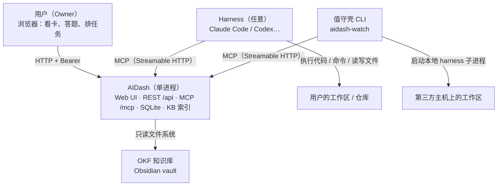
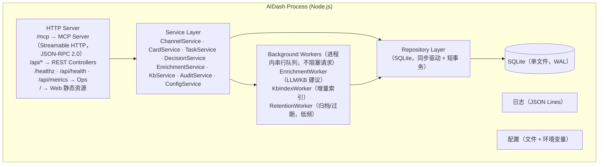
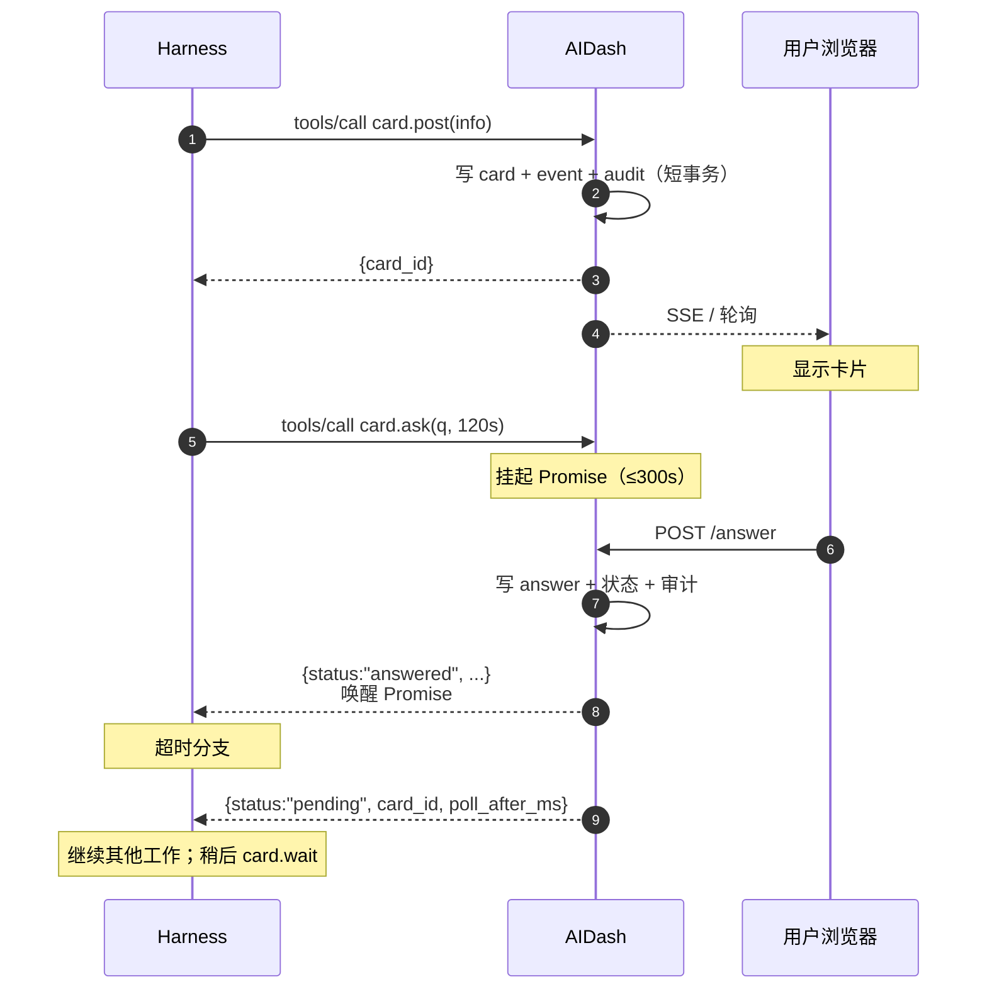
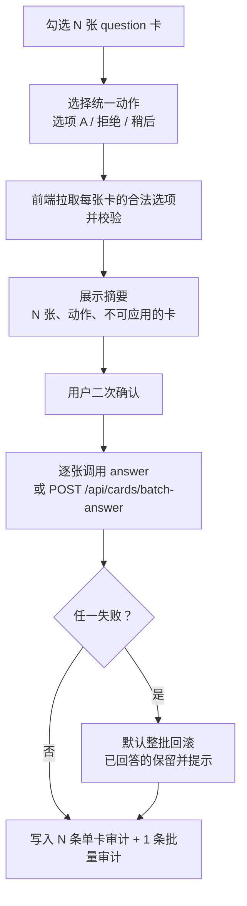
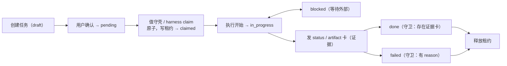
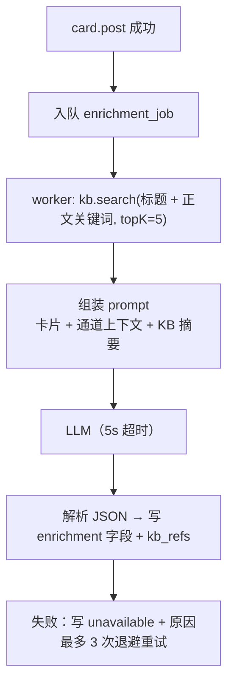

# AIDash — 概要设计

**文档状态**：V2.0（架构重构稿）
**日期**：2026-10-23
**上游**：`20-spec/需求与验收判据文档.md` V2.0
**替代**：V1.4（已归档至 `90-archive/v1-agent-sys/30-design-概要设计-V1.4.md`）

---

## 0. 文档元数据

| 项 | 内容 |
|---|---|
| 版本 | V2.0 |
| 设计范围 | AIDash 服务、Web、MCP、SQLite、OKF 索引、LLM 增强、值守壳 CLI、harness 契约 |
| 不在本文件展开 | 逐接口字段（见 04）、逐表 DDL（见 05）、逐模块类图（见 03） |
| 编号纪律 | ADR/MOD/SM/表/XIF/R 全项目唯一；本文件首次定义，其余文件引用不重定义 |
| 与需求的关系 | 每条 REQ 至少被一个 MOD 承接；第 13 节给追踪矩阵 |

---

## 1. 设计目标、约束与原则

### 1.1 目标

1. **一屏可决策**：用户打开网页，先看“等我拍板”的卡，再看“等我知晓/转发”的卡，最后才是任务树。
2. **执行不进来**：AIDash 不跑代码、不连主机、不存制品；执行留在 harness。
3. **契约可移植**：任何 harness 只要读 `AGENTS.md` 就能接入，不需要为 AIDash 写插件。
4. **失败可降级**：LLM、知识库、值守壳任一不可用，卡片与任务主流程仍可用。
5. **边界可审计**：谁在什么时候改了什么、认领了什么、回答了什么都可查。

### 1.2 硬约束

| 约束 | 来源 | 设计后果 |
|---|---|---|
| 单用户、单令牌 | REQ-FN-025 | 无 user/role/session 表；令牌即身份；令牌以 label 区分来源 |
| 不自动派发 | REQ-FN-019 | 无出站连接池、无任务推送；只有拉取式 claim |
| 交接卡不自动发送 | REQ-FN-004 | 无 SMTP/IM 适配器；只有“复制话术”与状态标记 |
| 知识库只读 | REQ-FN-045 | KB 模块只有 read/index；文件句柄只读打开 |
| 完成需证据 | REQ-FN-022 | `done` 转移带守卫，检查关联卡片 |
| 默认本地监听 | NF-001 | 启动默认 `127.0.0.1`；LAN 需显式配置 + 告警 |
| 增强不阻塞 | NF-003 | 卡片写入与增强分离；增强走后台队列 |

### 1.3 设计原则

1. **卡片是一等公民，任务不是**。V1 把任务当中心、卡片当附属；V2 反过来：用户看到的是卡片，任务树是“排布视图”。
2. **写路径短、读路径宽**。写操作在一个短事务内完成并立即返回；增强、索引、摘要都在事务外。
3. **状态机先行**。任何状态字段必须有显式转移表与守卫；禁止“代码里散落 if 判断”。
4. **契约文件即产品**。`AGENTS.md` 与 `skills/` 是交付物，不是文档附件；它们的准确性直接影响 harness 行为。
5. **默认值可配、默认行为保守**。所有超时/保留/并发都有默认值；默认行为不产生不可逆动作。

---

## 2. 系统上下文与总体架构

### 2.1 上下文图



**关键读法**：AIDash 的入站只有“用户浏览器（REST）”和“harness/值守壳（MCP）”；出站只有“读知识库文件”和“可选调 LLM”。**没有任何指向其他主机的执行通道**。

### 2.2 运行时视图（单进程）



**为什么单进程**：单用户规模下，多进程只会增加 IPC、锁与部署复杂度。后台任务用进程内串行队列 + 短事务即可；崩溃时未完成任务在重启后由幂等键与租约自愈。

### 2.3 部署视图

| 组件 | 部署位置 | 必需 | 说明 |
|---|---|---|---|
| AIDash | 用户主力机 或 内网一台常开机器 | 是 | 单进程；数据在本地 SQLite；默认 `127.0.0.1` |
| Harness | 用户主力机 / 开发机 | 是 | 任意现成工具；只读 `AGENTS.md` 与 `skills/` |
| 值守壳 CLI | 需要无人值守执行的主机 | 否 | 独立进程；只作为 MCP 客户端访问 AIDash |
| OKF 知识库 | AIDash 可读的本地路径 | 否 | 只读挂载/目录；不写 |
| LLM 端点 | 本地或远端 OpenAI 兼容服务 | 否 | 不可用时降级 |

---

## 3. 架构决策记录（ADR）

### ADR-001：AIDash 定位为“决策面板”，不是“调度总台”

- **背景**：V1 的总台承担接待、分解、派发、审批、汇总，导致长轮询、审批粒度、制品可见性三类问题无解。
- **决策**：AIDash 只负责“呈现给用户 + 接收用户决策 + 存任务与审计”。执行、重试、门禁、工作区全部交给 harness。
- **后果**：①删除 Runner/Adapter/AgentCard/attempt/gate 全部概念；②AIDash 不再需要出站连接到执行主机；③“任务完成”只能由外部（harness/值守壳）上报，因此必须要求证据（ADR-006）。
- **替代方案与否决理由**：继续做调度总台 → 三类问题依旧是结构性的；做纯 CLI → 用户失去“一屏看全部待决策”的价值。

### ADR-002：单用户、单令牌，不建用户体系

- **决策**：一个 Bearer token，多个可选 label 用于区分 harness 来源；无注册/登录/角色/密码。
- **后果**：删除 user/session/role 表；令牌泄露即全权，因此必须默认本地监听 + 日志脱敏 + 不入卡片。
- **替代方案**：OAuth/多用户 → 与“个人工具”定位不符，增加运维面。

### ADR-003：以“通道 + 卡片”为交互原子

- **决策**：`channel_key` 唯一标识会话通道；卡片六类型（info/handoff/question/suggestion/status/artifact）；首次发卡自动建通道。
- **后果**：harness 只需一次 `card.post` 即可产生可见结果；用户可按通道/类型/优先级筛选；卡片成为审计与检索的主对象。
- **替代方案**：只做任务看板 → 用户看不到“不需要任务但需要知道”的信息；只做消息流 → 决策无法结构化。

### ADR-004：`card.ask` 采用“有界阻塞 + 异步兜底”

- **决策**：`wait_seconds` 0~300；等待期内回答则同步返回；超时返回 `pending` + `card_id` + `poll_after_ms`；提供 `card.wait` 继续等待。
- **后果**：harness 可在关键歧义点真正“停下等用户”，又不会因用户离开而永久占住连接；需要心跳/保活与连接数上限。
- **替代方案**：纯长轮询 → 连接与超时管理复杂；纯异步 → harness 需要自己轮询，接入成本高。

### ADR-005：任务树单父、无自动派发、租约认领

- **决策**：`parent_id` 单父；DAG 禁止；状态机严格；`task.claim` 原子写 `claimed_by/claim_token/claim_expires_at`；AIDash 不推送任务。
- **后果**：任务树成为“规划视图”而非“执行队列”；执行方必须主动拉取；租约到期自动回收。
- **替代方案**：多父 DAG → 拖拽与环检测复杂、UI 难解释；自动派发 → 需要出站连接与 AgentCard，回到 V1 老路。

### ADR-006：任务完成必须有证据

- **决策**：`done` 守卫要求至少一个关联的 `status` 或 `artifact` 卡；`failed` 要求 `reason`。
- **后果**：harness 必须回报；否则任务停在 `in_progress` 或 `blocked`。审计能区分“真完成”和“打勾完成”。
- **替代方案**：允许无证据完成 → 回到“全打勾但链路空转”的 V1 失败模式。

### ADR-007：OKF 知识库只读 + SQLite FTS5

- **决策**：只读索引 Wiki 文章；校验根 `index.md` 的 `okf_version: "0.1"` 与文章 frontmatter 的 `type`；检索用 FTS5 + 标签/类型过滤。
- **后果**：无需向量库与嵌入模型；10k 文档规模下延迟可控；语义检索留 V2.1。
- **替代方案**：向量检索 → 增加模型下载、索引重建、内存占用；对“找相关笔记”收益边际。

### ADR-008：LLM 为可降级依赖，增强异步且 ≤5s

- **决策**：OpenAI 兼容端点可配；卡片写入不等 LLM；增强在后台队列执行，单次 5s 超时；失败降级为模板或“未生成”。
- **后果**：无 LLM 也能完整使用；建议区必须显式标注“AI 生成/无知识库依据”。
- **替代方案**：同步生成 → 卡片延迟不可控；强制依赖 LLM → 单点故障。

### ADR-009：TypeScript 全栈、单仓库

- **决策**：Node.js + TypeScript；Web 用 React/Next；MCP 用官方 TypeScript SDK；值守壳同为 TS/Node，单二进制打包。
- **后果**：类型与 schema 可共享（zod）；一套工具链；跨平台分发用 Node 单文件打包。
- **替代方案**：C#/ASP.NET → 生态割裂且与 Web 前端分属两套语言；Python → 前端仍需 TS。

### ADR-010：SQLite + WAL 作为唯一持久化

- **决策**：单文件 SQLite；WAL；`busy_timeout=5000`；写事务短小；迁移版本化。
- **后果**：零运维、易备份；写并发上限低（单写者），因此所有写路径必须短。
- **替代方案**：Postgres → 单用户场景运维过重。

### ADR-011：值守壳是独立 CLI，不进入 AIDash

- **决策**：`aidash-watch` 独立进程，配置驱动，循环“心跳 → 认领 → 起 harness → 回报 → 释放 → 睡眠”；AIDash 不监控其进程，只通过租约与心跳间接判断。值守壳**只作为 MCP 客户端**，不复用也不新增 REST 端点；续租通过带 `claim_token` 重调 `task.claim` 完成（ADR-015）。
- **后果**：AIDash 保持无出站；值守壳可部署在任意主机；失败隔离。
- **替代方案**：AIDash 内置调度器 → 需要出站连接与主机管理，违反 ADR-001。

### ADR-012：harness 契约用 `AGENTS.md` + `skills/`，不造工作台

- **决策**：`10-aidash/AGENTS.md` 定义端点、令牌环境变量、发卡规则、模板、任务规则、安全约束、完成定义；`10-aidash/skills/aidash-mcp` 给工具级参考；发布时复制到 harness 仓库根。
- **后果**：任何支持 AGENTS.md 约定的 harness 可直接接入；AIDash 不需要为每个 harness 写适配器。
- **替代方案**：自研工作台/插件 → 与“用现成 harness”相悖。

### ADR-013：不集成外部工单系统

- **决策**：AIDash 不连接任何外部工单系统，也不持有其地址或凭证。需要工单数据时，由用户在 harness 侧自行执行对应的 SOP skill；相关 skill 与网关随独立产品线维护，不在本仓库。
- **后果**：AIDash 数据库/配置/日志中不出现第三方工单凭证；工单操作的安全责任留在 harness 侧。
- **替代方案**：AIDash 直连工单系统 → 引入凭证管理与轮询，且与“执行留在 harness”冲突。

### ADR-014：审计只追加、迁移版本化

- **决策**：`audit_log` 只追加，无删除/修改 API；schema 变更走 `schema_migration`，迁移前备份、失败回滚。
- **后果**：审计可作为决策追溯依据；迁移可回退。
- **替代方案**：可编辑审计 → 失去证据价值。

### ADR-015：值守壳复用 MCP，不新增 REST

- **背景**：ADR-011 定了值守壳是独立 CLI，但没有规定它用什么协议访问 AIDash。初版设计里它既能走 REST 也能走 MCP，等于同一套语义维护两份客户端。
- **决策**：值守壳只作为 MCP 客户端；续租并入 `task.claim`（带原 `claim_token` 重调即延长租约）；REST 端点表移除 `claim` / `heartbeat` / `release` 三条只为值守壳存在的端点。
- **后果**：值守壳与 harness 共用同一套工具语义，REST 只服务浏览器；`task.claim` 同时承担“首次认领”和“续租”两种情形，守卫需按 `claim_token` 是否存在分流。
- **替代方案**：新增一个 `task.renew` 工具 → 工具数从 19 变 20，契约、计数、检查脚本全量改号，收益不抵成本。

---

## 4. 模块划分

| 模块ID | 名称 | 职责 | 主要依赖 | 承接需求 |
|---|---|---|---|---|
| MOD-001 | HTTP/MCP 入口 | 路由、认证、限流、请求 ID、错误映射、MCP 工具注册 | MOD-007 | REQ-FN-023~031, NF-006/013/014 |
| MOD-002 | 通道与卡片服务 | 通道 upsert、卡片 CRUD、状态、幂等、归档、搜索 | MOD-007 | REQ-FN-001~012 |
| MOD-003 | 任务树服务 | 任务 CRUD、状态机、拖拽移动、复制子树、证据守卫 | MOD-002, MOD-007 | REQ-FN-013~022 |
| MOD-004 | 决策服务 | 单张回答、批量推进、超时过期、回答校验 | MOD-002, MOD-007 | REQ-FN-005~007, DQ-009 |
| MOD-005 | 增强服务 | 组装上下文、调 LLM、生成建议、引用 KB、降级 | MOD-006, XIF-004 | REQ-FN-012/034~038 |
| MOD-006 | 知识库索引 | OKF 校验、增量索引、FTS 检索、路径安全 | XIF-003 | REQ-FN-032/033/035/045, NF-012 |
| MOD-007 | 审计与配置 | 审计写入、配置加载校验、迁移、备份恢复、健康指标 | XIF-009 | REQ-FN-059~064, NF-010/011/015 |
| MOD-008 | Web UI | 通道/卡片视图、决策面板、任务树看板、KB 引用、设置 | MOD-001 | REQ-FN-001~022 |
| MOD-009 | 值守壳 CLI | 配置、注册心跳、认领、起 harness、超时重试、回报、日志 | XIF-001/007 | REQ-FN-046~052, NF-009 |
| MOD-010 | Harness 契约 | `10-aidash/AGENTS.md`、`10-aidash/skills/aidash-mcp`、卡片模板、安全约束 | — | REQ-FN-039~045 |
| MOD-011 | 外部工单网关（已移出） | 独立仓库中的服务器端应用，不在本仓实现、不随 AIDash 发布 | — | REQ-FN-053/056 随该产品线维护 |

### 4.1 MOD-001 HTTP/MCP 入口

- **职责**：一个 HTTP Server 承载 Web、REST、MCP；认证在入口统一做；限流按令牌；错误统一映射为 `{code,message,retryable,details}`。
- **关键设计**：
  - MCP 使用 Streamable HTTP 单端点 `/mcp`，支持 `initialize`/`tools/list`/`tools/call`；工具注册表由 zod schema 生成 JSON Schema。
  - 有界等待（`card.ask`）在请求上下文内挂起 Promise，超时后返回 `pending`；等待中的请求计入连接上限，超过上限返回 `BUSY`。
  - 请求 ID 贯穿日志与审计。
- **不负责**：业务规则（在 MOD-002/003/004）。

### 4.2 MOD-002 通道与卡片服务

- **职责**：通道 upsert（按 `channel_key`）；卡片创建/读取/列表/编辑/归档；幂等；全文搜索。
- **关键设计**：
  - `card.post` 在一个短事务内写 `card` + `card_event` + `audit_log`。
  - 卡片正文大小与敏感模式在服务层校验（64KB/16KB）。
  - 搜索走 FTS5 虚表；结果带 snippet。
  - 归档只改状态，不删行。
- **不负责**：决策语义（MOD-004）、任务关联（MOD-003）。

### 4.3 MOD-003 任务树服务

- **职责**：任务 CRUD、状态机执行、移动/复制、认领/续租/释放、证据校验、树查询。
- **关键设计**：
  - 树用 `parent_id` + 物化路径 `path`（如 `/1/4/9/`）加速子树查询与环检测；移动时在同一事务内重写子树 `path`。
  - 环检测：新父的 `path` 不得以被移动节点的 `path` 为前缀。
  - 移动限制：仅 `draft`/`pending`/`blocked` 可移动。
  - 认领：`UPDATE task SET ... WHERE id=? AND status='pending' AND (claim_expires_at IS NULL OR claim_expires_at<now)`，受影响行数=1 才算成功。
  - `done` 守卫：查 `card` 表是否存在 `task_id=? AND type IN ('status','artifact') AND status<>'archived'`。
- **不负责**：推送/派发（明确不做）。

### 4.4 MOD-004 决策服务

- **职责**：回答决策卡、批量回答、过期处理、回答合法性校验。
- **关键设计**：
  - 回答写入 `card.answer`（JSON）+ 状态 `answered` + `card_event` + 审计。
  - 批量：先整体校验（每张卡必须 `open` 且选项合法），任一失败整批拒绝（除显式 `partial=true`）。
  - 过期：后台 worker 扫描 `question` 卡 `due_at < now` 且 `open` → `expired`；**不自动执行默认动作**（DQ-009）。
- **不负责**：向 harness 推送答案（harness 通过 `card.wait` 或再次 `card.get` 获取）。

### 4.5 MOD-005 增强服务

- **职责**：为卡片生成 `analysis_md`/`suggestions[]`/`kb_refs`/`confidence`。
- **关键设计**：
  - 触发：卡片创建后入队；用户可手动重试。
  - 上下文：卡片标题/正文 + 通道最近 N 张卡 + KB 检索 Top-K。
  - 输出严格 JSON；解析失败降级为模板。
  - 5s 超时；失败写 `enrichment_status=unavailable` + 原因，指数退避最多 3 次。
- **不负责**：任何写业务数据（建议必须用户点击才落地）。

### 4.6 MOD-006 知识库索引

- **职责**：校验 OKF 结构、扫描 Wiki、增量索引、FTS 检索、路径越界防护。
- **关键设计**：
  - 启动校验 `index.md` 的 `okf_version: "0.1"`；缺失则 KB 状态 `unavailable`，不阻塞启动。
  - 只索引 `Wiki/`（不索引 `RAW/`、`Output/`），遵循 OKF 的“Wiki 是知识层”。
  - 每篇计算内容哈希，变更才重建 FTS 行；删除文件则删行。
  - 路径解析后必须仍在根目录内（`path.resolve` 前缀校验）。
- **不负责**：写知识库、语义检索（V2.1）。

### 4.7 MOD-007 审计与配置

- **职责**：配置加载/校验、审计写入、迁移、备份、恢复、健康与指标。
- **关键设计**：
  - 配置优先级：环境变量 > 配置文件 > 默认值；启动 fail-fast 校验必填。
  - 审计写入与业务写在同一事务（保证“做了就有记录”）。
  - 备份用 SQLite backup API（含 WAL 检查点），输出校验和文件。
  - `/health` 检查 DB 可读写、KB 索引时间、schema 版本；异常 503。

### 4.8 MOD-008 Web UI

- **职责**：首页（待决策/待知晓/待转发）、通道详情、任务树看板、知识库引用、设置。
- **关键设计**：
  - 首页三栏：决策收件箱（question）、信息流（info/handoff/status/artifact）、任务树入口。
  - 批量推进：勾选 → 汇总摘要 → 二次确认 → 逐张提交（或批量接口）。
  - 任务树：虚拟滚动；首屏 2 层懒加载；拖拽用 HTML5 DnD，drop 前本地校验合法目标。
  - 卡片渲染 Markdown 时做 HTML 转义与链接协议白名单。

### 4.9 MOD-009 值守壳 CLI

- **职责**：配置、注册/心跳、拉取可认领任务、原子认领、启动 harness、超时与重试、回报、日志。
- **关键设计**：
  - 子进程管理：`spawn` 直接可执行文件（不经 shell）；超时杀进程树（Windows `taskkill /T`，POSIX 进程组 `kill -TERM`→`-KILL`）。
  - 认领后立刻续租（心跳线程），任务结束释放。
  - 失败重试：指数退避 + 最多次数；每次重试写 `task_event`。
  - `dry-run` 只打印计划，不认领。
- **不负责**：理解任务内容（由 harness 负责）。

### 4.10 MOD-010 Harness 契约

- **职责**：`10-aidash/AGENTS.md` + `10-aidash/skills/aidash-mcp/SKILL.md`。
- **关键设计**：
  - `AGENTS.md` 必须含 8 节：端点与令牌、工具清单、发卡规则、卡片模板、任务规则、安全约束、错误处理、完成定义。
  - 模板给出最小可用 JSON 示例（info/handoff/question/status/artifact）。
  - 明确“歧义必须发 question 卡”；明确“不得发令牌/密码/私钥”。

### 4.11 MOD-011 外部工单网关（已移出）

MOD-011 是独立仓库中的服务器端工单网关，与 AIDash 无接口、无配置、无凭证共享；不在本仓库实现，也不随 AIDash 发布。AIDash 只保留一条边界：**不持有其地址与令牌**。

---

## 5. 关键流程

### 5.1 harness 发卡与有界阻塞



**要点**：
- 等待发生在服务端内存，不占数据库事务。
- 等待请求计入并发上限；超过返回 `BUSY`（可重试）。
- 连接断开不影响卡片状态；harness 可用 `card.wait` 重新等待。

### 5.2 用户批量推进决策



### 5.3 任务从创建到完成



### 5.4 值守壳主循环

```
while true:
  register/heartbeat
  tasks = task.list(status=pending, assignee=me or tags∩my_tags)
  if none: sleep(poll_interval); continue
  t = task.claim(id)            # 原子；失败则跳过
  start lease-renew timer
  spawn harness(t)              # 子进程，超时杀进程树
  on success: post status card + artifact; task.update(done, evidence)
  on failure: post status card(reason); task.update(failed or retry)
  stop timer; task.release
  sleep(gap)
```

### 5.5 知识库增强



### 5.6 外部工单链路（不经过 AIDash）

该链路完全在 harness 与独立工单网关之间完成，相关实现不在本仓库。AIDash 不出现在调用链上，只会在最后收到一张 `status` 卡。

---

## 6. 状态机总览

> 完整转移表、守卫条件、非法转移处理见 `03-软件设计说明.md` §4.4。

| 状态机 | 对象 | 状态 | 归属模块 |
|---|---|---|---|
| SM-001 | 任务 Task | draft / pending / claimed / in_progress / blocked / done / failed / cancelled | MOD-003 |
| SM-002 | 卡片 Card | open / answered / dismissed / expired / archived | MOD-002 + MOD-004 |
| SM-003 | Harness | online / offline / disabled | MOD-001 + MOD-002 |
| SM-004 | 通道 Channel | active / archived | MOD-002 |

**设计约束**：
- 终态不可逆（done/failed/cancelled；archived）。
- 每次转移写事件表 + 审计。
- 守卫失败返回 409 并带原因码。

---

## 7. 数据架构总览

> 完整 DDL、索引、约束见 `05-数据库设计说明.md`。

| 表ID | 表名 | 作用 | 关键约束 |
|---|---|---|---|
| TBL-001 | channel | 会话通道 | `channel_key` 唯一 |
| TBL-002 | card | 卡片 | FK channel；type/status 枚举；幂等键唯一 |
| TBL-003 | card_event | 卡片事件流 | 只追加 |
| TBL-004 | task | 任务树 | `parent_id` 自引用；`path` 物化路径 |
| TBL-005 | task_event | 任务事件流 | 只追加 |
| TBL-006 | artifact | 产物引用 | 只存 URL/摘要，不存原件 |
| TBL-007 | harness | harness 注册与心跳 | `harness_id` 唯一 |
| TBL-008 | kb_doc | 知识库文档元数据 | 路径唯一；内容哈希 |
| TBL-009 | kb_fts | FTS5 虚表 | 与 kb_doc 行对齐 |
| TBL-010 | audit_log | 审计 | 只追加；无删除 API |
| TBL-011 | setting | 配置快照 | 键值 |
| TBL-012 | schema_migration | 迁移记录 | 版本唯一 |

**关系要点**：card 与 task 多对一（`card.task_id`）；artifact 属 card；kb_fts 由 kb_doc 派生；audit 不设 FK（保留历史）。

---

## 8. 接口架构总览

> 完整 JSON Schema、示例、错误码见 `04-接口设计说明.md`。

| 类别 | 内容 |
|---|---|
| MCP 工具 | 23 个：harness.register/heartbeat；channel.upsert；card.post/ask/get/wait/list；task.create/update/list/tree/claim/release/move/copy；kb.search/get；digest.get；memory.get/append/search/update |
| REST | `/api/channels`、`/api/cards`、`/api/cards/{id}/answer`、`/api/cards/batch-answer`、`/api/tasks`、`/api/tasks/{id}/move`、`/api/tasks/{id}/copy`、`/api/kb/search`、`/api/memory`、`/api/settings`、`/api/audit`、`/api/health`、`/api/metrics` |
| 文件契约 | `10-aidash/AGENTS.md`、`10-aidash/skills/aidash-mcp/SKILL.md` |
| 外部依赖 | OKF 目录（只读）、LLM OpenAI 兼容端点（可选） |

**统一约定**：所有写接口带 `idempotency_key`；所有响应带 `schema_version`；错误体 `{code,message,retryable,details}`。

---

## 9. 安全设计

### 9.1 威胁与对策

| 威胁 | 对策 | 对应需求 |
|---|---|---|
| 令牌泄露导致全权访问 | 默认 `127.0.0.1`；日志/卡片/导出全链路脱敏；令牌只存哈希用于比对 | REQ-FN-025/044/057, NF-001/006 |
| 卡片/评论注入 XSS | Markdown 渲染转义；链接协议白名单（http/https/mailto）；CSP | NF-006 |
| 路径穿越读知识库外文件 | 解析后前缀校验；只读打开；拒绝 `..` 与符号链接逃逸 | REQ-FN-045 |
| 未授权写入 | 所有 MCP/REST 写接口统一鉴权中间件 | REQ-FN-025 |
| 敏感信息进卡片 | 服务层正则拦截（`sk-`、`BEGIN PRIVATE KEY`、`password=` 等）+ 拒绝并审计 | REQ-FN-044 |
| 暴力/洪水请求 | 每令牌限流 60/min 突发 20；等待请求上限 | REQ-FN-028, NF-014 |
| 审计被篡改 | 只追加；无删除 API；应用账号无 DELETE 权限 | REQ-FN-060 |

### 9.2 权限边界

```
AIDash 持有：AIDASH_TOKEN、DB 路径、KB 路径、可选 LLM key
AIDash 不持有：第三方系统账号与令牌、git 凭据、SSH 私钥
Harness 持有：AIDASH_TOKEN、其自身的代码/命令能力、（可选）第三方系统凭证
值守壳 持有：AIDASH_TOKEN、harness 命令、工作目录
```

**验证方式**：REQ-FN-057 的验收准则要求在 AIDash 数据库/日志/导出中检索第三方系统凭证，命中数必须为 0。

---

## 10. 性能与容量设计

| 场景 | 目标 | 手段 |
|---|---|---|
| 卡片写入 | P95 ≤800ms（含审计） | 短事务；增强异步 |
| 卡片读取/列表 | P95 ≤300ms | 覆盖索引（channel+status+priority+created_at） |
| 全文搜索 | P95 ≤500ms @10k 卡 | FTS5 + snippet；分页 |
| 任务树首屏 | 2 层 ≤1s @1k 任务 | 懒加载 + 虚拟滚动 |
| 树展开 | P95 ≤500ms | `path` 前缀查询 |
| KB 全量索引 | ≤5min @10k 文档 | 批量事务 + 哈希跳过未变文件 |
| KB 检索 | P95 ≤300ms | FTS5 + 限制 Top-K |
| 增强 | ≤5s，失败降级 | 队列并发 1（可配），超时取消 |
| 并发 | 20 读 + 1 写无锁错 | WAL + busy_timeout=5000 |

---

## 11. 可靠性与运维

- **崩溃恢复**：WAL 自动恢复；写事务原子；重启后 `claimed` 且租约过期的任务回到 `pending`。
- **幂等**：MCP/REST 写接口均支持 `idempotency_key`，重放不产生重复数据。
- **备份**：`aidash backup` 生成 `.db` + `.sha256`；`aidash restore` 校验后替换；建议每日一次（RPO ≤24h）。
- **迁移**：`schema_migration` 记录版本；迁移前自动备份；失败回滚。
- **日志**：JSON Lines；字段 `ts/level/request_id/token_label/action/object/result/duration_ms`；令牌与正文敏感字段脱敏。
- **健康**：`/health`（DB、KB、schema 版本、队列积压）；`/metrics`（计数与延迟直方图）。
- **保留**：卡片 365 天归档、审计 2 年、日志 30 天；只归档/轮转，不物理删除业务记录。

---

## 12. 风险登记

| 风险ID | 风险 | 概率 | 影响 | 应对 | 触发信号 |
|---|---|---|---|---|---|
| R-001 | 单令牌泄露 | 低 | 高 | 本地监听、日志脱敏、令牌可一键轮换 | 日志/导出出现令牌模式 |
| R-002 | 有界等待占满连接 | 中 | 中 | 等待并发上限 + `BUSY` + 建议 `wait_seconds≤120` | 429/BUSY 比例上升 |
| R-003 | harness 乱发卡造成卡片洪水 | 中 | 中 | 限流 + 每通道速率上限 + 用户可归档通道 | 单通道分钟卡片数异常 |
| R-004 | 拖拽造成环或误移动 | 中 | 中 | 服务端环检测 + 状态限制 + 前端预校验 | 409 `CYCLE_DETECTED` 频发 |
| R-005 | 租约到期误判导致重复执行 | 中 | 高 | 续租心跳、幂等回报、任务级互斥标记 | 同一任务出现两条执行日志 |
| R-006 | LLM 幻觉建议被直接采纳 | 中 | 高 | 强制引用/“无知识库依据”标注；建议不自动执行 | 无引用建议被采纳比例高 |
| R-007 | OKF 路径变更/权限丢失 | 中 | 低 | 启动校验 + KB 状态可见 + 不阻塞主流程 | `/health` KB unavailable |
| R-008 | SQLite 单写瓶颈 | 低 | 中 | 短事务、批量写合并、WAL | 写 P95 上升、busy 重试增多 |
| R-009 | 跨平台进程树终止差异 | 中 | 中 | 平台分支杀进程树 + 三平台集成测试 | 出现孤儿进程 |
| R-010 | harness 不遵守 AGENTS.md | 高 | 中 | 服务端强校验必填字段；文档给最小示例；错误信息可操作 | 400 比例高、卡片字段缺失 |
| R-011 | 交接卡话术含敏感信息 | 中 | 高 | 服务层敏感模式拦截 + 用户复制前预览 | 拦截计数上升 |
| R-012 | 外部系统集成被重新引入后边界失守 | 低 | 中 | 范围外条目集中登记（REQ-FN-053~058）；ADR-013 明确不集成 | 依赖清单出现外部系统 SDK |
| R-013 | 外部系统凭据泄露 | 低 | 高 | 本仓不持有凭据（REQ-FN-057）；harness 只从环境变量读取 | 卡片/日志出现令牌模式 |
| R-014 | 完成证据形式主义（随便发张卡） | 高 | 中 | 证据卡要求含产物链接或结果摘要；审计可回看 | 证据卡为空/无链接比例高 |
| R-015 | 大树渲染卡顿 | 中 | 中 | 虚拟滚动 + 懒加载 + 折叠回收 DOM | 展开耗时 >500ms |
| R-016 | 时钟漂移导致过期/租约误判 | 低 | 中 | 统一用服务端时间；客户端时间只做展示 | 租约异常回收 |
| R-017 | 数据库损坏/备份不可用 | 低 | 高 | 校验和 + 定期恢复演练 + WAL 检查点 | 恢复演练失败 |
| R-018 | MCP 协议演进破坏兼容 | 中 | 中 | 声明版本、只做加法、破坏性变更升主版本 | 客户端初始化失败 |
| R-019 | 用户长期不在场，决策堆积 | 高 | 中 | 首页按优先级排序 + 过期标记 + 摘要卡 | `open` 决策数持续增长 |
| R-020 | 单机故障无 HA | 低 | 中 | 明确不做 HA；备份 + 快速重启（≤10s） | 启动时间超阈值 |

**与 V1 的差异**：V1 有 30 条风险，其中 10 条绑定 Runner/Adapter/审批/制品等已删除组件；V2 重新登记为 20 条，覆盖当前架构。完整索引见 `01-设计总纲与设计基线管理.md` §4.4。

---

## 13. 需求到设计的追踪

| 需求组 | 承接模块 | 关键设计位置 |
|---|---|---|
| REQ-FN-001~012 会话与卡片 | MOD-002, MOD-008 | 4.2、4.8、§7 TBL-001/002/003 |
| REQ-FN-013~022 任务树 | MOD-003, MOD-008 | 4.3、4.8、§6 SM-001、§7 TBL-004/005/006 |
| REQ-FN-023~031 MCP | MOD-001 | 4.1、§8、04 §4 |
| REQ-FN-032~038 OKF/增强 | MOD-005, MOD-006 | 4.5、4.6、ADR-007/008、§7 TBL-008/009 |
| REQ-FN-039~045 Harness | MOD-010 | 4.10、04 §6 |
| REQ-FN-046~052 值守壳 | MOD-009 | 4.9、5.4、04 §7 |
| REQ-FN-053~058 外部工单系统 | MOD-011（已移出） | 4.11、5.6、ADR-013 |
| REQ-FN-059~064 配置/审计/运维 | MOD-007 | 4.7、§11、§7 TBL-010/011/012 |
| NF-001~015 | 全模块 | §9、§10、§11 |
| XIF-001~010 | MOD-001/005/006/009/011 | §8、04 |

---

## 14. 自检

| 检查项 | 结论 | 依据 |
|---|---|---|
| 每条 REQ 都有模块承接？ | 通过 | §13 覆盖 REQ-FN-001~064 |
| 是否残留 V1 组件概念？ | 通过 | 全文无 Runner/Adapter/AgentCard/IngestRecipe 作为设计元素；仅在 ADR 背景与风险差异说明中出现 |
| ADR 是否都有后果与替代方案？ | 通过 | ADR-001~015 均含背景/决策/后果/替代方案 |
| 模块是否职责单一、依赖无环？ | 通过 | MOD-005→MOD-006；MOD-003→MOD-002；MOD-007 被所有模块依赖；无反向依赖 |
| 状态机是否可落地？ | 通过 | §6 给总览，03 §4.4 给完整转移表与守卫 |
| 数据表是否覆盖所有实体？ | 通过 | 14 表覆盖通道/卡片/任务/产物/harness/KB/审计/配置/迁移/记忆/已读 |
| 是否与需求冲突？ | 通过 | “不自动派发”与“任务树看板”在 ADR-005 中解释为规划视图 |
| 风险是否可监测？ | 通过 | R-001~020 均给触发信号 |

---

## 附：编号对照

- 需求：REQ-FN-001~064、NF-001~015、XIF-001~010（见 `20-spec`）
- 决策：ADR-001~015（本文件）
- 模块：MOD-001~011（本文件）
- 状态机：SM-001~004（本文件 §6，详表见 03 §4.4）
- 表：TBL-001~012（05）
- MCP 工具：MCP-001~023（04）
- 风险：R-001~020（本文件 §12，索引见 01 §4.4）
