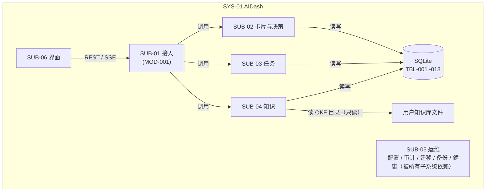
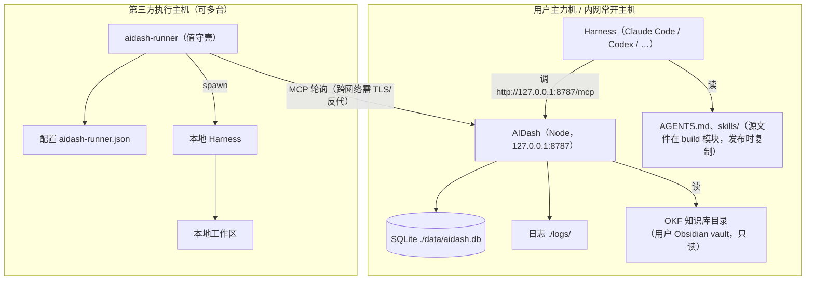
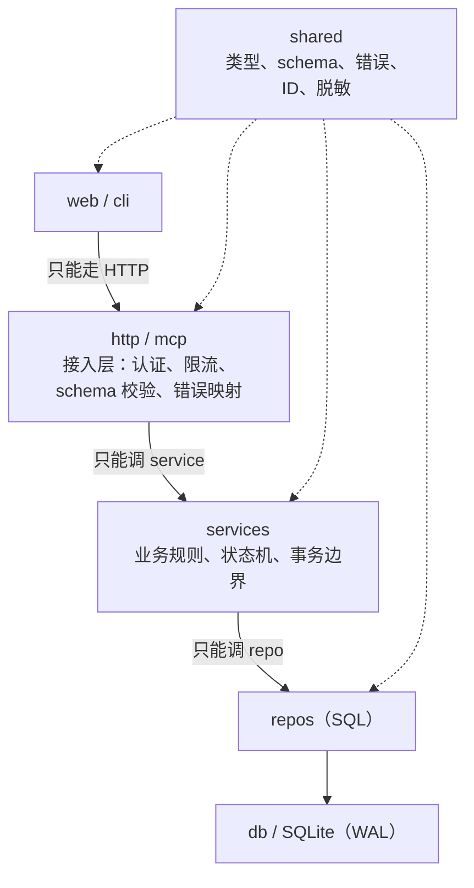
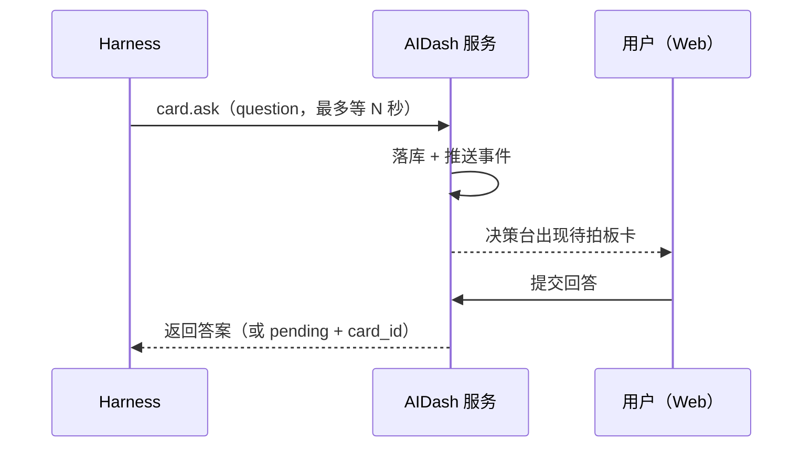
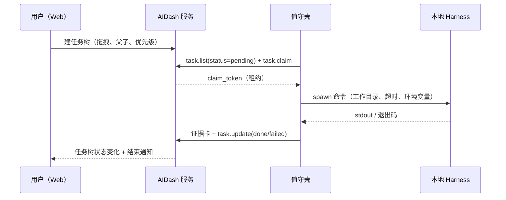

# 02 — 系统与子系统设计说明

**文档包**：AIDash 设计文档包 V2.0
**版本**：V2.0
**日期**：2026-10-23（2026-10-25 合并原 `docs/architecture.md` 的架构总览内容）
**上游**：`30-design/概要设计.md` V2.0
**下游**：`03-软件设计说明.md`、`04-接口设计说明.md`

---

## 0. 本文件回答什么

1. 整个交付物由哪几个**可独立部署/独立交付**的部分组成（系统）。
2. 每个系统内部再分成哪些**子系统**，边界与职责是什么。
3. 子系统之间怎么交互、谁依赖谁、失败时谁受影响。
4. 每个子系统的部署位置、运行形态、数据归属。

**不回答**：模块内部实现（03）、字段级契约（04）、表结构（05）。

---

## 1. 系统清单

V2.0 交付物由 **3 个系统**组成。它们的共同点是“可以分别安装、分别升级、分别失败”。外部工单网关（SYS-04）不在本仓库交付，仅保留边界说明。

| 系统ID | 名称 | 形态 | 是否常驻 | 部署位置 | 与 AIDash 的关系 |
|---|---|---|---|---|---|
| SYS-01 | AIDash 服务 | Node.js 单进程 + Web 静态资源 | 是 | 用户主力机 / 内网常开主机 | 本体 |
| SYS-02 | 值守壳 `aidash-runner` | 跨平台 Node CLI（零依赖 ESM 包） | 是（循环时） | 需要无人值守执行的主机 | 客户端，只通过 MCP 访问 AIDash |
| SYS-03 | Harness 契约包 | 纯文件（`40-build/10-aidash/AGENTS.md` + 两个模块的 `skills/`） | 否 | 跟仓库走 / 由用户复制到 harness 工作区 | 契约，无运行时 |
| SYS-04 | 外部工单网关（已移出） | 独立仓库中的服务器端应用 | — | 不在本仓部署 | **完全独立**，与 AIDash 无连接 |

> **为什么把契约包也算一个“系统”**：它不是文档附件，而是 harness 行为的实际控制面。改一句发卡规则，等于改所有 harness 的行为。必须像代码一样纳入版本与评审。

---

## 2. SYS-01 AIDash 服务

### 2.1 子系统分解

| 子系统ID | 名称 | 包含模块 | 一句话职责 |
|---|---|---|---|
| SUB-01 | 接入子系统 | MOD-001 | 收 HTTP/JSON-RPC，做认证、限流、错误映射 |
| SUB-02 | 卡片与决策子系统 | MOD-002、MOD-004 | 通道、卡片、回答、批量推进、过期 |
| SUB-03 | 任务子系统 | MOD-003 | 任务树、状态机、认领租约、证据校验 |
| SUB-04 | 知识子系统 | MOD-005、MOD-006 | OKF 索引、检索、增强建议、记忆归纳、汇报生成 |
| SUB-05 | 运维子系统 | MOD-007 | 配置、审计、迁移、备份、健康指标 |
| SUB-06 | 界面子系统 | MOD-008 | Web 页面与交互 |

### 2.2 子系统边界

### 2.3 各子系统职责与失败模式

#### SUB-01 接入子系统

| 项 | 内容 |
|---|---|
| 职责 | 路由、Bearer 认证、每令牌限流、请求 ID、MCP 工具注册、错误码映射、有界等待的连接配额 |
| 输入 | HTTP 请求（Web/REST/MCP） |
| 输出 | 服务层调用结果；统一 JSON 错误体 |
| 数据归属 | 无（只读设置） |
| 失败模式 | 认证失败 401；限流 429；等待配额满 `BUSY`；未知工具 404 |
| 降级 | 入口不可用 = 全站不可用（唯一单点）；但进程重启 ≤10s（NF-008） |

#### SUB-02 卡片与决策子系统

| 项 | 内容 |
|---|---|
| 职责 | 通道 upsert；卡片六类型 CRUD；编辑/归档；幂等；搜索；回答与批量回答；过期 |
| 输入 | `card.*`、`channel.upsert`、REST 答题 |
| 输出 | `channel`、`card`、`card_event`、`audit_log` 写入 |
| 数据归属 | TBL-001/002/003 |
| 失败模式 | 非法类型/字段 400；已回答再答 409；批量中任一非法整批拒绝 |
| 降级 | 增强不可用时卡片仍可创建（ADR-008）；搜索不可用时列表仍可分页 |

#### SUB-03 任务子系统

| 项 | 内容 |
|---|---|
| 职责 | 任务 CRUD、状态机、移动/复制、认领/续租/释放、证据守卫、树查询 |
| 输入 | `task.*`、REST 拖拽/复制 |
| 输出 | `task`、`task_event`、`artifact`、审计 |
| 数据归属 | TBL-004/005/006 |
| 失败模式 | 环 409；非法转移 409；已被认领 `ALREADY_CLAIMED`；无证据 409 |
| 降级 | 无值守壳时任务停在 `pending`，不影响卡片与决策 |

#### SUB-04 知识子系统

| 项 | 内容 |
|---|---|
| 职责 | OKF 校验、增量索引、FTS 检索、增强生成（LLM）、项目记忆归纳、周期/专题汇报 |
| 输入 | 卡片内容、任务与卡片素材、KB 目录、LLM 端点、汇报指令 |
| 输出 | `kb_doc`、`kb_fts`、卡片的 enrichment 字段、记忆行、归纳记录、汇报正文 |
| 数据归属 | TBL-008/009/013/015/016/017/018；不写 KB 文件 |
| 失败模式 | KB 路径无效 → `unavailable`，不阻塞启动；LLM 超时 → 建议区 `unavailable` |
| 降级 | 两者都失败时，卡片与任务功能 100% 可用 |

#### SUB-05 运维子系统

| 项 | 内容 |
|---|---|
| 职责 | 配置加载与校验、审计写入、schema 迁移、备份/恢复、`/health` `/metrics`、保留策略 |
| 输入 | 配置文件、环境变量、定时触发 |
| 输出 | `audit_log`、`setting`、`schema_migration`、备份文件、指标 |
| 数据归属 | TBL-010/011/012；备份目录 |
| 失败模式 | 配置非法 → 启动失败（fail-fast）；DB 只读 → `/health` 503 |
| 降级 | 指标不可用不影响业务；备份失败告警但不阻塞 |

#### SUB-06 界面子系统

| 项 | 内容 |
|---|---|
| 职责 | 首页（决策收件箱/信息流/任务入口）、卡片详情抽屉（含 KB 引用）、通道详情、任务树看板、设置 |
| 输入 | REST + SSE |
| 输出 | 用户操作（答题、拖拽、复制、归档） |
| 数据归属 | 无（不直接访问 DB） |
| 失败模式 | 后端 5xx → 顶部告警 + 重试；SSE 断开 → 退化为轮询 |
| 降级 | 前端挂了不影响 MCP/REST 被 harness 使用 |

### 2.4 子系统交互矩阵

| 调用方 ↓ / 被调方 → | SUB-01 | SUB-02 | SUB-03 | SUB-04 | SUB-05 | SUB-06 |
|---|---|---|---|---|---|---|
| SUB-01 接入 | — | 调用 | 调用 | 调用 | 读配置/写审计 | 提供静态资源 |
| SUB-02 卡片与决策 | 经接入 | — | 读任务引用 | 入队增强 | 写审计 | 推送事件 |
| SUB-03 任务 | 经接入 | 读证据卡 | — | — | 写审计 | 推送事件 |
| SUB-04 知识 | 经接入 | 写增强字段 | — | — | 写审计 | — |
| SUB-05 运维 | — | — | — | — | — | 提供健康数据 |
| SUB-06 界面 | 调 REST | 经接入 | 经接入 | 经接入 | 读健康 | — |

**约束**：不允许 SUB-06 直连数据库；不允许 SUB-04 写卡片正文（只能写增强字段）；不允许 SUB-03 直接改卡片状态。

---

## 3. SYS-02 值守壳 `aidash-runner`

### 3.1 定位

值守壳是 AIDash 的**外部执行代理**，不是 AIDash 的子系统。它不被 AIDash 管理，不被 AIDash 推送任务；它自己轮询、自己认领、自己起 harness、自己回报。

### 3.2 内部结构

| 组件 | 职责 |
|---|---|
| ConfigLoader | 按 `--config` / `AIDASH_RUNNER_CONFIG` / `./aidash-runner.json` / `~/.aidash/runner.json` 查找并校验 |
| Register/Heartbeat | `harness.register` / `harness.heartbeat`；维护在线状态 |
| TaskPoller | `task.list(status=pending)` + 本地过滤（指派/通道/暂缓） |
| Claimer | `task.claim` 原子认领；失败跳过 |
| LeaseKeeper | 按租约 1/3 周期带 `claim_token` 重调 `task.claim` 续租；丢失即终止命令且不 release |
| Runner | 以参数数组 `spawn` harness（默认不走 shell）；超时/停止/租约丢失统一杀进程树 |
| Reporter | 发 `status` 证据卡（幂等键由 `claim_token` 派生）；`task.update` 置 complete/fail/block |
| Registry + 控制面 | `<data-dir>/instances/<harness_id>.json`（0600 原子写）+ 仅回环的 HTTP 控制面 |
| Logger | 写日志文件 + 首尾各 8KB 环形缓冲；脱敏后输出 |
| CLI | `start` / `once` / `dry-run` / `list` / `status` / `pull` / `stop` / `kill` / `logs` / `config` / `init` / `check` |

### 3.3 边界

- **只走 MCP**：只通过 MCP 工具操作自己的任务与卡片，不依赖 REST；不能读别人的通道内容（除公开摘要）。
- **不解析任务语义**：任务正文原样传给 harness；值守壳不判断“该怎么做”。
- **不存业务数据**：本地只存日志与运行状态。
- **不做多任务并行**：默认并发 1；可配但需用户理解租约与资源竞争。

### 3.4 失败模式

| 失败 | 表现 | 恢复 |
|---|---|---|
| AIDash 不可达 | 重试 + 退避；日志告警 | 恢复后继续轮询 |
| 认领冲突 | `ALREADY_CLAIMED`，跳过 | 下一轮再看 |
| harness 崩溃（命令已启动） | 记失败卡 + 原因；**不 release** | 由人决定是否重排，避免重复执行副作用 |
| harness 超时 | 杀进程树，记失败 | 同上 |
| 值守壳被杀 | 租约到期，任务回 `pending` | 重启后重新认领 |
| 网络分区 | 无法续租 → 任务被回收 | 恢复后可能重复执行一次（窄窗口，幂等回报降低影响） |

---

## 4. SYS-04 外部工单网关（已移出）

SYS-04 是独立仓库中的服务器端工单网关（原 REQ-FN-053~058），与 AIDash 无接口、无配置、无凭证共享。它不在本仓库实现，也不随 AIDash 发布；本文件不再展开其接口与部署细节。

AIDash 在这里只保留一条可验证的边界：**代码、配置、数据库、日志与导出中检索不到它的 URL 与令牌（REQ-FN-057）。**

---

## 5. 部署拓扑

**网络要求**：
- AIDash 默认只监听回环；跨主机访问必须显式配置 + TLS/反代（NF-001）。
- 值守壳到 AIDash 的方向是“值守壳主动连 AIDash”，AIDash 不反向连接。

---

## 6. 故障域与降级矩阵

| 故障 | AIDash 卡片 | AIDash 任务 | 决策 | 值守壳 | 用户感受 |
|---|---|---|---|---|---|
| LLM 不可用 | 可用 | 可用 | 可用 | 可用 | 建议区显示“未生成” |
| KB 不可用 | 可用 | 可用 | 可用 | 可用 | 建议无引用，标注“无知识库依据” |
| SQLite 只读 | 读可用 | 读可用 | 只读 | 认领失败 | 横幅告警，写操作失败 |
| AIDash 进程崩溃 | 不可用 | 不可用 | 不可用 | 重试 | 重启 ≤10s |
| 值守壳未运行 | 可用 | 任务停在 pending | 可用 | — | 任务不自动推进 |
| Harness 未运行 | 可用 | 同上 | 可用 | 可用 | 无新卡片 |
| 用户长期不在 | 堆积 | 堆积 | 过期标记 | 空转 | 首页显示积压数 |

**设计结论**：AIDash 的可用性不依赖 LLM、KB、值守壳中的任何一个。这是 V2 与 V1 最大的结构差异。

---

## 7. 子系统到需求的映射

| 子系统 | 承接需求 |
|---|---|
| SUB-01 接入 | REQ-FN-023~031、NF-006/013/014 |
| SUB-02 卡片与决策 | REQ-FN-001~012、REQ-FN-005~007 |
| SUB-03 任务 | REQ-FN-013~022 |
| SUB-04 知识 | REQ-FN-032~038、REQ-FN-045、REQ-FN-065~068、NF-012 |
| SUB-05 运维 | REQ-FN-059~064、NF-010/011/015 |
| SUB-06 界面 | REQ-FN-001~022（呈现层）、REQ-FN-065/067/068 |
| SYS-02 值守壳 | REQ-FN-046~052、NF-009 |
| SYS-03 契约包 | REQ-FN-039~045 |
| SYS-04 外部工单网关（已移出） | REQ-FN-053~058 随该产品线维护 |

---

## 8. 架构总览（面向使用者的补充）

> 本节合并自原 `docs/architecture.md`，回答“为什么这么切、代码怎么分层、两条数据流怎么闭环、东西放在哪里”。字段级契约、状态转移与表结构仍以 03、04、05 为准；本节与它们冲突时，以它们为准。

### 8.1 三个交付物如何分工

一句话：一个单进程服务负责“记事实”，一个外部 CLI 负责“干活”，一份契约文件负责“教 agent 怎么用”。三者互不嵌入。

| 交付物 | 只做什么 | 明确不做 | 为什么这样切 |
|---|---|---|---|
| AIDash 服务（SYS-01） | 卡片、通道、任务树、决策、审计、知识库索引；对外只有 HTTP（REST + MCP） | 不调度、不派活、不主动向任何机器推送任务；不保存代码、工作区与制品 | 面板只做“呈现决策 + 存事实”，执行留在 harness，避免面板“以为任务在跑” |
| 值守壳 `aidash-runner`（SYS-02） | 轮询可认领任务 → 原子认领 → 拉起本地 harness → 回写状态与证据 | 不解析任务语义、不存业务数据、不被服务端管理 | 执行器独立成进程后，任务只有“有人认领”或“没人认领”两种状态，没有中间态 |
| 契约包（SYS-03） | `AGENTS.md` + `skills/aidash-mcp/SKILL.md`：告诉 harness 何时发卡、怎么认领、完成怎么举证 | 不含运行时、不复制业务逻辑 | 改一句发卡规则等于改所有 harness 的行为，必须像代码一样纳入版本与评审 |

**为什么值守壳不是服务的一部分**：如果执行器长在面板里，面板很容易“以为任务在跑”，实际没有任何进程在干活。拆成独立 CLI 后，服务端只通过租约与心跳间接判断执行方是否还活着。

**为什么契约包也算交付物**：它不是文档附件，而是 harness 行为的实际控制面。契约与代码不一致时，harness 的调用会直接出错，所以两份文件都随版本管理并在变更记录里留痕。

### 8.2 代码分层与铁律

四条铁律（事实源：`03-软件设计说明.md` §1.2）：

1. **入口不写业务**：`http/` 与 `mcp/` 只做参数校验、错误映射、调用 service；反方向，`services` 不得 import `http`/`mcp`/`web`，业务逻辑与传输方式无关。
2. **只有 `repos/` 碰 SQL**：`repos` 不 import `services`，也不做业务判断；换存储时只改 repo。
3. **`shared/` 无副作用**：类型、zod schema、错误码、ID 生成、敏感模式拦截都放在这里，不依赖其他层。
4. **事务边界在 service**：任何跨表写操作必须通过 service 的事务助手，禁止在 route 里直接开事务。

### 8.3 两条数据流

#### 8.3.1 卡片：agent 问，人答

有界等待是关键：MCP 客户端通常在 30~60 秒就判定工具调用超时。服务端默认 25 秒（`AIDASH_MCP_WAIT_CAP_SECONDS`）主动返回 `pending` + `card_id`，调用方可以继续做别的、稍后用 `card.get` 或 `card.wait` 取答案。这样不会出现“客户端报失败、用户却看到新卡”的错位；`pending` 不是失败，重试发卡反而会造出重复卡。

#### 8.3.2 任务：人排，机器领

服务端**从不主动推送任务**。执行方自己轮询、自己认领；租约到期没续租，任务自动回到 `pending`。这条规则换来一个确定的事实：任务树上的“进行中”一定对应一个真实存活的执行者。

### 8.4 关键设计取舍

| 取舍 | 选择 | 理由 | 事实源 |
|---|---|---|---|
| 存储 | SQLite + WAL，单文件 | 单用户、单进程；备份就是拷文件；不引入需要运维的数据库 | ADR-010 |
| agent 接口 | MCP Streamable HTTP，`/mcp` | stdio 无法跨机；REST 与 MCP 共用 service，不维护两套语义 | DQ-007、ADR-015 |
| 值守壳协议 | 只走 MCP，不另开 REST | 少一套客户端与鉴权面 | ADR-011、ADR-015 |
| 增强能力 | LLM / 知识库失败不阻塞主流程 | 卡片与任务 100% 可用；建议区显示“未生成”即可 | ADR-007、ADR-008 |
| 审计 | 只追加：数据库触发器禁止 UPDATE/DELETE | 审计一旦可改，就不再是审计 | ADR-014 |
| 令牌 | 单令牌 Bearer，只从环境变量读 | 单用户场景；多用户体系是负债 | ADR-002 |
| 监听 | 默认 `127.0.0.1` | 最小暴露面；跨机访问是部署方的显式选择 | NF-001 |

### 8.5 目录结构与文档落点

| 路径 | 放什么 | 备注 |
|---|---|---|
| `00-admin/` ~ `10-input/` | 管理记录、只读输入 | 不参与构建 |
| `20-spec/` | 需求与验收判据 | 需求唯一事实源 |
| `30-design/` | 概要设计、设计文档包、基线模型、检查脚本 | 设计唯一事实源 |
| `40-build/00-platform/` | 构建与工具配置（tsconfig、vitest、MCP 配置模板、打包脚本） | 不含业务代码 |
| `40-build/10-aidash/` | 服务端、Web、旧值守壳、测试、契约文件、迁移 SQL | 服务端与 Web 的主代码位置 |
| `40-build/20-aidash-runner/` | 值守壳 `aidash-runner`（零依赖 ESM 包） | 独立 npm 包，代码在 `40-build/` 内 |
| `60-deliver/` | 交付文档：`配置模板.md`、`部署脚本.md`、`回滚方案.md`、`报错预案.md`、运维脚本 | 配置与部署的事实源 |
| `50-verify/`、`70-operate/`、`80-derived/`、`90-archive/` | 验证记录、运维记录、派生数据、归档 | 归档只读，不参与检查 |

原仓库根的 `docs/` 目录已按主题合并后删除：架构内容即本节，配置内容见 `60-deliver/配置模板.md`，MCP 与值守壳内容见 `04-接口设计说明.md`（安装与命令细节见 `40-build/20-aidash-runner/README.md`），开发与贡献内容见根 `CONTRIBUTING.md`，文档入口见根 `README.md`。

`40-build/10-aidash/` 内部：

| 路径 | 内容 |
|---|---|
| `src/shared/` | 类型、schema、错误、ID、脱敏 |
| `src/server/` | `http/`、`mcp/`（23 个工具）、`services/`、`repos/`、`workers/`、`db/`（含 18 个迁移 SQL） |
| `src/web/` | React + Vite 前端 |
| `src/cli/` | 旧值守壳（已弃用，仅保留兼容） |
| `tests/` | 61 个测试文件（546 个用例通过 + 1 个跳过） |
| `scripts/` | Windows 启动脚本 |

---

## 9. 本文件自检

| 检查项 | 结论 | 依据 |
|---|---|---|
| 是否列出全部系统？ | 是 | §1（SYS-01~03，SYS-04 标注已移出） |
| 每个系统是否有边界与部署位置？ | 是 | §1、§5 |
| 每个子系统是否有职责/输入/输出/数据归属/失败模式？ | 是 | §2.3 |
| 子系统交互是否无环？ | 是 | §2.4；SUB-06 只经 SUB-01 |
| 外部工单网关与 AIDash 是否零耦合？ | 是 | §4，含验收方式 |
| 是否给出故障域与降级？ | 是 | §6 |
| 是否覆盖全部 REQ 组？ | 是 | §7 |
| 面向使用者的架构总览是否完整？ | 是 | §8：交付物分工、分层铁律、两条数据流、关键取舍、目录落点；原 `docs/architecture.md` 已合并于此 |
