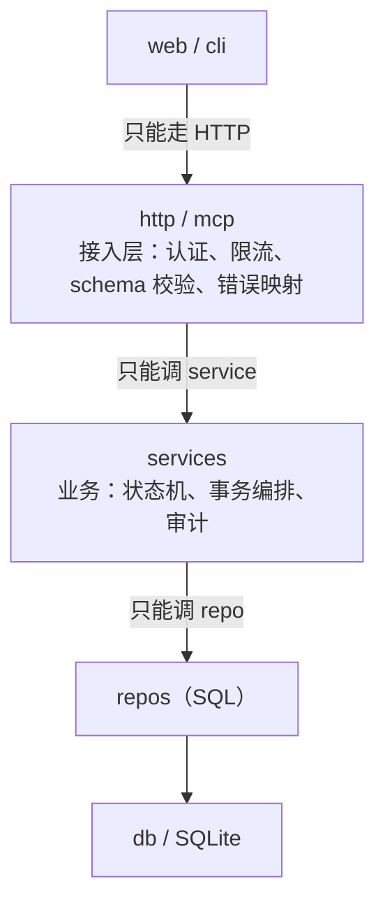
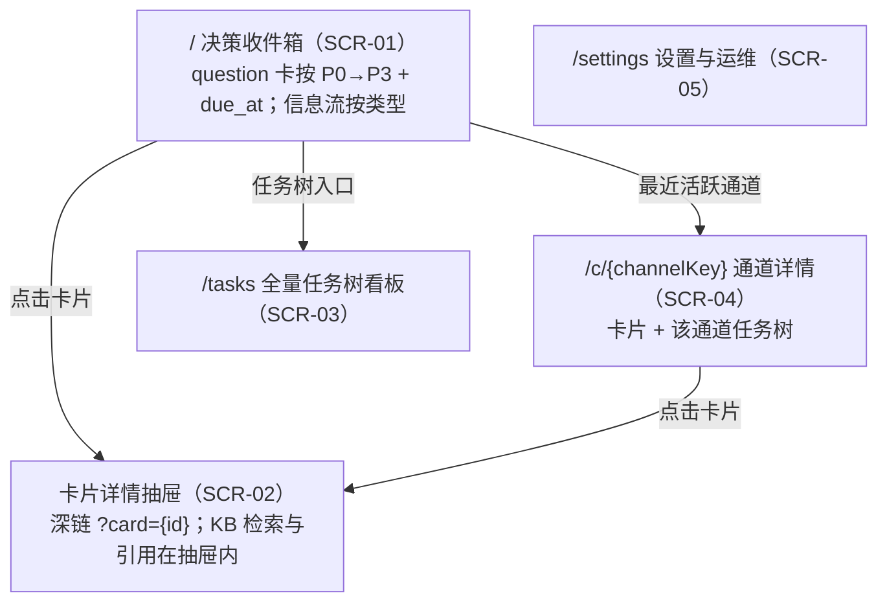

# 03 — 软件设计说明

**文档包**：AIDash 设计文档包 V2.0
**版本**：V2.0
**日期**：2026-10-23
**上游**：`30-design/概要设计.md` V2.0、`02-系统-子系统设计说明.md` V2.0
**下游**：`04-接口设计说明.md`、`05-数据库设计说明.md`

## 0. 本文件的定位

本文件回答“**代码怎么组织、每个模块内部怎么做、状态怎么转、事务怎么保证**”。

- 不重复需求（`20-spec`）与架构决策（`概要设计.md`）。
- 不重复字段级契约（`04`）与 DDL（`05`），只引用。
- 所有伪代码是**实现约束**，不是示例：开发可以换语法，但不能换语义。

---

## 1. 代码组织与构建

### 1.1 仓库结构

> 本树为仓库的实际布局；`40-build/00-platform/` 只放构建与工具配置，应用代码全部在 `40-build/10-aidash/`。

```
AIDash/                              # 仓库根（同时也是 pnpm workspace 根）
├─ README.md                         # 中文入口
├─ README.en.md                      # English entry
├─ LICENSE                           # MIT
├─ CONTRIBUTING.md                   # 贡献与合规说明
├─ .gitignore
├─ docs/index.md                     # 文档索引
├─ 20-spec/                          # 需求与验收判据
├─ 30-design/                        # 概要设计 + 设计文档包
├─ package.json / pnpm-workspace.yaml / pnpm-lock.yaml
├─ 40-build/00-platform/                      # 构建脚本与工具配置
│  ├─ config/
│  │  ├─ tsconfig.base.json
│  │  ├─ tsconfig.server.json
│  │  ├─ vitest.config.ts
│  │  └─ mcp.json                    # Claude Code MCP 接入（--mcp-config）
│  └─ tools/build-cli.mjs            # 值守壳打包入口
└─ 40-build/10-aidash/                        # 应用本体（服务端 + Web + CLI + 契约）
   ├─ AGENTS.md                      # harness 契约（产品交付物）
   ├─ skills/aidash-mcp/SKILL.md     # MCP 工具参考
   ├─ scripts/start-aidash.ps1       # Windows 固定启动参数
   ├─ src/
   │  ├─ shared/                     # 无业务依赖的共享层
   │  │  ├─ errors.ts                # AppError + 错误码枚举
   │  │  ├─ ids.ts                   # 单调 ID 生成
   │  │  ├─ schemas.ts               # zod：card / task / channel / envelope
   │  │  ├─ secrets.ts               # 常量时间比较
   │  │  ├─ time.ts                  # Clock 接口（可注入，便于测试）
   │  │  └─ types.ts
   │  ├─ server/
   │  │  ├─ main.ts                  # 装配依赖、启动、优雅退出
   │  │  ├─ config.ts                # 环境变量 / 配置文件
   │  │  ├─ context.ts               # 请求上下文
   │  │  ├─ log.ts
   │  │  ├─ http/                    # app / middleware / respond / routes
   │  │  ├─ mcp/                     # Streamable HTTP 传输 + 23 个工具
   │  │  ├─ services/                # 业务层：状态机、事务编排、审计
   │  │  ├─ repos/                   # 一表一文件，只写 SQL
   │  │  ├─ workers/background.ts    # 过期 / 保留 / 索引等后台任务
   │  │  └─ db/                      # connection / migrate / migrations
   │  ├─ web/                        # 前端（React 19 + Vite）
   │  └─ cli/                        # aidash-watch 值守壳
   ├─ tests/                         # vitest 用例与 helpers
   └─ dist/                          # 生成物（server / web / cli），忽略
```

### 1.2 分层与依赖规则



**四条铁律**：

1. `services` 不得 import `http`/`mcp`/`web`；业务逻辑与传输无关。
2. `repos` 不得 import `services`；不得包含业务判断（如“是否可认领”）。
3. `shared` 不依赖任何其他层。
4. 任何跨表写操作必须通过 service 的事务助手，禁止在 route 里直接开事务。

### 1.3 构建与分发

| 产物 | 工具 | 说明 |
|---|---|---|
| 服务端 | `tsc -p 40-build/00-platform/config/tsconfig.server.json` → `40-build/10-aidash/dist/server` | Node ≥24 |
| 前端 | Vite → `40-build/10-aidash/dist/web` | 静态资源由同一 HTTP Server 提供 |
| 值守壳 | `esbuild`（`40-build/00-platform/tools/build-cli.mjs`）→ `40-build/10-aidash/dist/cli/aidash-watch.mjs` | 单文件可执行；V1 只构建 Windows（跨平台见 NF-009，后续版本） |
| schema | zod → JSON Schema | MCP `tools/list` 直接复用，避免两套定义 |

**防漂移**：MCP 工具的参数 schema 与 REST 的请求 schema 必须来自同一份 zod 定义，禁止手写两份。

---

## 2. 关键设计约定

### 2.1 统一时钟

所有“现在”必须来自 `Clock.now()`，禁止直接 `Date.now()` 散落各处。原因：租约、过期、保留策略都依赖时间；测试需要可控时钟（R-016）。

### 2.2 统一错误

所有业务异常抛 `AppError(code, message, details?, retryable?)`；接入层统一序列化为 `{code,message,retryable,details}`。禁止把数据库异常、堆栈、SQL 直接返回给调用方。

### 2.3 统一 ID

| 对象 | 形式 | 说明 |
|---|---|---|
| channel | `ch_` + ULID | 可排序 |
| card | `cd_` + ULID | |
| task | `tk_` + ULID | |
| event | 自增整数 | 只追加 |
| claim_token | `cl_` + 随机 32 字节 base64url | 不可预测 |

### 2.4 统一时间格式

- 存储：UTC ISO 8601 字符串（`2026-10-23T08:00:00.000Z`）或整数毫秒；二者择一，V2 选**整数毫秒**，避免时区解析歧义。
- 对外 JSON：ISO 8601 带 `Z`。
- 展示：前端按本地时区渲染。

### 2.5 事务边界

一个“用户可感知的动作” = 一个事务：

- 发一张卡 = `card` + `card_event` + `audit_log`
- 认领任务 = `task` 更新 + `task_event` + `audit_log`
- 回答决策 = `card` 更新 + `card_event` + `audit_log`

**禁止**在事务内做：LLM 调用、文件 IO、HTTP 请求、发通知。
## 3. 模块详细设计

### 3.1 MOD-001 接入子系统

#### 3.1.1 请求处理链

```
request
  → requestId()           # 生成/透传 X-Request-Id
  → auth()                # Bearer 校验；失败 401
  → rateLimit()           # 令牌桶；失败 429 + Retry-After
  → schemaValidate()      # zod；失败 400 INVALID_ARGUMENT
  → handler()             # 调 service
  → errorMapper()         # AppError → 统一错误体
  → accessLog()           # 脱敏后写日志
```

#### 3.1.2 认证

```ts
// 常量时间比较，避免时序侧信道；令牌只存 sha256，不存明文
function authenticate(req: Request): TokenContext {
  const raw = req.headers.authorization?.replace(/^Bearer\s+/i, '');
  if (!raw) throw new AppError('UNAUTHORIZED', 'missing token');
  const hash = sha256(raw);
  const token = config.tokens.find(t => timingSafeEqual(t.hash, hash));
  if (!token) throw new AppError('UNAUTHORIZED', 'invalid token');
  return { label: token.label, scopes: token.scopes }; // scopes: ['read','write'] 等
}
```

#### 3.1.3 有界等待（`card.ask` / `card.wait`）

```ts
// 等待不占数据库事务；只在内存挂起 Promise，并受全局等待配额约束
async function waitForAnswer(cardId: string, waitSeconds: number): Promise<AskResult> {
  const deadline = clock.now() + Math.min(waitSeconds, 300) * 1000;

  // 已有答案：立即返回
  const existing = await cardService.getAnswerIfAny(cardId);
  if (existing) return { status: 'answered', ...existing };

  if (waitingCount >= config.maxWaitingRequests) {
    throw new AppError('BUSY', 'too many waiting requests', { retryable: true });
  }

  waitingCount++;
  try {
    return await waitRegistry.wait(cardId, deadline); // 回答时由 DecisionService 唤醒
  } finally {
    waitingCount--;
  }
}
```

**关键点**：

- `maxWaitingRequests` 默认 100；超过返回 `BUSY`（可重试）。
- 等待期间连接断开不取消卡片；只是 `wait` 返回。
- 唤醒源是 `DecisionService.answer()` 的内存事件，不轮询数据库。
- 进程重启会丢失等待者；harness 用 `card.wait` 重新等待即可（卡片状态在库里）。

#### 3.1.4 MCP 工具注册

```ts
// 一份 zod schema 同时用于：MCP tools/list、REST 校验、TypeScript 类型
defineTool({
  name: 'card.ask',
  description: '发一张决策卡并等待用户回答（有界阻塞）',
  input: z.object({
    channel_key: z.string().min(1),
    title: z.string().min(1).max(200),
    background_md: z.string().max(64_000),
    options: z.array(optionSchema).min(2).max(10),
    allow_free_text: z.boolean().default(false),
    wait_seconds: z.number().int().min(0).max(300).default(90),
    idempotency_key: z.string().optional(),
  }),
  handler: async (input, ctx) => decisionService.ask(input, ctx),
});
```

#### 3.1.5 错误映射

| 内部异常 | code | HTTP | retryable |
|---|---|---|---|
| 参数校验失败 | `INVALID_ARGUMENT` | 400 | false |
| 资源不存在 | `NOT_FOUND` | 404 | false |
| 状态冲突/非法转移 | `CONFLICT` | 409 | false |
| 已被认领 | `ALREADY_CLAIMED` | 409 | true |
| 缺证据 | `EVIDENCE_REQUIRED` | 409 | false |
| 限流 | `RATE_LIMITED` | 429 | true |
| 未认证 | `UNAUTHORIZED` | 401 | false |
| 等待配额满 | `BUSY` | 503 | true |
| 其他 | `INTERNAL` | 500 | false（细节只进日志） |

---

### 3.2 MOD-002 通道与卡片服务

#### 3.2.1 通道 upsert

```ts
// channel_key 唯一；首次发卡自动建通道；归档通道收到新卡时自动恢复 active
function upsertChannel(key: string, meta: ChannelMeta): Channel {
  const existing = repo.findByKey(key);
  if (existing) {
    if (existing.status === 'archived') {
      repo.setStatus(existing.id, 'active');
      audit.record('channel.reactivate', existing.id, { reason: 'new_card' });
    }
    return repo.get(existing.id);
  }
  return repo.insert({ id: newId('ch'), channel_key: key, ...meta, status: 'active' });
}
```

**工作路径与统计**：

- `workdir` 只登记非空值：`channel.upsert` 传空串或 `null` 视为“本次不提供”，不得清空已有值；旧通道可以一直为空。
- `ChannelView.task_count` 统计该通道全部任务；`open_task_count` 只统计 `pending`/`claimed`/`in_progress`/`blocked`。
- `channel_key` 仍是 `host/project/topic` 三段式：`project` 是主对话，`topic` 是子对话；解析后物化到 `channel.project`/`channel.topic`，供 Web 分组与 `card.list` 的 `project` 过滤使用。
- **在线判定**：`ChannelView.agent_online` 只由 `channel.last_mcp_at` 决定——MCP 入口在每次 `tools/call`（含读操作）后刷新它，`now - last_mcp_at ≤ offlineThreshold` 即在线。阈值复用 `AIDASH_OFFLINE_THRESHOLD_SECONDS`（默认 180 秒）。不复用 `updated_at`：REST/Web 写也会刷新它，会把用户操作误算成 agent 在线；也不看 `open_task_count`：有遗留任务不等于 agent 还在。历史通道 `last_mcp_at` 为空时显示“无 MCP 活动记录”，不回填。

#### 3.2.2 发卡

```ts
function postCard(input: CardInput, ctx: TokenContext): Card {
  return db.transaction(() => {
    const channel = upsertChannel(input.channel_key, input.channel_meta);

    // 1) 幂等：同 (channel_id, idempotency_key) 直接返回旧卡
    if (input.idempotency_key) {
      const prior = repo.findByIdemKey(channel.id, input.idempotency_key);
      if (prior) return prior;
    }

    // 2) 类型必填校验（见 3.2.3）
    validateByType(input);

    // 2.1) 归属校验（4.0 起）：非 question 必须挂任务，且任务与卡同通道。
    // 信息流只在任务详情展示；无归属卡会让用户找不到上下文。
    if (input.type !== 'question' && !input.task_id) {
      throw new ValidationError('task_id is required for non-question cards');
    }
    if (input.task_id) assertTaskInChannel(input.task_id, channel.id);

    // 3) 敏感信息扫描（见 3.2.4）
    assertNoSecrets(input);

    // 4) 大小限制
    assertSize(input.body_md, 64_000, 'body_md');
    assertSize(input.message_md ?? '', 16_000, 'message_md');
    // 决策卡四段与选项优缺点同受 05 §4.7 的硬限制约束
    assertSize(input.goal_md ?? '', 64_000, 'goal_md');
    assertSize(input.research_md ?? '', 64_000, 'research_md');
    assertSize(input.decision_md ?? '', 64_000, 'decision_md');
    for (const option of input.options ?? []) {
      assertSize(option.pros_md ?? '', 4_000, `options.${option.id}.pros_md`);
      assertSize(option.cons_md ?? '', 4_000, `options.${option.id}.cons_md`);
    }

    const card = repo.insert({
      id: newId('cd'),
      channel_id: channel.id,
      type: input.type,
      status: 'open',
      priority: input.priority ?? 'P2',
      ...normalize(input),
      created_at: clock.now(),
    });

    eventRepo.append(card.id, 'created', ctx);
    audit.record('card.post', card.id, { type: card.type }, ctx);
    enrichmentQueue.push(card.id); // 事务外由 worker 消费
    return card;
  });
}
```

#### 3.2.3 各类型必填字段

| 类型 | 必填 | 可选 |
|---|---|---|
| `info` | `title`, `body_md`, `severity`, `task_id` | `links[]` |
| `handoff` | `recipient`, `channel_kind`, `reason`, `message_md`, `task_id` | `due_at`, `handoff_state` |
| `question` | `title`, `background_md`, `goal_md`, `research_md`, `decision_md`, `options[2~10]`（每项 `pros_md`、`cons_md`；恰好 1 个 `primary` + 1 个 `backup`） | `allow_free_text`, `default_action`, `due_at`, `task_id`, `blocking` |
| `suggestion` | `analysis_md`, `suggestions[≥1]`, `task_id` | `kb_refs[]`, `confidence` |
| `status` | `summary`, `result`(`success`/`failed`/`blocked`/`partial`), `task_id` | `detail_md` |
| `artifact` | `url`, `kind`, `summary`, `task_id` | `size_bytes` |

> `question` 是唯一允许 `task_id` 为空的类型：拍板可能先于任务存在。其余五类缺 `task_id` 直接在 schema 层被拒。

**决策卡校验位置**：`shared/schemas.ts` 的 `refineQuestionOptions` 统一校验四段非空、选项 2~10 个、`id` 唯一、每项 `pros_md`/`cons_md` 非空、`recommendation_role` 恰好 1 个 `primary` 与 1 个 `backup`。`card.post` 与 `card.ask` 共用这套 schema，避免两个入口的规则漂移；历史卡三列为 `NULL` 时按“未提供”降级展示，不阻断读取与回答。

#### 3.2.4 敏感信息扫描

```ts
// 命中即拒绝（不落库），并写一条审计（只记模式名，不记原文）
const SECRET_PATTERNS = [
  { name: 'openai_key', re: /\bsk-[A-Za-z0-9]{16,}\b/ },
  { name: 'private_key', re: /-----BEGIN (?:RSA |EC |OPENSSH )?PRIVATE KEY-----/ },
  { name: 'password_assign', re: /(?:password|passwd|pwd)\s*[:=]\s*\S{6,}/i },
  { name: 'bearer', re: /\bBearer\s+[A-Za-z0-9._-]{20,}/ },
  { name: 'generic_token', re: /\b(?:token|secret|api[_-]?key)\s*[:=]\s*[A-Za-z0-9._-]{16,}/i },
];
```

> 说明：这是“防手滑”而非“防蓄意”。真正的边界是 REQ-FN-057：AIDash 根本不持有这些凭证。

#### 3.2.5 列表与搜索

```sql
-- 列表：覆盖索引 (channel_id, status, priority, created_at)
SELECT * FROM card
WHERE channel_id = ? AND status <> 'archived'
ORDER BY CASE priority WHEN 'P0' THEN 0 WHEN 'P1' THEN 1 WHEN 'P2' THEN 2 ELSE 3 END,
         created_at DESC
LIMIT ? OFFSET ?;

-- 搜索：LIKE（不新增 card_fts，保持 05 的 14 张表基线）
-- 用户输入里的 % / _ 必须转义，否则会被当成通配符。
SELECT * FROM card
WHERE (title LIKE ? ESCAPE '\'
    OR body_md LIKE ? ESCAPE '\'
    OR background_md LIKE ? ESCAPE '\'
    OR message_md LIKE ? ESCAPE '\'
    OR summary LIKE ? ESCAPE '\'
    OR detail_md LIKE ? ESCAPE '\')
  AND status <> 'archived'
ORDER BY created_at DESC
LIMIT ? OFFSET ?;
```

**按项目过滤**：`project` 参数不是 `card` 的列，需要 `JOIN channel ON card.channel_id = channel.id`
后按 `channel.project = ?` 过滤；它和 `channel_key` 可以同时出现（前者跨话题、后者锁定单通道）。
`card.list` 的 `project` 过滤与 `GET /api/cards?project=` 走同一条查询构造，避免 MCP 与 REST 结果不一致。

**任务归属与未读口径**：`task_id` 过滤直接命中 `card.task_id`；`unassigned=true` 只取
`task_id IS NULL` 的升级前存量卡，新卡已不可能进入该集合。任务未读数在一条查询里聚合，
任务列表、任务树与任务详情共用同一口径：

```sql
SELECT t.id,
       COUNT(c.id) AS unread_count
FROM task t
LEFT JOIN card c
  ON c.task_id = t.id
 AND c.status <> 'archived'
 AND NOT EXISTS (SELECT 1 FROM card_read r WHERE r.card_id = c.id)
WHERE t.channel_id = ?
GROUP BY t.id;
```

归档不算已读，但归档卡会退出 `LEFT JOIN` 条件，所以红点能自然清掉；否则用户永远清不完。

**为什么不用 FTS5**：卡片搜索是低频操作，V2.0 规模按 10k 卡设计；再建一张 `card_fts` 会破坏
05 的 14 表计数基线（`kb_fts` 是 TBL-009，只服务知识库）。LIKE 在 10k 规模下可接受，
后续确有性能压力时再通过迁移替换，而不是现在预支复杂度。

#### 3.2.6 编辑与归档

- 编辑守卫：`status IN ('open')`；否则 409。编辑写 `card_event('edited')`，审计记录**前后内容哈希**（不存全文，避免审计表膨胀）。
- 归档：只改 `status='archived'`，`archived_at=now`；不删行。
- 保留策略到期的卡片同样只归档。

#### 3.2.7 已读

```ts
function markRead(cardId: string, ctx: TokenContext): { read_at: string | null } {
  const card = repo.get(cardId);
  if (!card) throw new NotFoundError('card', cardId);
  // INSERT OR IGNORE：已读是“第一次看到”的事实，重复调用不刷新时间。
  readRepo.insertIfAbsent(cardId, clock.now());
  audit.record('card.read', cardId, {}, ctx);
  return { read_at: iso(readRepo.get(cardId)!.read_at) };
}
```

- 已读是单用户全局状态，存 `card_read`（TBL-014），不写 `card` 主表，避免每次阅读都刷新 `updated_at`。
- 归档不写已读；未读数只统计 `status <> 'archived'` 的卡。
- 前端在条目可见比例 ≥60% 时调用，失败保持未读并在下次重试。

---

### 3.3 MOD-003 任务树服务

#### 3.3.1 物化路径

```ts
// 每个节点存 path，形如 "/tk_root/tk_a/tk_b/"；根节点为 "/tk_root/"
// 子树查询：WHERE path LIKE '/tk_root/tk_a/%'
// 环检测：新父的 path 不能以被移动节点的 path 为前缀
function moveTask(taskId: string, newParentId: string | null): Task {
  return db.transaction(() => {
    const task = repo.get(taskId);
    assertMovable(task); // 仅 draft/pending/blocked

    const newParent = newParentId ? repo.get(newParentId) : null;
    const newPrefix = newParent ? `${newParent.path}` : '/';

    if (newParent && newParent.path.startsWith(task.path)) {
      throw new AppError('CONFLICT', 'CYCLE_DETECTED');
    }

    const oldPrefix = task.path;
    const newPath = `${newPrefix}${task.id}/`;

    // 先改自己，再批量改子树（同一事务）
    repo.updatePath(task.id, newParentId, newPath);
    repo.rewriteSubtreePrefix(oldPrefix, newPath);

    eventRepo.append(task.id, 'moved', { from: task.parent_id, to: newParentId });
    audit.record('task.move', task.id, { from: task.parent_id, to: newParentId });
    return repo.get(task.id);
  });
}
```

**为什么用物化路径**：树规模 1,000、深度 5；`path LIKE` 比递归 CTE 更简单、更快，且环检测是字符串前缀比较，逻辑不易写错。

#### 3.3.2 复制子树

```ts
function copySubtree(taskId: string, newParentId: string | null): Task[] {
  return db.transaction(() => {
    const subtree = repo.findSubtree(taskId); // 按 path 前缀，含自身
    const idMap = new Map<string, string>();

    // 第一遍：建新节点（不含 parent）
    for (const t of subtree) {
      const copy = repo.insert({ ...t, id: newId('tk'), status: 'draft', title: `${t.title}（副本）` });
      idMap.set(t.id, copy.id);
    }
    // 第二遍：重建父子与 path
    for (const t of subtree) {
      const copyId = idMap.get(t.id)!;
      const parentId = t.id === taskId ? newParentId : idMap.get(t.parent_id!)!;
      repo.setParentAndPath(copyId, parentId);
    }
    audit.record('task.copy', taskId, { count: subtree.length });
    return subtree.map(t => repo.get(idMap.get(t.id)!));
  });
}
```

**注意**：副本状态一律 `draft`，避免“复制即执行”；复制不复制认领信息与证据卡关联。

#### 3.3.3 原子认领

```sql
-- 单条 UPDATE 完成“检查 + 占用”，依赖 SQLite 的单写者与事务原子性
UPDATE task
SET status = 'claimed',
    claimed_by = :harness_id,
    claim_token = :token,
    claim_expires_at = :now + :lease_ms,
    updated_at = :now
WHERE id = :task_id
  AND status = 'pending'
  AND (assignee IS NULL OR assignee = :harness_id)
  AND (claim_expires_at IS NULL OR claim_expires_at < :now);
-- 受影响行数 = 1 才算认领成功；0 → ALREADY_CLAIMED
```

#### 3.3.4 续租与释放

```ts
function heartbeat(taskId: string, token: string, leaseMs: number): Task {
  const n = repo.extendLease(taskId, token, clock.now() + leaseMs);
  if (n !== 1) throw new AppError('CONFLICT', 'INVALID_CLAIM_TOKEN');
  return repo.get(taskId);
}

function release(taskId: string, token: string, reason: string): Task {
  const n = repo.release(taskId, token, reason, clock.now());
  if (n !== 1) throw new AppError('CONFLICT', 'INVALID_CLAIM_TOKEN');
  eventRepo.append(taskId, 'released', { reason });
  return repo.get(taskId);
}
```

#### 3.3.5 完成守卫（证据）

```ts
function complete(taskId: string, token: string, evidenceCardId?: string): Task {
  return db.transaction(() => {
    assertClaimToken(taskId, token);
    const evidence = repo.findEvidenceCards(taskId); // type IN ('status','artifact')
    if (evidence.length === 0) {
      throw new AppError('EVIDENCE_REQUIRED', 'task needs a status or artifact card');
    }
    // 证据质量：至少一张卡有非空摘要，或 artifact 有 url
    const usable = evidence.some(c => c.summary?.trim() || c.url);
    if (!usable) throw new AppError('EVIDENCE_REQUIRED', 'evidence is empty');
    return transition(taskId, 'done', { evidence_ids: evidence.map(c => c.id) });
  });
}
```

> R-014 的对策：不仅要求“有卡”，还要求“卡里有内容或链接”。

#### 3.3.6 树查询

```ts
// 首屏：只取根 + 第一层（2 层含根）
function tree(channelId: string, depth = 2): TreeNode[] {
  const rows = repo.listByChannel(channelId, { maxDepth: depth });
  return buildTree(rows); // O(n)，一次查询，禁止 N+1
}
```

**状态时间线写入点**（字段见 05 §3.4；`TaskView` 统一转 ISO，未发生为 `null`）：

| 事件 | 写入 | 说明 |
|---|---|---|
| `task.claim`（含过期租约接管） | `claimed_at` | 记录最近一次接手时间；续租不改写，避免把认领时间冲成心跳时间 |
| `start` | `started_at` | 进入 `in_progress` 的时刻 |
| `block` | `blocked_at`、`blocked_reason` | 最近一次阻塞；`unblock` 不清空，页面用它计算阻塞时长 |
| `complete` | `completed_at` | 终态时间 |
| `fail` | `failed_at`、`fail_reason` | 终态时间与失败原因 |
| `cancel` | `cancelled_at` | 可从 `draft`/`pending` 直接取消，因此不能只在认领路径写 |
| `defer` | `deferred_at`、`defer_reason`、`deferred_until` | 暂缓覆盖层，不改变 `status`；只允许 `draft`/`pending` |
| `undefer` / `claim` / 终态 | 清空暂缓三列 | 恢复处理时不再显示“已暂缓” |
| `flag_risk` | `risk_note`、`risk_flagged_at` | 隐患覆盖层，不改变 `status`；任何状态（含终态）可用；重新标记清空 `risk_resolved_at`/`risk_resolution` |
| `unflag_risk` | `risk_resolved_at`、`risk_resolution` | 只写解除时间与可选复盘结论；保留 `risk_note`/`risk_flagged_at`；不随认领或终态清空 |

`release` 与租约回收只把状态退回 `pending`，不清空 `started_at`/`blocked_at`：状态由 `status` 表达，时间列只负责记录历史。

---

### 3.4 MOD-004 决策服务

#### 3.4.1 回答

```ts
function answer(cardId: string, input: AnswerInput, ctx: TokenContext): Card {
  return db.transaction(() => {
    const card = repo.get(cardId);
    if (card.type !== 'question') throw new AppError('CONFLICT', 'NOT_A_QUESTION');
    if (card.status !== 'open') throw new AppError('CONFLICT', 'ALREADY_ANSWERED');

    const value = validateAnswer(card, input); // 选项必须存在；自由文本需允许
    const updated = repo.setAnswer(cardId, value, 'answered', clock.now());

    eventRepo.append(cardId, 'answered', { by: ctx.label });
    audit.record('card.answer', cardId, { option_id: value.option_id ?? null }, ctx);
    waitRegistry.wake(cardId, updated); // 唤醒 card.ask
    return updated;
  });
}
```

#### 3.4.2 批量回答

```ts
function batchAnswer(items: AnswerInput[], opts: { partial?: boolean }, ctx): BatchResult {
  // 1) 先全量校验，避免“答了一半才发现第三张不合法”
  const prepared = items.map(it => prepare(it)); // 抛错即整批失败
  if (opts.partial) return runSequentially(prepared); // 显式要求才允许部分成功
  return db.transaction(() => prepared.map(p => answerInTx(p, ctx)));
}
```

**默认整批原子**：用户点“全部同意”时不希望一半成功一半失败。

#### 3.4.3 过期

```ts
// 每分钟一次；只标记，不执行默认动作（DQ-009）
function expireDueQuestions(now: number): number {
  const due = repo.findOpenQuestionsDue(now);
  for (const c of due) {
    repo.setStatus(c.id, 'expired');
    eventRepo.append(c.id, 'expired', {});
    audit.record('card.expire', c.id, {});
  }
  return due.length;
}
```

---

### 3.5 MOD-005 增强服务

#### 3.5.1 队列

- 进程内串行队列（并发 1，可配）；任务持久化在 `card.enrichment_status`（`pending`/`running`/`done`/`unavailable`），重启后扫描 `pending` 重新入队。
- 每张卡最多重试 3 次，指数退避（1s/4s/16s）。

#### 3.5.2 生成

```ts
async function enrich(card: Card): Promise<void> {
  const kbHits = await kb.search(buildQuery(card), { topK: 5 });
  const prompt = buildPrompt(card, kbHits); // 明确要求输出 JSON

  try {
    const raw = await llm.chat(prompt, { timeoutMs: 5_000, maxTokens: 800 });
    const parsed = parseEnrichment(raw); // 严格 JSON；失败抛错
    repo.saveEnrichment(card.id, {
      analysis_md: parsed.analysis_md,
      suggestions: parsed.suggestions,       // 每条含 text/rationale/confidence
      kb_refs: kbHits.map(toRef),
      confidence: clamp01(parsed.confidence),
      model: llm.model,
      status: 'done',
    });
  } catch (e) {
    repo.saveEnrichment(card.id, { status: 'unavailable', reason: classify(e) });
  }
}
```

#### 3.5.3 防幻觉约束

1. 有 `kb_refs` 才能在建议里写“根据知识库……”；否则 `analysis_md` 必须含“无知识库依据”。
2. `confidence` 由模型给出后**截断到 [0,1]**，不允许缺失。
3. 解析失败 → 用模板建议（“建议人工复核”），不把半截 JSON 展示给用户。
4. 建议永远不自动落地（REQ-FN-038）；UI 的“采纳”是显式动作。

---

### 3.6 MOD-006 知识库索引

#### 3.6.1 OKF 校验

```ts
function validateKbRoot(root: string): KbStatus {
  const index = path.join(root, 'index.md');
  if (!fs.existsSync(index)) return { state: 'unavailable', reason: 'index_missing' };
  const fm = parseFrontmatter(fs.readFileSync(index, 'utf8'));
  if (fm.okf_version !== '0.1') return { state: 'degraded', reason: 'okf_version_mismatch' };
  return { state: 'ok' };
}
```

**降级而非失败**：KB 不合规只影响建议区（REQ-FN-032）。

#### 3.6.2 索引

```ts
// 只索引 Wiki/；RAW/ 与 Output/ 不索引（OKF 的“知识层”约定）
function indexAll(): IndexReport {
  const files = walk(path.join(root, 'Wiki'), { ext: ['.md'] });
  let added = 0, updated = 0, skipped = 0, invalid = 0;

  for (const f of files) {
    const text = fs.readFileSync(f, 'utf8');       // 只读
    const fm = parseFrontmatter(text);
    if (!fm.type) { invalid++; continue; }          // 缺 type 跳过并计数

    const hash = sha256(text);
    const row = kbRepo.findByPath(f);
    if (row?.hash === hash) { skipped++; continue; }

    kbRepo.upsert({ path: f, type: fm.type, title: fm.title, description: fm.description,
                    tags: fm.tags ?? [], timestamp: fm.timestamp, hash, body: stripFm(text) });
    row ? updated++ : added++;
  }
  fts.rebuildChanged(); // 只重写变更行
  return { added, updated, skipped, invalid, at: clock.now() };
}
```

#### 3.6.3 检索

```sql
SELECT d.path, d.title, d.type, d.tags,
       snippet(kb_fts, 3, '<mark>', '</mark>', '…', 16) AS snippet,
       bm25(kb_fts) AS score
FROM kb_fts JOIN kb_doc d ON d.rowid = kb_fts.rowid
WHERE kb_fts MATCH :q
  AND (:type IS NULL OR d.type = :type)
ORDER BY score LIMIT :topK;
```

#### 3.6.4 路径安全

```ts
function resolveInsideRoot(root: string, rel: string): string {
  const abs = path.resolve(root, rel);
  const rootAbs = path.resolve(root) + path.sep;
  if (!abs.startsWith(rootAbs)) throw new AppError('FORBIDDEN', 'PATH_ESCAPE');
  return abs;
}
```

**额外**：拒绝符号链接逃逸（`fs.realpath` 后再比一次前缀）。

---

### 3.7 MOD-007 审计与配置

#### 3.7.1 配置优先级

```
环境变量  >  配置文件（默认 ./aidash.config.json）  >  内置默认值
```

必填项：`AIDASH_TOKEN`（或配置文件中的 token hash）、`db_path`。缺失 → 启动失败并打印缺失项（REQ-FN-059）。

#### 3.7.2 审计写入

- 与业务写同事务；`audit_log` 无 UPDATE/DELETE API。
- 字段：`ts, actor_label, action, object_type, object_id, result, request_id, detail_json`。
- `detail_json` 只放**可公开的元数据**（如 `{option_id: 2}`），不放正文、不放凭证。

#### 3.7.3 迁移

```
migrate():
  current = readVersion()
  pending = migrations.filter(m => m.version > current)
  if pending.empty: return
  backup()                       # 迁移前自动备份
  for m in pending:
    tx(() => { run(m.sql); writeVersion(m.version) })
  on error: restore(backup); throw
```

#### 3.7.4 健康与指标

| 端点 | 内容 | 失败条件 |
|---|---|---|
| `/health` | `db`（可读写）、`kb`（状态与上次索引时间）、`schema_version`、`queue_backlog` | DB 不可写或迁移未完成 → 503 |
| `/metrics` | 卡片数/任务数/待决策数、请求计数、延迟直方图、增强失败数 | 不返回 5xx（指标自身不阻塞） |

#### 3.7.5 保留策略

```ts
// 只归档/轮转，不物理删除业务记录
function retentionSweep(now: number): RetentionReport {
  const cards = cardRepo.findOlderThan(now - config.cardRetentionDays * DAY);
  for (const c of cards) cardService.archive(c.id, { reason: 'retention' });
  rotateLogs(now - config.logRetentionDays * DAY);
  return { archivedCards: cards.length };
}
```

---

### 3.8 MOD-008 Web UI

#### 3.8.1 页面结构



> 知识库**不单独成页**：使用场景是“看某张卡时顺手查依据”，入口放在卡片抽屉内。
> 页面清单、区域与字段以 `界面设计说明.md` §1 为准；本节只保留路由与模块映射。

#### 3.8.2 任务树渲染

```tsx
// 虚拟滚动 + 懒加载：首屏只请求 2 层；展开时按 parent_id 拉子节点
<Tree
  rows={flatten(visibleNodes)}          // 扁平化后交给虚拟列表
  rowHeight={32}
  overscan={8}
  onExpand={(id) => loadChildren(id)}   // 展开才请求
/>
```

**性能约束**：折叠时必须从 DOM 移除子树（不是 `display:none`），否则 1,000 节点会拖慢页面（REQ-FN-021）。

#### 3.8.3 批量推进交互

```
勾选 → 底部操作条（选择动作 / 拒绝 / 稍后）
     → 抽屉展示：N 张卡、动作、逐卡预览、不可应用的卡标红
     → 「确认提交」二次确认
     → 调 POST /api/cards/batch-answer
     → 结果：成功数 / 失败数 / 失败原因，可重试失败项
```

#### 3.8.4 Markdown 与链接安全

- 渲染前转义 HTML；禁用内联 `<script>`、`on*` 属性。
- 链接协议白名单：`http:`、`https:`、`mailto:`；其他（`javascript:`、`data:`）替换为纯文本。
- 外链加 `rel="noopener noreferrer"`。

---

### 3.9 MOD-009 值守壳 CLI

#### 3.9.1 配置

```json
{
  "aidash_url": "http://127.0.0.1:8787",
  "token_env": "AIDASH_TOKEN",
  "harness": {
    "command": "claude",
    "args": ["-p", "{prompt_file}"],
    "cwd": "F:/work",
    "timeout_seconds": 1800
  },
  "poll_interval_seconds": 60,
  "concurrency": 1,
  "lease_seconds": 900,
  "tags": ["dev"],
  "log_dir": "./logs"
}
```

**凭证**：配置只写“从哪个环境变量取”，不写令牌明文（REQ-FN-057 的同源要求）。

#### 3.9.2 主循环

```ts
// 值守壳是纯 MCP 客户端：所有调用都走 tools/call，不依赖 REST。
// 这样同一套语义只有一份实现，Web 的 REST 与服务端的 MCP 共享同一批 service。
async function runLoop(cfg: Config): Promise<void> {
  await register(cfg);                       // MCP-001 harness.register（幂等）
  while (!stopping) {
    await heartbeat(cfg);                    // MCP-002 harness.heartbeat
    const tasks = await listClaimable(cfg);  // MCP-011 task.list：status=pending
    for (const t of tasks.slice(0, cfg.concurrency)) {
      const claimed = await tryClaim(t.id);  // MCP-013 task.claim；失败则跳过
      if (!claimed) continue;
      await executeOne(claimed, cfg);        // 起 harness、续租、回报
    }
    await sleep(cfg.poll_interval_seconds * 1000);
  }
}
```

#### 3.9.3 执行与进程树终止

```ts
async function executeOne(task: Task, cfg: Config): Promise<void> {
  // 续租复用 task.claim：带原 claim_token 再调，服务端延长租约；不新增 REST 端点
  const renew = setInterval(() => renewClaim(task.id, task.claim_token), cfg.lease_seconds * 1000 / 3);
  const child = spawn(cfg.harness.command, buildArgs(cfg, task), {
    cwd: cfg.harness.cwd,
    shell: false,                 // 关键：不经 shell，避免注入与转义问题
    windowsHide: true,
  });

  try {
    const result = await withTimeout(child, cfg.harness.timeout_seconds * 1000);
    await reportSuccess(task, result);
  } catch (e) {
    await reportFailure(task, e);
  } finally {
    clearInterval(renew);
    await releaseTask(task.id, task.claim_token); // 失败也要释放
  }
}
```

**跨平台杀进程树**：

| 平台 | 做法 |
|---|---|
| Windows | `taskkill /PID <pid> /T /F` |
| POSIX | `spawn` 时 `detached: true`，杀 `-pid` 进程组：先 `SIGTERM`，5s 后 `SIGKILL` |

#### 3.9.4 回报内容

- 成功：`card.post(type=status, result=ok, summary=...)` + 可选 `artifact` + `task.update(done)`。
- 失败：`card.post(type=status, result=fail, detail_md=脱敏日志摘录)` + `task.update(failed, reason)`。
- 重试：`task_event('retry')`，不改变任务状态（仍 `in_progress`），只记录次数与原因。

---

### 3.10 MOD-010 Harness 契约

#### 3.10.1 文件组成

| 文件 | 内容 | 变更影响 |
|---|---|---|
| `40-build/10-aidash/AGENTS.md` | 端点/令牌、工具清单、发卡规则、模板、任务规则、安全、错误处理、完成定义 | 所有 harness 行为 |
| `40-build/10-aidash/skills/aidash-mcp/SKILL.md` | 23 个工具的入参/出参/示例 | harness 调用正确性 |

#### 3.10.2 契约的“可执行性”要求

- 每个模板必须是**可直接复制的 JSON**，不是伪代码。
- 每个工具必须给“最小合法调用”和“常见错误”。
- 明确写“不确定就发 question 卡”，避免 harness 猜测。
- 明确写“不要发令牌/密码/私钥”，并说明服务端会拒绝。

#### 3.10.3 版本

`AGENTS.md` 顶部声明 `contract_version`；AIDash 在 `/mcp` 初始化响应中返回 `schema_version`。两者不要求相等，但必须都在变更记录里。

---

### 3.11 MOD-011 外部工单网关（已移出）

MOD-011 是独立仓库中的服务器端工单网关，不在本仓库实现，也不随 AIDash 发布。AIDash 与它无接口、无配置、无凭证共享；接口细节与安全改造随该产品线维护。

AIDash 侧只需保证一条：代码、配置、技能文件与文档中不出现它的域名与令牌变量，且不得有默认值。
## 4. 状态机设计

### 4.1 通用实现约定

**一条铁律**：任何 `status` 字段只能通过 `transition()` 修改，禁止在 repo 或 route 里直接 `UPDATE ... SET status=?`。

```ts
type Transition<S extends string, E extends string> = {
  id: string;                 // T-001 ...
  from: S;
  event: E;
  to: S;
  guards: GuardId[];          // 全部通过才允许
  effects?: EffectId[];       // 事务内副作用
  error: ErrorCode;           // 失败时返回的错误码
};

// 表驱动：状态机定义是数据，不是散落的 if
function transition<S extends string, E extends string>(
  machine: Machine<S, E>,
  entity: { id: string; status: S },
  event: E,
  ctx: TransitionContext,
): S {
  const candidates = machine.transitions.filter(t => t.from === entity.status && t.event === event);
  if (candidates.length === 0) {
    throw new AppError('CONFLICT', `ILLEGAL_TRANSITION:${entity.status}->${event}`);
  }
  for (const t of candidates) {
    if (t.guards.every(g => GUARDS[g](entity, ctx))) {
      return t.to; // 调用方在同一事务内落库 + 写事件 + 审计
    }
  }
  throw new AppError(candidates[0].error, 'GUARD_FAILED');
}
```

**四条约定**：

1. **事件必须显式**：`submit/claim/start/block/unblock/complete/fail/release/expire/archive/...`，不允许“直接设状态”。
2. **守卫是纯函数**：只读实体与上下文，不写库、不调外部服务。
3. **副作用在事务内**：写事件表、写审计、清空 token；LLM/HTTP/文件 IO 一律放事务外。
4. **转移可重放**：同一事件重复到达时，已处于目标状态应返回幂等结果（见 §5.2），而不是报错。

---

### 4.2 状态机清单

| 状态机 | 对象 | 状态 | 事件数 | 归属 |
|---|---|---|---|---|
| SM-001 | Task | draft / pending / claimed / in_progress / blocked / done / failed / cancelled | 9 | MOD-003 |
| SM-002 | Card | open / answered / dismissed / expired / archived | 6 | MOD-002 + MOD-004 |
| SM-003 | Harness | online / offline / disabled | 5 | MOD-001 + MOD-002 |
| SM-004 | Channel | active / archived | 4 | MOD-002 |

---

### 4.3 守卫条件库

#### 4.3.1 任务守卫

| 守卫ID | 名称 | 判定 | 失败码 |
|---|---|---|---|
| G-T01 | 主体可提交 | 调用者是 owner 或已注册且未禁用的 harness | `UNAUTHORIZED` |
| G-T02 | 仅 owner 可移动/取消 | 调用者是 owner（人） | `FORBIDDEN` |
| G-T03 | 可认领 | `status='pending'`；`assignee IS NULL OR assignee=harness_id`；租约空闲或已过期；harness 未禁用 | `ALREADY_CLAIMED` |
| G-T04 | 持有有效租约 | `claim_token` 匹配且 `claim_expires_at > now` | `CONFLICT` |
| G-T05 | 状态可移动 | `status IN ('draft','pending','blocked')` | `CONFLICT` |
| G-T06 | 不成环且父合法 | `new_parent != self`；父存在；父 `path` 不以本节点 `path` 为前缀 | `CONFLICT` (`CYCLE_DETECTED`) |
| G-T07 | 失败原因非空 | `reason.trim().length > 0` | `INVALID_ARGUMENT` |
| G-T08 | 标题非空 | `title.trim().length > 0` | `INVALID_ARGUMENT` |
| G-T09 | 同通道且深度合法 | 父与本任务同 `channel_id`；移动后深度 ≤ 32 | `INVALID_ARGUMENT` |
| G-T10 | harness 可用 | `harness.status != 'disabled'` | `FORBIDDEN` |
| G-T11 | 无活跃租约 | `claim_expires_at IS NULL OR claim_expires_at < now` | `ALREADY_CLAIMED` |
| G-T12 | 租约已到期 | `now > claim_expires_at` | `CONFLICT` |
| G-T13 | 阻塞原因非空 | `reason.trim().length > 0` | `INVALID_ARGUMENT` |
| G-T14 | 存在证据卡 | 关联卡片中至少一张 `type IN ('status','artifact')` 且未归档 | `EVIDENCE_REQUIRED` |
| G-T15 | 证据可用 | 证据卡 `summary` 非空，或 `artifact.url` 非空 | `EVIDENCE_REQUIRED` |

#### 4.3.2 卡片守卫

| 守卫ID | 名称 | 判定 | 失败码 |
|---|---|---|---|
| G-C01 | 是决策卡 | `type='question'` | `CONFLICT` (`NOT_A_QUESTION`) |
| G-C02 | 仍可回答 | `status='open'` | `CONFLICT` (`ALREADY_ANSWERED`) |
| G-C03 | 选项合法 | `option_id` 在 `options[].id` 中；或允许自由文本且文本非空 | `INVALID_ARGUMENT` |
| G-C04 | 已到期 | `due_at != null AND due_at < now` | —（后台转移用） |
| G-C05 | 可编辑 | `status='open'` | `CONFLICT` |
| G-C06 | 可归档 | `status != 'archived'` | `CONFLICT` |

#### 4.3.3 Harness 守卫

| 守卫ID | 名称 | 判定 | 失败码 |
|---|---|---|---|
| G-H01 | 已注册 | `harness_id` 存在 | `NOT_FOUND` |
| G-H02 | 未禁用 | `status != 'disabled'` | `FORBIDDEN` |
| G-H03 | 心跳超时 | `now - last_seen > 3 × heartbeat_interval`（默认 180s） | —（后台转移用） |

#### 4.3.4 通道守卫

| 守卫ID | 名称 | 判定 | 失败码 |
|---|---|---|---|
| G-CH01 | 未归档 | `status='active'` | — |
| G-CH02 | 已归档 | `status='archived'` | — |

---

### 4.4 状态机设计（SM-001~SM-004 完整转移表）

#### 4.4.1 SM-001 任务（Task）

**状态定义**

| 状态 | 含义 | 是否终态 | 是否占租约 |
|---|---|---|---|
| `draft` | 草稿，尚未确认要执行 | 否 | 否 |
| `pending` | 已确认，等待认领 | 否 | 否 |
| `claimed` | 已被认领，尚未开始 | 否 | 是 |
| `in_progress` | 正在执行 | 否 | 是 |
| `blocked` | 执行中受阻，等待外部条件 | 否 | 是 |
| `done` | 完成（必须有证据） | **是** | 否 |
| `failed` | 失败（必须有原因） | **是** | 否 |
| `cancelled` | 取消 | **是** | 否 |

**转移表（完整）**

| 编号 | From | 事件 | 守卫 | To | 事务内副作用 | 失败码 |
|---|---|---|---|---|---|---|
| T-001 | draft | `submit` | G-T01, G-T08 | pending | 事件 `submitted`；审计 | `INVALID_ARGUMENT` |
| T-002 | draft | `cancel` | G-T02 | cancelled | 事件 `cancelled`；审计 | `FORBIDDEN` |
| T-003 | draft | `move` | G-T02, G-T05, G-T06, G-T09 | draft | 重写 `parent_id`/`path`；事件 `moved` | `CONFLICT` |
| T-004 | pending | `claim` | G-T03, G-T10, G-T11 | claimed | 写 `claimed_by/claim_token/claim_expires_at`；事件 `claimed` | `ALREADY_CLAIMED` |
| T-005 | pending | `move` | G-T02, G-T05, G-T06, G-T09 | pending | 重写 `parent_id`/`path`；事件 `moved` | `CONFLICT` |
| T-006 | pending | `cancel` | G-T02, G-T11 | cancelled | 事件 `cancelled` | `FORBIDDEN` |
| T-007 | claimed | `start` | G-T04 | in_progress | 写 `started_at`；事件 `started` | `CONFLICT` |
| T-008 | claimed | `release` | G-T04 | pending | 清空租约；事件 `released` | `CONFLICT` |
| T-009 | claimed | `expire_lease` | G-T12 | pending | 清空租约；事件 `lease_expired` | —（后台） |
| T-010 | claimed | `fail` | G-T04, G-T07 | failed | 清空租约；写 `reason`；事件 `failed` | `INVALID_ARGUMENT` |
| T-011 | in_progress | `block` | G-T04, G-T13 | blocked | 写 `blocked_reason`；事件 `blocked` | `INVALID_ARGUMENT` |
| T-012 | in_progress | `complete` | G-T04, G-T14, G-T15 | done | 清空租约；写 `evidence_ids`；事件 `completed` | `EVIDENCE_REQUIRED` |
| T-013 | in_progress | `fail` | G-T04, G-T07 | failed | 清空租约；写 `reason`；事件 `failed` | `INVALID_ARGUMENT` |
| T-014 | in_progress | `release` | G-T04 | pending | 清空租约；事件 `released`（放弃执行） | `CONFLICT` |
| T-015 | in_progress | `expire_lease` | G-T12 | pending | 清空租约；事件 `lease_expired` | —（后台） |
| T-016 | blocked | `unblock` | G-T04 | in_progress | 清空 `blocked_reason`；事件 `unblocked` | `CONFLICT` |
| T-017 | blocked | `cancel` | G-T02 | cancelled | 清空租约；事件 `cancelled` | `FORBIDDEN` |
| T-018 | blocked | `expire_lease` | G-T12 | pending | 清空租约；事件 `lease_expired` | —（后台） |
| T-019 | done / failed / cancelled | 任意事件 | — | — | — | `CONFLICT` (`TERMINAL_STATE`) |

**非法转移统一处理**：`409 CONFLICT`，`details.from`、`details.event`、`details.allowed_events` 一并返回，方便 harness 自纠。

**不变式（每次事务提交后校验）**

| 编号 | 不变式 |
|---|---|
| INV-T1 | `status` ∈ 8 个枚举值 |
| INV-T2 | `path` 与 `parent_id` 链一致，且以 `/` 开头结尾 |
| INV-T3 | `status IN ('claimed','in_progress','blocked')` ⇒ `claim_token NOT NULL AND claim_expires_at NOT NULL` |
| INV-T4 | 终态 ⇒ `claim_token IS NULL` |
| INV-T5 | `done` ⇒ 存在至少一张可用的证据卡 |
| INV-T6 | 任意节点沿 `parent_id` 上溯不重复（无环） |

**关于 `blocked` 的特别说明**：`blocked` 仍占租约，因为“等待外部条件”通常需要执行方继续持有上下文（例如等待用户回答、等待第三方接口）。如果执行方要彻底放手，应 `release` 回 `pending`，让其他执行方接手。

**关于暂缓（`defer`/`undefer`）的特别说明**：暂缓是独立于状态机的覆盖层，不是第 9 个状态——`TASK_TRANSITIONS` 不含它，`INV-T1` 也不受影响。原因有三：

1. `blocked` 要求 `claim_token`（INV-T3），而会话结束后令牌失效，未认领的 `pending` 任务根本没法“挂起”——它不在任何人手上；
2. 新增 `deferred` 状态要重建 `task` 表（SQLite 无法改 CHECK），迁移风险远大于收益；
3. 用户需要同时看到“没人接”和“已决定先不做”：两个维度正交，覆盖层正好表达（`pending + defer_reason`）。

约束：`defer` 只允许 `draft`/`pending` 且 `reason` 非空，`deferred_until` 可选；`undefer` 要求当前确实处于暂缓（否则 `CONFLICT TASK_NOT_DEFERRED`）；`claim` 与所有终态事件都清空暂缓三列。

**关于隐患（`flag_risk`/`unflag_risk`）的特别说明**：隐患同样是不改 `status` 的覆盖层，回答的是“这次收口是不是打了折扣、欠了什么”。它与暂缓的差异是刻意设计的：

1. **任何状态可用，包括终态**：最常见的场景恰恰是任务已经 `done`，复盘时才发现当时跳过了验证；要求 `claim_token` 会让事后补记无法进行，因此两个事件都不需要令牌；
2. **解除不删除原文**：`risk_note` 是决策当时的欠账记录，`risk_resolution` 是事后验证结论，两者并排保留，才能判断“留隐患的抉择是否正确”；
3. **不随认领/终态清空**：它不属于执行过程状态，而是交付质量的历史标签；`task.list` 用 `has_risk=true`（含已解除）复盘全部带病交付，用 `risk_open=true` 只看仍未处理的欠账。

#### 4.4.2 SM-002 卡片（Card）

**状态定义**

| 状态 | 含义 | 终态 |
|---|---|---|
| `open` | 待处理（待读/待答/待转发） | 否 |
| `answered` | 已回答（仅 question） | 否 |
| `dismissed` | 用户主动忽略 | 否 |
| `expired` | 已过期（仅 question） | 否 |
| `archived` | 已归档 | **是** |

**转移表（完整）**

| 编号 | From | 事件 | 守卫 | To | 事务内副作用 | 失败码 |
|---|---|---|---|---|---|---|
| C-001 | （新建） | `create` | 类型必填字段齐全；大小合法；无敏感信息 | open | 事件 `created`；审计；入队增强 | `INVALID_ARGUMENT` |
| C-002 | open | `answer` | G-C01, G-C02, G-C03 | answered | 写 `answer_json`/`answered_at`；事件 `answered`；审计；唤醒等待者 | `CONFLICT` |
| C-003 | open | `dismiss` | 无 | dismissed | 事件 `dismissed`；审计 | `CONFLICT` |
| C-004 | open | `expire` | G-C01, G-C04 | expired | 事件 `expired`；审计 | —（后台） |
| C-005 | open | `archive` | G-C06 | archived | 写 `archived_at`；事件 `archived` | `CONFLICT` |
| C-006 | answered | `archive` | G-C06 | archived | 同上 | `CONFLICT` |
| C-007 | dismissed | `archive` | G-C06 | archived | 同上 | `CONFLICT` |
| C-008 | expired | `archive` | G-C06 | archived | 同上 | `CONFLICT` |
| C-009 | archived | 任意事件 | — | — | — | `CONFLICT` (`TERMINAL_STATE`) |

**非 question 卡片的可用事件**：`create` → `open` → `dismiss`/`archive`。`answer`/`expire` 对 `info`/`handoff`/`status`/`artifact`/`suggestion` 均返回 `CONFLICT (NOT_A_QUESTION)`。

**`handoff` 的附属状态（`handoff_state`，不单独占 SM 编号）**

| 编号 | From | 事件 | To | 说明 |
|---|---|---|---|---|
| H-01 | draft | `copy` | copied | 用户点了“复制话术”；只记状态，不发送 |
| H-02 | draft | `mark_sent` | sent | 用户自己发完后标记 |
| H-03 | copied | `mark_sent` | sent | 同上 |
| H-04 | sent | `mark_ack` | ack | 对方已确认 |
| H-05 | draft / copied / sent | `archive` | （卡片 archived） | 归档与 handoff_state 独立 |

**明确**：`handoff_state` 的任何转移都**不产生网络发送**（REQ-FN-004）。

**不变式**

| 编号 | 不变式 |
|---|---|
| INV-C1 | `status` ∈ 5 个枚举值 |
| INV-C2 | `answered` ⇒ `answer_json NOT NULL AND answered_at NOT NULL` |
| INV-C3 | `answered` 只可能出现在 `type='question'` |
| INV-C4 | `expired` 只可能出现在 `type='question'` |
| INV-C5 | `archived` ⇒ `archived_at NOT NULL` |

#### 4.4.3 SM-003 Harness

**状态定义**

| 状态 | 含义 |
|---|---|
| `online` | 心跳正常 |
| `offline` | 超过阈值未心跳 |
| `disabled` | 被用户禁用，不参与认领 |

**转移表（完整）**

| 编号 | From | 事件 | 守卫 | To | 副作用 |
|---|---|---|---|---|---|
| H-101 | （未注册） | `register` | `harness_id` 合法；名称非空 | online | 建行；`last_seen=now`；审计 |
| H-102 | online | `heartbeat` | G-H01, G-H02 | online | 更新 `last_seen` |
| H-103 | online | `timeout` | G-H03 | offline | 审计 `harness.offline` |
| H-104 | offline | `heartbeat` | G-H01, G-H02 | online | 更新 `last_seen`；审计 `harness.online` |
| H-105 | online / offline | `disable` | 调用者为 owner | disabled | 审计 |
| H-106 | disabled | `enable` | 调用者为 owner | offline | 审计；需下一次心跳才 `online` |
| H-107 | disabled | `heartbeat` | G-H01 | disabled | 更新 `last_seen` 但不转 online；返回 `FORBIDDEN` 提示已禁用 |

**说明**：`disabled` 不能靠心跳自愈，必须 owner 显式启用——避免“远程主机一直心跳把禁用冲掉”。

**不变式**

| 编号 | 不变式 |
|---|---|
| INV-H1 | `status` ∈ 3 个枚举值 |
| INV-H2 | `online` ⇒ `now - last_seen <= 3 × heartbeat_interval` |
| INV-H3 | `disabled` 的 harness 不得成功认领任务（G-T10） |

#### 4.4.4 SM-004 Channel

**状态定义**

| 状态 | 含义 |
|---|---|
| `active` | 正常显示与接收新卡 |
| `archived` | 归档，默认列表不显示 |

**转移表（完整）**

| 编号 | From | 事件 | 守卫 | To | 副作用 |
|---|---|---|---|---|---|
| CH-01 | （不存在） | `first_card` | `channel_key` 非空 | active | 建行；审计 |
| CH-02 | active | `archive` | 调用者为 owner | archived | `archived_at=now`；审计 |
| CH-03 | archived | `unarchive` | 调用者为 owner | active | 清空 `archived_at`；审计 |
| CH-04 | archived | `new_card` | 卡片合法 | active | 自动恢复；审计 `channel.reactivate` |
| CH-05 | archived | `list` | — | archived | 默认列表排除；`include_archived=true` 可见 |

**为什么 CH-04 自动恢复**：harness 可能不知道通道被归档；如果直接拒绝发卡，会丢信息。自动恢复 + 审计是更安全的默认。

---

### 4.5 非法转移与错误处理

| 场景 | 返回 | 附加信息 |
|---|---|---|
| 当前状态不接受该事件 | `409 CONFLICT` | `details.from`、`details.event`、`details.allowed_events[]` |
| 守卫失败 | 守卫表指定的错误码 | `details.guard` |
| 终态收到事件 | `409 CONFLICT` + `TERMINAL_STATE` | `details.status` |
| 同一事件重复到达且已在目标态 | `200`（幂等） | 不重复写事件与审计 |
| 后台转移（过期/租约）与用户操作并发 | 以先提交者为准；后者收到 409 | 错误信息提示刷新 |

**幂等判定**：转移前若 `entity.status === target` 且该事件是幂等的（`claim`/`archive`/`heartbeat`/`move` 同目标），直接返回当前实体。

---

### 4.6 状态机测试矩阵

| 测试 | 覆盖 | 方法 |
|---|---|---|
| 每条合法转移 | T-001~T-019、C-001~C-009、H-101~H-107、CH-01~CH-05 | 参数化用例逐条走通 |
| 每个守卫失败 | G-T01~G-T15、G-C01~G-C06、G-H01~G-H03 | 构造反例，断言错误码 |
| 终态不可逆 | 8 终态组合 | 对终态发所有事件，断言 409 |
| 并发认领 | T-004 | 10 并发 claim，断言恰好 1 成功 |
| 租约回收 | T-009/T-015/T-018 | 可控时钟推进，断言回 pending |
| 证据守卫 | T-012 | 无卡/空卡/有链接三种 |
| 不变式 | INV-T1~T6、INV-C1~C5、INV-H1~H3 | 每次转移后断言 |
| 幂等重放 | 全部写事件 | 同 key 重放，断言不产生第二条事件 |
## 5. 并发、事务与幂等

### 5.1 SQLite 配置

```sql
PRAGMA journal_mode = WAL;        -- 读写并发
PRAGMA synchronous = NORMAL;      -- WAL 下的性能/安全平衡
PRAGMA busy_timeout = 5000;       -- 锁等待 5s，超时返回 BUSY
PRAGMA foreign_keys = ON;         -- 外键生效
```

**单写者模型**：SQLite 同一时刻只允许一个写事务。所有写路径必须短（目标 < 50ms），禁止在事务内做 IO/LLM/HTTP。

### 5.2 并发认领

认领靠**单条 UPDATE 的条件匹配**保证原子，而不是“先查后写”：

```sql
UPDATE task
SET status='claimed', claimed_by=?, claim_token=?, claim_expires_at=?, updated_at=?
WHERE id=? AND status='pending'
  AND (assignee IS NULL OR assignee=?)
  AND (claim_expires_at IS NULL OR claim_expires_at < ?);
```

- `changes() = 1` → 成功；`0` → `ALREADY_CLAIMED`。
- 不需要应用层锁；SQLite 的写锁 + 条件更新足以防止双认领（R-005）。
- 测试必须包含 10 并发认领，断言恰好 1 成功。

### 5.3 时间与租约

- 所有时间来自 `Clock.now()`（服务端），客户端时间只用于展示（R-016）。
- 租约默认 900s；值守壳每 1/3 租约续租一次。
- 后台每 60s 扫描一次过期租约，执行 `expire_lease`。
- 禁止用“前端倒计时到期”触发任何服务端状态变化。

### 5.4 幂等键

| 对象 | 唯一约束 | 行为 |
|---|---|---|
| card | `UNIQUE(channel_id, idempotency_key)`（`idempotency_key` 非空时） | 重复返回旧卡 |
| task | `UNIQUE(idempotency_key)`（非空时） | 重复返回旧任务 |
| 其他写操作 | `audit_log.request_id` 去重 | 同请求 ID 不重复写审计 |

**注意**：幂等键的作用域是“通道内”而非“全局”，避免不同 harness 用相同 key 互相吞卡。

### 5.5 后台 worker 与请求的边界

| worker | 触发 | 与请求的关系 |
|---|---|---|
| EnrichmentWorker | 发卡后入队 | 完全异步；失败不影响发卡 |
| KbIndexWorker | 启动 + 每 5 分钟 + 手动 | 与请求无共享事务 |
| RetentionWorker | 每小时 | 批量归档，分批提交 |
| LeaseSweeper | 每 60s | 单条 UPDATE，短事务 |

**规则**：worker 不得调用 HTTP 层；只能调 service；不得长时间持有写事务。

### 5.6 崩溃恢复

| 崩溃点 | 结果 | 恢复 |
|---|---|---|
| 事务提交前 | 全部回滚 | 无脏数据 |
| 事务提交后、响应前 | 数据已落库，调用方可能重试 | 幂等键兜底 |
| 等待回答期间 | 卡片仍在 `open` | harness 用 `card.wait` 重新等待 |
| 值守壳执行中 | 任务 `in_progress` + 租约 | 租约到期回 `pending` |
| 迁移中 | 事务回滚 + 备份可用 | 自动恢复备份 |

---

## 6. 错误处理与日志

### 6.1 错误分层

| 层 | 责任 | 不得做 |
|---|---|---|
| repo | 把 SQL 错误翻译为 `AppError`（如唯一约束 → `CONFLICT`） | 不吞错、不返回原始 SQL |
| service | 业务校验与状态机守卫 | 不拼 HTTP 状态码 |
| http/mcp | 映射为 HTTP/JSON-RPC 错误 | 不暴露堆栈 |
| worker | 记录并重试/降级 | 不静默丢弃 |

### 6.2 日志字段

```json
{
  "ts": "2026-10-23T08:00:00.000Z",
  "level": "info",
  "request_id": "req_01J...",
  "actor": "harness:claude-dev",
  "action": "card.post",
  "object_type": "card",
  "object_id": "cd_01J...",
  "result": "ok",
  "duration_ms": 12,
  "error_code": null
}
```

### 6.3 脱敏规则

- 令牌、`Authorization` 头、`password/token/secret/api_key` 赋值：一律替换为 `[REDACTED]`。
- 卡片正文：日志只记长度与前 80 字符（可配），不记全文。
- 工单凭证：**根本不进入 AIDash**，因此日志中不应出现相关变量名（CI 检查）。

---

## 7. 安全实现要点

| 要点 | 实现 |
|---|---|
| 令牌比较 | `crypto.timingSafeEqual`；令牌只存 `sha256` |
| 请求体大小 | HTTP 层限制 10MB（任务描述可内嵌 base64 截图）；卡片正文 64KB、话术 16KB；任务描述 2,000,000 字符 |
| SQL 注入 | 全部参数化查询；禁止字符串拼接 SQL |
| XSS | 前端 Markdown 渲染转义 + 链接与图片协议白名单（图片仅 http(s) 与 png/jpeg/webp/gif base64）+ CSP |
| 路径穿越 | `path.resolve` + 前缀校验 + `realpath` 二次校验 |
| 速率限制 | 令牌桶，按 token label 维度 |
| 敏感信息 | 服务层正则拦截（3.2.4），命中即拒绝并审计 |
| 审计不可篡改 | 无 DELETE/UPDATE API；迁移脚本不提供删除审计的语句 |
| 依赖安全 | CI 跑 `npm audit --audit-level=high`，高危阻断 |

### 7.1 安全性要求索引（SAFE-001~020）

本索引由 `06-安全性设计支撑材料.md` 生成；正文在 06 §2，本节只做追溯入口。

| ID | 一句话 | 06 § | 验证方式 |
|---|---|---|---|
| SAFE-001 | 令牌只存哈希、常量时间比较、日志脱敏 | §2.1 | 单测 + 日志扫描 |
| SAFE-002 | 只写字段不可读回 | §2.1 | 接口测试 |
| SAFE-003 | 轮换先验证新令牌再失效旧令牌 | §2.1 | 集成测试 |
| SAFE-004 | 跨机 TLS、禁止 CORS 通配 | §2.1 | 部署扫描 + 集成测试 |
| SAFE-005 | 入站 schema 校验、拒绝未知字段 | §2.2 | 契约测试 |
| SAFE-006 | 敏感模式拒绝且不回显原文 | §2.2 | 单测 + 日志扫描 |
| SAFE-007 | 错误体不回显输入/路径/SQL/堆栈 | §2.2 | 错误路径测试 |
| SAFE-008 | Markdown 白名单与链接协议 | §2.2 | 前端单测 + E2E |
| SAFE-009 | KB 路径 resolve + realpath + 前缀 | §2.2 | 单测 + 集成测试 |
| SAFE-010 | 审计与业务同事务 | §2.3 | 故障注入 |
| SAFE-011 | 审计只追加、触发器阻止改删 | §2.3 | 集成测试 + 脚本扫描 |
| SAFE-012 | 认领单条原子更新 | §2.3 | 并发测试 |
| SAFE-013 | 备份用 Backup API 且受访问控制 | §2.3 | 备份恢复测试 |
| SAFE-014 | 增强/LLM/KB 失败降级 | §2.4 | 依赖停用测试 |
| SAFE-015 | 有界阻塞与并发上限 | §2.4 | 并发压测 |
| SAFE-016 | 未知状态/事件一律拒绝 | §2.4 | 状态机矩阵 |
| SAFE-017 | 时间/字节/置信度单位只换算一次 | §2.5 | 边界测试 |
| SAFE-018 | 破坏性操作复述对象与后果 | §2.5 | 走查 + E2E |
| SAFE-019 | UTC 存储、本地显示、不信客户端时间 | §2.5 | Clock 注入测试 |
| SAFE-020 | 依赖锁定、审计、许可证清单 | §2.5 | CI + 清单比对 |

---

## 8. 测试策略

### 8.1 单元测试

| 对象 | 必测 |
|---|---|
| 状态机引擎 | 每条转移、每个守卫、终态、幂等重放 |
| 卡片校验 | 六类型必填字段、大小、敏感模式 |
| 树操作 | 移动、环检测、复制、路径重写 |
| 幂等 | 同 key 重复、并发同 key |
| KB | 路径穿越、frontmatter 缺失、增量索引 |

### 8.2 集成测试

| 场景 | 断言 |
|---|---|
| MCP `initialize`/`tools/list`/`tools/call` | 协议正确、schema 完整 |
| `card.ask` 有界等待 | 1s 超时返回 pending；回答后 wait 返回 answered |
| 批量回答 | 全成功 / 任一张非法整批拒绝 |
| 认领并发 | 10 并发仅 1 成功 |
| 迁移 | 升版本、失败回滚 |
| 备份恢复 | 数据一致、校验和不匹配拒绝 |

### 8.3 端到端测试（ACC-E2E）

按 `20-spec` §7.2 的脚本跑通主链路；任一断言失败即整体失败。

### 8.4 覆盖率

- 行覆盖 ≥80%，分支覆盖 ≥70%（状态机与守卫要求 100% 分支）。
- 状态机、幂等、认领、路径安全为**强制覆盖区**，不达标即阻断合并。

### 8.5 性能测试

| 测试 | 数据 | 阈值 |
|---|---|---|
| 卡片写入 | 10k 卡 | P95 ≤800ms |
| 列表/搜索 | 10k 卡 | P95 ≤500ms |
| 树首屏/展开 | 1k 任务、深度 5 | 首屏 ≤1s、展开 P95 ≤500ms |
| KB 索引 | 10k 文档 | 全量 ≤5min、增量 ≤60s |
| 并发 | 20 读 + 1 写 | 连续 10 分钟无 `database is locked` |

---

## 9. 本文件自检

| 检查项 | 结论 | 依据 |
|---|---|---|
| 是否覆盖 MOD-001~011？ | 是 | §3.1~§3.11 |
| 是否给出代码组织与分层规则？ | 是 | §1 |
| 是否有统一时钟/错误/ID/事务约定？ | 是 | §2 |
| 是否给出 SM-001 完整转移表？ | 是 | §4.4.1（T-001~T-019） |
| 是否给出 SM-002 完整转移表？ | 是 | §4.4.2（C-001~C-009、H-01~H-05） |
| 是否给出 SM-003 完整转移表？ | 是 | §4.4.3（H-101~H-107） |
| 是否给出 SM-004 完整转移表？ | 是 | §4.4.4（CH-01~CH-05） |
| 每条转移是否有守卫与失败码？ | 是 | §4.4 各表 |
| 是否给出不变式？ | 是 | INV-T/C/H |
| 是否覆盖并发与幂等？ | 是 | §5 |
| 是否覆盖错误与脱敏？ | 是 | §6 |
| 是否给出测试策略与阈值？ | 是 | §8 |
| 是否残留 V1 组件？ | 无 | 全文无 Runner/Adapter/AgentCard |
