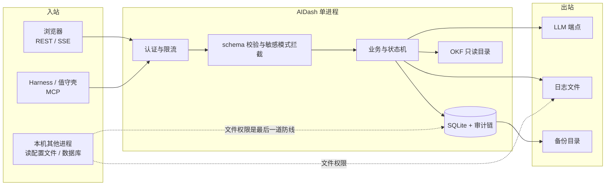

# 06 安全性设计支撑材料（AIDash V2.0）

| 项 | 内容 |
|---|---|
| 文档版本 | V2.0 |
| 日期 | 2026-10-23 |
| 状态 | 3D 完成，待设计评审 |
| 定位 | AIDash 的 safety **唯一正文**；01~05 只保留落到本层的点并引用本文 |
| 上游输入 | 20-spec 的非功能与安全需求、概要设计 ADR-002/007/010、03 §7、04 §1~§5、05 §9、界面设计说明 §6 |
| 下游消费者 | 安全评审、实现、测试用例设计、07 质量记录 |

---

## 0. 定位与写法

本文不是 01~05 的摘要。01~05 回答「怎么做」，本文回答「**什么必须成立、为什么、怎么验证**」。因此本文包含 01~05 没有原句的内容，集中在三块：

1. **威胁模型与信任边界**（§1）——01~05 没有系统列出资产与攻击面。
2. **单位与量纲一致性**（§3）——秒/毫秒/字节/置信度的换算规则，01~05 只在各自章节零散提到单位，没有跨层约束。
3. **人机界面安全属性约束**（§4）——只写字段、确认交互、错误回显，01~05 没有原句。

写完后出索引表（§5）回指 01~05 的落点，供评审逐条追溯。

**本文不含任何真实凭证**。示例一律用 `<token>`、`<api-key>` 占位。

---

## 1. 威胁模型与信任边界

### 1.1 资产

| 资产 | 为什么值钱 | 泄露/损坏后果 |
|---|---|---|
| `AIDASH_TOKEN` | 持有它等于拥有面板全部权限 | 他人可读你的卡片、改任务、伪造回答 |
| LLM API key | 直接产生费用 | 被盗刷 |
| 卡片正文 | 含代码片段、业务判断、交接话术 | 泄露项目信息；被篡改会误导决策 |
| 任务树与证据 | 规划与执行状态的事实源 | 篡改会让「已完成」变假 |
| 审计日志 | 事后追责与取证 | 删除或改写等于销毁证据 |
| OKF 知识库 | 用户长期积累 | 只读；被写坏会污染后续建议 |
| 备份文件 | 数据库全量副本 | 泄露等同数据库泄露 |

### 1.2 攻击面

**信任边界**：

- 浏览器与 harness 都**不可信**；它们送来的一切都要校验，包括 `channel_key`、`card_id`、`markdown`。
- LLM 端点**不可信**；它的输出只作为建议字段，永不直接拼进 SQL、命令或 HTML。
- 本机其他进程不在应用内防护范围，靠操作系统文件权限；这一点必须在部署文档里写明，不能假装应用能防。

### 1.3 主要威胁

| 威胁 | 场景 | 对应要求 |
|---|---|---|
| 令牌泄露 | 日志打印 Authorization、卡片正文贴了令牌 | SAFE-001、SAFE-006 |
| 越权读取 | 反向代理把面板暴露到公网 | SAFE-004 |
| 注入 | 卡片正文含 `<script>` 或 `javascript:` 链接 | SAFE-005、SAFE-008 |
| 路径穿越 | KB 路径 `../../etc/passwd` | SAFE-009 |
| 审计被改 | 直接 UPDATE 审计表 | SAFE-010、SAFE-011 |
| 双认领 | 两个值守壳同时抢一个任务 | SAFE-012 |
| 资源耗尽 | 大量 `card.ask` 长等待 | SAFE-015 |
| 状态绕过 | 未知事件被默认放行 | SAFE-016 |
| 单位错配 | 900 被当成毫秒而非秒 | SAFE-017 |
| 供应链 | 依赖包带恶意 postinstall | SAFE-020 |

---

## 2. 安全性要求（SAFE-001~020）

### 2.1 凭证与认证

#### SAFE-001 令牌只以哈希形式落盘，比较必须常量时间

- **要求**：`AIDASH_TOKEN` 在配置中只保存 `sha256` 哈希；进程启动时读取一次，之后不再从磁盘读。所有日志、审计、错误栈、导出文件不得出现 `Authorization` 头的原文或片段。比较用 `crypto.timingSafeEqual`，长度不等时先补齐再比较，避免用长度差异做旁路。
- **理由**：常量时间比较防时序侧信道；只存哈希让「拿到数据库文件」不等于「拿到令牌」。
- **验证**：单元测试构造不同长度令牌；日志扫描测试断言无 `Bearer ` 原文；代码评审检查比较实现。

#### SAFE-002 只写字段不得可读回

- **要求**：API key、令牌等只写字段写入后，任何读接口只能返回 `configured: true|false`，**不得返回掩码后的片段**（如 `sk-***abc`）。掩码会泄露长度、前缀与尾号，足够用于撞库与社工。
- **理由**：单用户场景下「读回确认」没有业务价值；用户需要的是「是否已配置」。
- **验证**：接口测试断言响应中不含该字段；序列化层测试断言字段被白名单过滤。

#### SAFE-003 令牌轮换必须先验证新令牌可用，再失效旧令牌

- **要求**：轮换分两步：① 新令牌写入并完成一次自检请求；② 自检通过后才撤销旧令牌。任一步失败，旧令牌保持有效。顺序反了会把用户和所有 harness 锁在门外。
- **理由**：轮换是低频、高风险操作；失败必须可回退。
- **验证**：集成测试模拟新令牌无效，断言旧令牌仍可用；界面确认框必须写明影响范围（SAFE-018）。

#### SAFE-004 跨机访问必须 TLS，禁止 CORS 通配

- **要求**：默认只监听 `127.0.0.1`。跨机部署必须经反向代理提供 TLS，且响应不得包含 `Access-Control-Allow-Origin: *`；需要跨域时按来源白名单逐条配置。
- **理由**：Bearer 令牌在明文 HTTP 上等于公开；通配 CORS 让任意网页可代用户发请求。
- **验证**：部署检查脚本扫描监听地址与响应头；集成测试断言 OPTIONS 响应不含 `*`。

### 2.2 输入与输出

#### SAFE-005 所有入站在接入层完成 schema 校验，拒绝未知字段

- **要求**：REST 与 MCP 共用同一份 zod schema；校验失败返回 `INVALID_ARGUMENT`，并在 `details.field` 指出字段路径。**未知字段一律拒绝**，不做「静默忽略」，否则参数名拼错会变成「功能没生效但没报错」。
- **理由**：静默忽略会让调用方以为设置成功；拒绝未知字段能让契约漂移立刻暴露。
- **验证**：契约测试对每个工具/端点发送多一个字段，断言 400；schema 快照对比。

#### SAFE-006 敏感模式命中即拒绝，错误详情只给模式名

- **要求**：卡片正文、标题、话术在写入前用正则扫描令牌、密码、私钥的常见形态。命中返回 `INVALID_ARGUMENT`，`details.pattern` 只给模式名（如 `private_key`），**不回显命中的原文**。
- **理由**：把命中的原文放进错误体，等于把秘密复制到日志和调用方上下文。
- **验证**：单元测试用假令牌断言拒绝且响应不含原文；日志扫描断言无假令牌。

#### SAFE-007 错误消息不回显用户输入，不含路径、SQL、堆栈

- **要求**：对外错误体固定为 `{code, message, request_id, details?}`。`message` 用预置文案；不得拼接用户输入、文件绝对路径、SQL 片段或异常堆栈。堆栈只进本地日志，且日志按 SAFE-001 脱敏。
- **理由**：回显用户输入会让错误页成为反射型注入载体；路径与 SQL 泄露内部结构。
- **验证**：错误路径测试用含 `<script>` 与 `../../` 的输入，断言响应原样不含这些字符串。

#### SAFE-008 Markdown 渲染禁用 HTML 与事件属性，链接协议白名单

- **要求**：渲染前转义 HTML；禁用内联 `<script>`、`on*` 属性、`<iframe>`、`<object>`。链接协议只允许 `http:`、`https:`、`mailto:`；`javascript:`、`data:`、`file:` 一律降级为纯文本。外链加 `rel="noopener noreferrer"`。
- **理由**：卡片正文来自 harness 与 LLM，属于不可信内容；即使服务端已转义，前端二次渲染仍可能被绕过。
- **验证**：前端单元测试覆盖 10 种恶意 payload；E2E 断言页面无脚本执行。

#### SAFE-009 知识库路径必须 resolve + realpath + 前缀校验

- **要求**：只允许访问 `Wiki/` 下的文件。步骤固定为：`path.resolve` 归一化 → `realpath` 解析符号链接 → 断言结果以知识库根目录的真实路径为前缀 → 拒绝 `..`、绝对路径、NUL 字符。
- **理由**：只做字符串前缀判断会被 `Wiki/../../etc/passwd` 绕过；不解析符号链接会被软链逃逸。
- **验证**：单元测试覆盖 8 种穿越 payload；集成测试在知识库放一个指向外部的软链，断言拒绝。

### 2.3 数据完整性与审计

#### SAFE-010 审计与业务写同事务，审计失败则业务失败

- **要求**：一次业务写产生一条审计；两者在同一事务内提交。审计插入失败时整个事务回滚，不允许「业务成功、审计丢失」。
- **理由**：审计是事实源的一部分；允许丢审计等于允许无痕操作。
- **验证**：注入审计表写入失败，断言业务数据未落库。

#### SAFE-011 审计只追加，数据库层阻止 UPDATE/DELETE

- **要求**：审计表通过触发器拒绝 UPDATE 与 DELETE；应用层不提供任何删除/修改审计的 API；迁移脚本不得包含针对审计表的删除语句。哈希链字段把相邻记录串起来，事后校验能发现缺口。
- **理由**：仅靠应用层约束，一次 SQL 注入或误操作就能清空证据；数据库层是最后一道闸。
- **验证**：集成测试直接执行 UPDATE/DELETE，断言被触发器拒绝；迁移脚本静态扫描。

#### SAFE-012 认领必须是单条原子更新

- **要求**：`task.claim` 用 `UPDATE task SET status='claimed', claimed_by=?, claim_expires_at=? WHERE id=? AND status='pending'`，以受影响行数判断成败；不得「先查再改」。续租同样以 `claim_token` 为条件做原子更新。
- **理由**：先查再改在两个进程并发时会出现双认领；单条 UPDATE 由 SQLite 的行锁保证互斥。
- **验证**：10 并发认领测试，断言仅 1 成功；续租与过期竞争测试。

#### SAFE-013 备份必须使用 SQLite Backup API，且备份文件受访问控制

- **要求**：备份用 Backup API 生成一致性快照，完成后计算 sha256 并写入同名 `.sha256`。备份目录权限只给运行用户；备份文件不得放进 Web 可访问目录。恢复前校验哈希，不匹配拒绝。
- **理由**：WAL 模式下直接复制 `.db` 可能漏页；备份含全量正文，暴露面等同数据库。
- **验证**：备份/恢复集成测试；部署检查脚本扫描备份目录权限与位置。

### 2.4 可用性与故障安全

#### SAFE-014 增强、LLM、KB 失败一律降级，不阻断决策

- **要求**：`enrichment` 失败写 `status='unavailable'` 并记录原因；KB 不可用时卡片照常显示与回答；LLM 超时 5 秒后放弃。任何增强失败都不得让 `card.post` 或 `card.answer` 失败。
- **理由**：增强是锦上添花；让它阻断主链路，等于把可选依赖变成单点故障。
- **验证**：集成测试停掉 LLM/KB，断言发卡与答题仍成功；`enrichment.status` 为 `unavailable`。

#### SAFE-015 有界阻塞与并发上限防止资源耗尽

- **要求**：`card.ask` 的 `wait_seconds` 上限 300 秒；同时挂起的等待请求有上限（默认 32），超过返回 `BUSY` 并可重试。等待发生在内存，不占用数据库事务。
- **理由**：无限等待会让少量客户端拖垮进程；占着事务等待会锁库。
- **验证**：并发压测 33 个 `card.ask`，断言第 33 个返回 `BUSY`；等待期间数据库仍可写。

#### SAFE-016 未知状态与未知事件一律拒绝

- **要求**：状态机只接受转移表中列出的 `event`；未知 `event` 返回 `INVALID_ARGUMENT`，非法转移返回 `CONFLICT`。禁止「默认放行」或「忽略未知事件」。
- **理由**：默认放行会让拼错的 `event` 静默成功，状态停在原地却以为已推进。
- **验证**：状态机测试矩阵覆盖每个状态的未知事件；断言错误码。

### 2.5 单位、界面与供应链

#### SAFE-017 时间、字节、置信度的单位在跨层处只换算一次

- **要求**：
  - 时间：HTTP/MCP 契约层用**秒**（`lease_seconds`、`wait_seconds`），数据库与内存用**毫秒整数**；换算只允许发生在接入层的一个函数里，业务层不得再乘除 1000。
  - 字节：`*_md` 的长度上限按 UTF-8 编码后的字节数计算，不按字符数；中文一个字符通常占 3 字节。
  - 置信度：统一 `0.0~1.0`；界面显示百分比时向下取整，`0.999` 显示 `99%`，不得显示 `100%` 除非确实为 1.0。
- **理由**：单位错配是本项目最容易出的 bug（900 秒被当毫秒，卡片大小按字符算导致中文超限）。
- **验证**：单位换算单元测试；用 64KB 中文正文测边界；置信度边界测试。

#### SAFE-018 破坏性操作必须复述对象与后果

- **要求**：归档、令牌轮换、重建索引、整批回答的确认框必须写明「对什么对象、产生什么不可逆后果、如何恢复」。只写「确定吗？」不算确认。令牌轮换必须写明「所有 harness 将立即 401」。
- **理由**：确认框的价值在于让用户知道后果；空泛确认只是形式。
- **验证**：界面走查清单逐项核对；E2E 断言确认文案含对象与后果。

#### SAFE-019 时间一律存 UTC，显示按本地时区，不信任客户端时间

- **要求**：所有时间戳存 UTC 毫秒整数；接口传输 ISO 8601 UTC；界面显示时转换为用户本地时区。服务端不接收客户端提供的「当前时间」，到期、租约、保留策略一律用服务端时钟。
- **理由**：客户端时间可被篡改；时区混用会让到期判断漂移。
- **验证**：单元测试注入固定 Clock；跨时区显示测试；客户端伪造时间测试。

#### SAFE-020 依赖锁定、审计与许可证清单

- **要求**：提交锁文件；CI 执行 `npm audit --audit-level=high`，高危阻断；禁止引入带 `postinstall` 脚本且来源不明的包；第三方许可证单列（见 4A 规格）。升级依赖必须走变更记录。
- **理由**：供应链攻击最常见入口是安装脚本与拼写相近的包名。
- **验证**：CI 日志；`npm audit` 输出；许可证清单与锁文件比对。

---

## 3. 单位与量纲一致性（本文新增约束）

这一节是 01~05 没有的跨层规定。它不重复各文档的单位说明，而是给出**唯一换算点**。

| 量 | 契约层单位 | 存储层单位 | 唯一换算点 | 禁止 |
|---|---|---|---|---|
| 租约、等待、超时 | 秒 | 毫秒整数 | 接入层 `toMillis()` | service 内再乘 1000 |
| 保留天数 | 天 | 毫秒（天×86400000） | 配置加载时一次换算 | 运行中按天比较 |
| 卡片正文大小 | 字节（UTF-8） | 字节 | 校验函数 `utf8Bytes()` | `string.length` |
| 置信度 | 0.0~1.0 小数 | 0.0~1.0 小数 | 无 | 存百分数 |

**边界测试要求**：64 KB 正文用纯中文构造，必须刚好拒绝；299 秒等待成功、301 秒拒绝；`0.999` 显示为 99%。

---

## 4. 人机界面安全属性约束（本文新增约束）

这一节约束界面设计说明里的可写属性；界面文档负责「怎么摆」，本文负责「什么不能做」。

1. **只写字段不可读回**：API key、令牌在界面上只能显示「已配置/未配置」。不得显示掩码、长度、尾号（SAFE-002）。
2. **确认必须含对象与后果**：见 SAFE-018。确认框的文案要能在评审时逐字念出来。
3. **错误提示不回显输入**：界面把服务端错误原样展示时，服务端已按 SAFE-007 脱敏；前端不得把用户刚输入的原文拼进提示。
4. **权限边界**：界面不得提供「认领/释放任务」按钮，因为 `claim_token` 不能出现在前端；也不得提供「新建卡片」入口，因为卡片的事实源是 harness。
5. **导出与复制**：复制交接话术只复制 `message_md`；任何导出功能都不得包含令牌、API key、审计 `detail_json` 以外的敏感字段。
6. **会话失效**：401 时清空前端缓存中的卡片正文，避免共享电脑上留下内容。

---

## 5. 安全性要求索引（回指 01~05）

| ID | 一句话 | 06 § | 落到 01~05 哪节 | 验证方式 |
|---|---|---|---|---|
| SAFE-001 | 令牌只存哈希、常量时间比较、日志脱敏 | §2.1 | 03 §7；04 §1.2 | 单测 + 日志扫描 |
| SAFE-002 | 只写字段不可读回 | §2.1 | 04 §3.1；界面 §6.4/6.6 | 接口测试 |
| SAFE-003 | 轮换先验证新令牌再失效旧令牌 | §2.1 | 03 §3.7；界面 §6.6 | 集成测试 |
| SAFE-004 | 跨机 TLS、禁止 CORS 通配 | §2.1 | 02 §2.3；05 §8 | 部署扫描 + 集成测试 |
| SAFE-005 | 入站 schema 校验、拒绝未知字段 | §2.2 | 03 §3.1；04 §1.3 | 契约测试 |
| SAFE-006 | 敏感模式拒绝且不回显原文 | §2.2 | 03 §3.2.4、§7 | 单测 + 日志扫描 |
| SAFE-007 | 错误体不回显输入/路径/SQL/堆栈 | §2.2 | 03 §6.1；04 §2 | 错误路径测试 |
| SAFE-008 | Markdown 白名单与链接协议 | §2.2 | 03 §3.8.4；界面 §3.4 | 前端单测 + E2E |
| SAFE-009 | KB 路径 resolve + realpath + 前缀 | §2.2 | 03 §3.6；04 §5.3 | 单测 + 集成测试 |
| SAFE-010 | 审计与业务同事务 | §2.3 | 03 §3.7.2；05 审计表 | 故障注入 |
| SAFE-011 | 审计只追加、触发器阻止改删 | §2.3 | 05 §3、§9 | 集成测试 + 脚本扫描 |
| SAFE-012 | 认领单条原子更新 | §2.3 | 03 §5.2 | 并发测试 |
| SAFE-013 | 备份用 Backup API 且受访问控制 | §2.3 | 05 §9 | 备份恢复测试 |
| SAFE-014 | 增强/LLM/KB 失败降级 | §2.4 | 03 §3.5；02 SUB-04 | 依赖停用测试 |
| SAFE-015 | 有界阻塞与并发上限 | §2.4 | 04 §4.6；03 §3.4 | 并发压测 |
| SAFE-016 | 未知状态/事件一律拒绝 | §2.4 | 03 §4.5 | 状态机矩阵 |
| SAFE-017 | 时间/字节/置信度单位只换算一次 | §2.5、§3 | 04 §1.6；05 §1 | 边界测试 |
| SAFE-018 | 破坏性操作复述对象与后果 | §2.5、§4 | 界面 §6 | 走查 + E2E |
| SAFE-019 | UTC 存储、本地显示、不信客户端时间 | §2.5 | 04 §1.6 | Clock 注入测试 |
| SAFE-020 | 依赖锁定、审计、许可证清单 | §2.5 | 03 §1.3；4A 规格 | CI + 清单比对 |

**索引完整性**：SAFE-001~020 共 20 条，本表 20 行，无遗漏。

---

## 6. 自检

| # | 检查项 | 结论 | 依据 |
|---|---|---|---|
| 1 | 06 是自己成文的正文，不是 01~05 的摘抄？ | 通过 | §1 威胁模型、§3 单位一致性、§4 界面约束是 01~05 没有的正文；§2 每条按「要求/理由/验证」重写，不是复述实现 |
| 2 | 03 的安全性要求索引生成了吗？06 的每个 ID 都在索引里出现？ | 通过 | §5 索引 20 行；03 §7.1 已挂回 |
| 3 | 每条 SAFE 都有验证方式？ | 通过 | §2 每条「验证」项 + §5 验证方式列 |
| 4 | 是否包含真实凭证？ | 通过 | 全文无真实令牌；示例用 `<token>`、`<api-key>` 占位 |
| 5 | 是否越权改写 01~05？ | 通过 | 只新增本文与 03 的索引节；01~05 正文未改 |
| 6 | 版本头是否统一？ | 通过 | 本文 V2.0 / 2026-10-23，与包内其他文档一致 |

**无法判断项**：SAFE-004 的部署检查脚本尚未实现，当前只能做人工走查；待 4B 实测补充。
