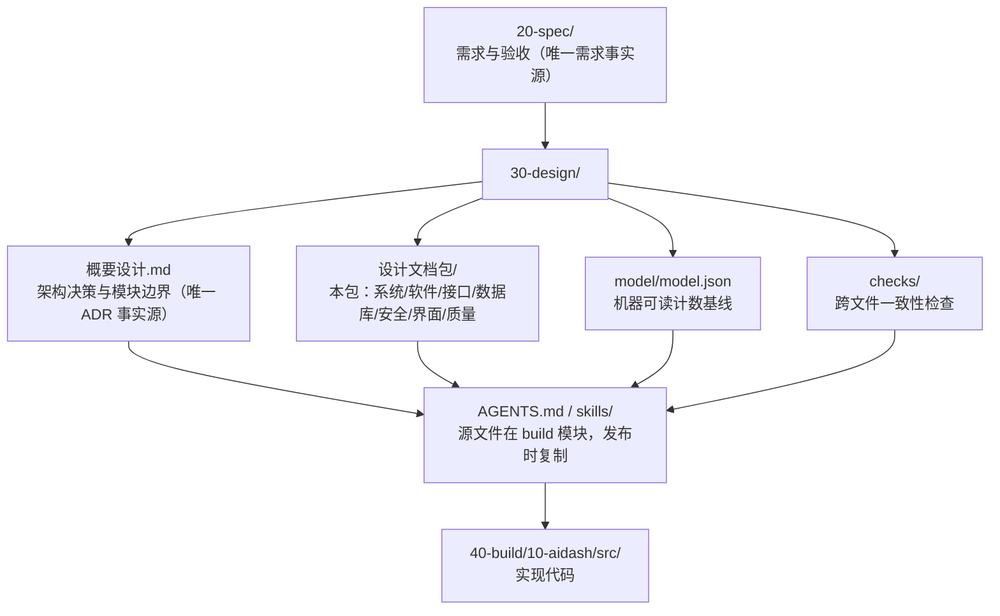

# AIDash 设计文档包 — 核心包导航

**版本**：V2.0
**日期**：2026-10-23
**适用范围**：`20-spec/需求与验收判据文档.md` V2.0 对应的全部设计文件

---

## 1. 这个包是什么

这是 AIDash V2.0 的**设计基线**：从需求到接口到表结构的完整闭环。它不是“参考资料”，而是评审、开发、验收的共同依据。

**一条判断标准**：如果代码行为与包内文档冲突，以文档为准；如果文档之间冲突，按 `01-设计总纲` §2 的权威顺序裁决。

---

## 2. 文件清单与阅读顺序

| 顺序 | 文件 | 读它是为了 | 建议读者 |
|---|---|---|---|
| 1 | [`01-设计总纲与设计基线管理.md`](01-设计总纲与设计基线管理.md) | 知道谁说了算、编号怎么查、风险在哪 | 所有人 |
| 2 | [`02-系统-子系统设计说明.md`](02-系统-子系统设计说明.md) | 知道系统边界、部署形态、故障域 | 架构/评审 |
| 3 | [`03-软件设计说明.md`](03-软件设计说明.md) | 知道模块怎么实现、状态怎么转 | 开发 |
| 4 | [`04-接口设计说明.md`](04-接口设计说明.md) | 知道 MCP/REST/CLI 的字段与错误码 | 开发/接入方 |
| 5 | [`05-数据库设计说明.md`](05-数据库设计说明.md) | 知道表、索引、迁移、备份 | 开发/运维 |
| 6 | [`06-安全性设计支撑材料.md`](06-安全性设计支撑材料.md) | 知道威胁模型、SAFE 要求、验证方式 | 安全/评审/开发 |
| 7 | [`07-质量记录包.md`](07-质量记录包.md) | 知道评审/验证/确认/更改做到哪一步 | 评审/质量 |
| 8 | [`界面设计说明.md`](界面设计说明.md) | 知道 5 个界面的区域、属性表与交互闭环 | 前端/评审 |
| 9 | 本文件 | 导航与自检 | 新人/评审 |

**上游**：`20-spec/需求与验收判据文档.md`、`30-design/概要设计.md`。
**下游**：`40-build/10-aidash/AGENTS.md`、两个模块下的 `skills/`、实现代码、验收脚本。
**包外**：阶段 4 的 `../技术规格清单.md` 与 `../技术验证意见.md` 不属于设计基线，只引用本包结论。

---

## 3. 编号总表

| 前缀 | 含义 | 定义方 | 数量 |
|---|---|---|---|
| `REQ-FN-` | 功能需求 | `20-spec` | 64 |
| `ACC-` | 验收准则 | `20-spec` | 64（+1 条 E2E） |
| `NF-` | 非功能需求 | `20-spec` | 15 |
| `XIF-` | 外部接口 | `20-spec` | 10 |
| `DQ-` | 设计裁决 | `20-spec` §8.2 | 10 |
| `ADR-` | 架构决策 | `30-design/概要设计.md` | 15 |
| `MOD-` | 模块 | `30-design/概要设计.md` | 11 |
| `SM-` | 状态机 | `03` §4.4 | 4 |
| `TBL-` | 数据表 | `05` §3 | 12 |
| `MCP-` | MCP 工具 | `04` §4 | 19 |
| `R-` | 风险 | `30-design/概要设计.md` §12 | 20 |
| `SYS-` | 系统 | `02` §2.1 | 4 |
| `SCR-` | 界面 | `界面设计说明.md` §1 | 5 |
| `GAP-` | 界面/契约缺口 | `界面设计说明.md` §7.3 | 14 |
| `SAFE-` | 安全性要求 | `06` §2 | 20 |

> 机器可读版本见 [`../model/model.json`](../model/model.json)。

---

## 4. 自检

在仓库根目录执行：

```bash
node 30-design/设计文档包/checks/文档包自检.mjs
node 30-design/设计文档包/checks/结构计数交叉核对.mjs
node 30-design/checks/三边一致.mjs
```

三条全部退出码 0，才算文档包自洽。检查内容：

| 脚本 | 检查什么 |
|---|---|
| `文档包自检.mjs` | 文件齐全（01~07 + 界面 + 本文件）、版本头、必备章节（01 §4.4 风险索引、03 §4.4 状态机）、SCR/GAP/SAFE 编号齐全、编号范围无越界 |
| `结构计数交叉核对.mjs` | 文档中实际出现的编号数量 vs `model.json` 声明 |
| `三边一致.mjs` | 需求 → 设计覆盖；设计引用不悬空；model 计数与实际一致 |

---

## 5. 本包与其他目录的关系



---

## 6. V2.0 相对 V1 的关键变化

| 变化 | 影响文件 |
|---|---|
| 删除“调度总台”定位，改为“决策面板” | 全部 |
| 删除 Runner/Adapter/AgentCard/attempt/gate | 01、02、03 |
| 新增通道/卡片/决策/交接 | 02、03、04、05 |
| 新增值守壳 CLI | 02 §3、03 §3.9、04 §7 |
| 不集成外部工单系统 | 02 §4、03 §3.11、04 §8 |
| OKF 只读 + FTS5 | 03 §3.6、05 §3.9 |
| 风险从 30 条重登为 20 条 | 01 §4.4、概要设计 §12 |

---

## 7. 变更记录

| 版本 | 日期 | 变更 |
|---|---|---|
| V2.0 | 2026-10-23 | 新建 V2.0 设计包；V1 全量归档至 `90-archive/v1-agent-sys/` |

---

## 8. 自检（本文件）

| 检查项 | 结论 |
|---|---|
| 是否列出全部包内文件？ | 是（§2，9 个） |
| 是否给出阅读顺序？ | 是（§2） |
| 是否给出编号总表？ | 是（§3，15 类） |
| 是否给出自检命令？ | 是（§4） |
| 是否说明与上下目录关系？ | 是（§5） |
| 是否说明 V1→V2 变化？ | 是（§6） |
