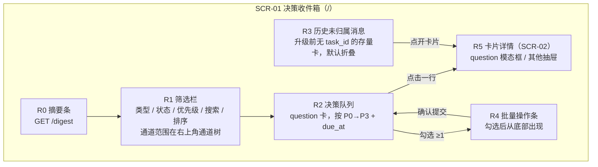
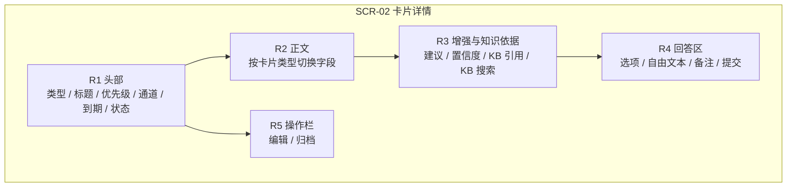
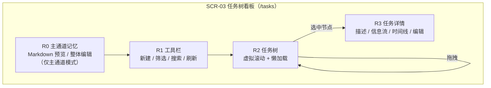
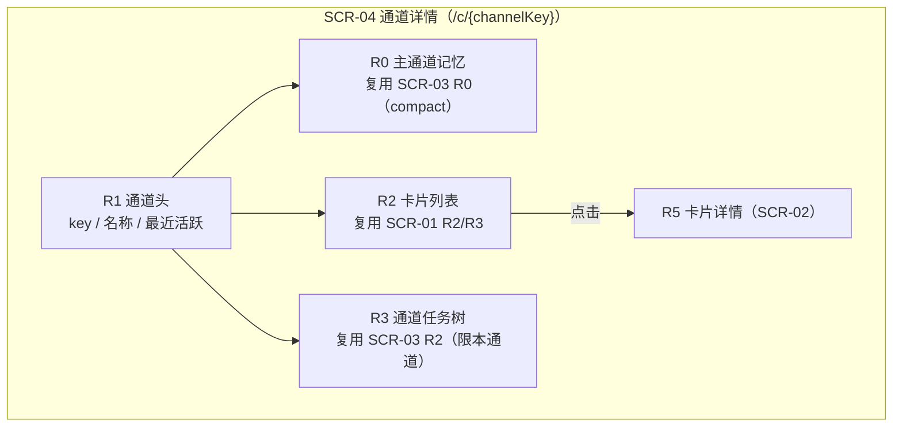
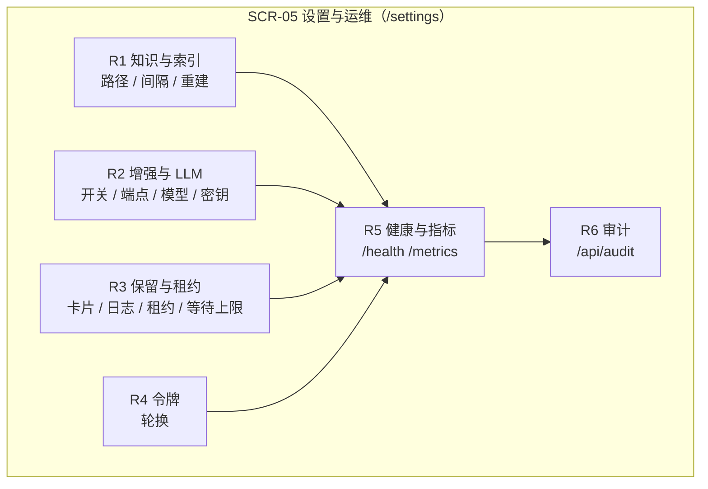

# 界面设计说明（AIDash V2.0）

| 项 | 内容 |
|---|---|
| 文档版本 | V2.0 |
| 日期 | 2026-10-23 |
| 状态 | 3C2 完成，待设计评审 |
| 上游输入 | 20-spec 需求与验收判据；30-design 概要设计；本包 03 模块划分、04 接口字段 |
| 下游消费者 | 前端实现、界面评审、3D 安全性约束回指 |

---

## 0. 范围与约定

### 0.1 本轮判据

本项目有需要人工操作的界面（看卡、答题、排任务、改设置），且界面属性必须与 REST 字段一一对应，满足 3C2 的触发条件。`aidash-runner`（旧名 `aidash-watch`）是命令行程序，不在本轮界面范围。

### 0.2 图与表的关系

每张 Mermaid 图只表达**区域怎么分块、块之间怎么走**；取值范围、缺省值、接口字段以属性表为准。图与表冲突时，以表为准并登记为待修。

### 0.3 三方校验的降级说明

本轮未做 3B 孪生程序集，因此「孪生信号」一列统一标 `N/A（未做 3B）`。实际执行的是两方校验：**界面属性 → 接口字段**。这是降级，不是通过；在 3D 的认知对齐里如实记录。

### 0.4 缺口编号

`GAP-xx` 表示「界面需要、但 04 现有契约没有定义」的条目。按 3C2 纪律，本轮**只登记、不改接口**，由下一轮 3C2 或 3A 处置。

---

## 1. 界面清单

| 编号 | 界面 | 一句话目的 | 对应模块/用例 | 路由 |
|---|---|---|---|---|
| SCR-01 | 决策收件箱 | 一屏看完待拍板的决策卡，能批量推进；信息流在任务详情 | MOD-008；REQ-FN-007/008 | `/` |
| SCR-02 | 卡片详情 | 看清一张卡的背景、增强建议与知识依据，并作答；`question` 用大模态框，其他类型用右侧抽屉 | MOD-008、MOD-004；REQ-FN-006/007 | `/` 内浮层（深链 `?card={id}`） |
| SCR-03 | 任务树看板 | 排布任务层级、改状态、移动/复制子树 | MOD-008、MOD-003；REQ-FN-014~021 | `/tasks` |
| SCR-04 | 通道详情 | 按通道看卡片与该通道的任务树 | MOD-008；REQ-FN-001/008 | `/c/{channelKey}` |
| SCR-05 | 设置与运维 | 改知识库/增强/保留配置，查健康与审计 | MOD-008、MOD-007；REQ-FN-059~062 | `/settings` |

**为什么没有「新建卡片」界面**：卡片的产生者是 harness（MCP-004），用户只在网页上处理卡片。REST 的 `POST /api/cards` 保留给脚本与调试，不在界面开入口；这一条在 §7.2 单独列出，避免被误读为漏画。

**为什么知识库不单独成页**：知识检索的使用场景是「看某张卡时顺手查依据」，独立成页会让用户在两页之间来回跳。它作为 SCR-02 的 R3 出现，接口仍是 `GET /api/kb/search` 与 `GET /api/kb/doc`。

**路由写法说明**：实现使用 hash 路由，浏览器地址实际为 `#/`、`#/tasks`、`#/c/{channelKey}`、`#/settings`；
卡片详情是叠加在当前页上的 `?card={id}`：`question` 卡渲染为居中模态框，其他类型仍是右侧抽屉。服务端始终只看到 `/`，因此不需要为每个前端路由配置回退。
上表写的是逻辑路径，不含 `#`；`#/kb` 独立页已在 3C2 对齐时删除，知识库只在卡片详情内出现。

**通道范围只有一个入口**：决策台与任务树不再各自渲染通道下拉，统一由右上角「通道」树控制。树根「全部通道」= 清空 `project` 与 `channel_key`；主对话行 = 只按 `project` 聚焦；单通道行 = 只按 `channel_key` 过滤。三者互斥，点一次即生效，不再需要「选全部通道 + 再点聚焦全部」两步。

---

## 2. SCR-01 决策收件箱

### 2.1 目的

用户打开面板的第一屏，只回答「有什么在等我拍板」。信息流已归到任务详情——一条消息必须属于某个任务，决策台不再承担消息列表；升级前遗留的无归属卡收在页面底部默认折叠的「历史未归属消息」里，数量为 0 时整块不显示。

### 2.2 区域划分

**为什么 R0 与 R1 分开**：摘要条是「今天整体怎么样」，筛选栏是「我现在只想看什么」。合并会让摘要随筛选变化，失去全局意义。

**为什么 R3 不再是信息流**：信息流挪进任务详情后，消息才有上下文（属于哪件事、之前发生了什么）；决策台若继续承载消息，agent 会继续往这里发流水，用户又要在两个地方找同一件事。新卡已由服务端强制挂任务，这个区只减不增。

### 2.3 R1 筛选栏属性表

| 属性名 | 分组 | 唯一 key | 读写类型 | 控件类型 | 取值范围或枚举 | 缺省值 | 关联接口字段 |
|---|---|---|---|---|---|---|---|
| 项目聚焦 | filter | `f.project` | 可写 | 右上角通道树的「主对话」行 | 来自 `GET /api/channels` 的 `project` 去重；允许空 | 全部 | `GET /api/cards?project=` |
| 通道筛选 | filter | `f.channel_key` | 可写 | 右上角通道树的「单通道」行 | 来自 `GET /api/channels` 的 `channel_key`；选项文案为 `project / topic`；允许空 | 全部 | `GET /api/cards?channel_key=` |
| 状态筛选 | filter | `f.status` | 可写 | 多选标签 | `open,answered,expired,archived`（以 03 §4.4 SM-002 为准） | `open` | `GET /api/cards?status=` |
| 优先级筛选 | filter | `f.priority` | 可写 | 多选标签 | `P0,P1,P2,P3` | 全部 | `GET /api/cards?priority=` |
| 搜索词 | filter | `f.q` | 可写 | 文本框（输入防抖 300ms） | 1~200 字符；空白视为未填 | 空 | `GET /api/cards?q=` |
| 含归档 | filter | `f.include_archived` | 可写 | 复选框 | `true / false` | `false` | `GET /api/cards?include_archived=` |
| 排序字段 | filter | `f.sort` | 可写 | 下拉单选 | `priority,due_at,created_at,updated_at` | `priority` | `GET /api/cards?sort=` |
| 排序方向 | filter | `f.order` | 可写 | 下拉单选 | `asc,desc` | `asc`（优先级 P0 在前） | `GET /api/cards?order=` |
| 每页条数 | paging | `f.page_size` | 可写 | 下拉单选 | 20 / 50 / 100；上限 200 | 50 | `GET /api/cards?page_size=` |
| 刷新 | action | `a.refresh` | 可写 | 按钮 | — | — | 重新发起当前查询 |

**类型固定为 `question`**：决策台只筛拍板卡，筛选栏不再提供类型勾选。其他类型的卡只能在任务详情信息流里看到。

**筛选与分页的组合规则**：任一筛选变化都把 `page` 重置为 1。这条是前端行为，接口没有对应字段。

**右上角通道树显示什么**：每组主对话显示「N 通道 · N 卡 · N 待处理」与「开始 `YYYY-MM-DD HH:mm`」；**在线状态只看 `agent_online`**（`last_mcp_at` 距今 ≤ 180 秒）——在线时显示转圈动画与「在线」，否则显示「已停止 · 最后活动 `YYYY-MM-DD HH:mm`」，没有 MCP 记录时显示「已停止 · 无 MCP 活动记录」。开始时间取组内最早 `created_at`，最后活动时间取组内最大 `last_active_at`（回退 `updated_at`）。单通道行额外显示自己的卡数、任务数与待处理数。这些字段全部来自 `GET /api/channels`，没有新增接口。

**为什么在线不能沿用“有未结束任务”**：旧实现把 `open_task_count > 0` 当成“进行中”，于是 agent 早已停止、只剩一条遗留 `pending` 任务时，通道仍会转圈，用户无法判断 MCP 到底还活不活着。任务数回答“还有多少活”，`last_mcp_at` 回答“agent 最近有没有在调 AIDash”，两者必须分开显示；阈值与 harness 心跳共用 `AIDASH_OFFLINE_THRESHOLD_SECONDS`。

### 2.4 R2 决策队列属性表

| 属性名 | 分组 | 唯一 key | 读写类型 | 控件类型 | 取值范围或枚举 | 缺省值 | 关联接口字段 |
|---|---|---|---|---|---|---|---|
| 行选中 | selection | `s.selected_ids` | 可写 | 复选框（多选） | 卡片 ID 集合，单次 ≤200 | 空集 | 本地状态；提交时映射为 `items[].card_id` |
| 卡片 ID | identity | `c.id` | 只读 | 隐藏（行 key） | `cd_` 前缀 | — | `id` |
| 标题 | content | `c.title` | 只读 | 文本，最多 2 行截断 | ≤200 字符 | — | `title` |
| 通道 | context | `c.channel_key` | 只读 | 标签 | `project / topic`（主对话 / 子对话；`host` 不占主视觉） | — | `channel_key` |
| 工作路径 | context | `c.workdir` | 只读 | 等宽文本，单行截断（悬停显示全路径） | ≤500 字符 / `null` | 空（显示「未登记」） | `workdir` |
| 优先级 | context | `c.priority` | 只读 | 徽标 | `P0,P1,P2,P3` | — | `priority` |
| 到期时间 | context | `c.due_at` | 只读 | 相对时间（悬停显示绝对时间） | ISO 8601 或 `null` | `null` | `due_at` |
| 阻塞标记 | context | `c.blocking` | 只读 | 图标 | `true / false` | `false` | `blocking` |
| 选项数 | content | `c.options_count` | 只读 | 数字 | 2~10 | — | `options.length` |
| 增强状态 | enhancement | `c.enrichment_status` | 只读 | 徽标 | `pending,running,done,unavailable,skipped`（见 03 §3.5） | `pending` | `enrichment.status` |
| 建议摘要 | enhancement | `c.enrichment_excerpt` | 只读 | 文本，单行截断 | ≤120 字符 | 空 | `enrichment.analysis_md`（截断，不新增字段） |
| 推荐选项 | enhancement | `c.recommended_option` | 只读 | 徽标（主推荐实心、备选描边） | `recommendation_role='primary'` 的选项；`backup` 以次级样式并列显示 | 无 | `options[].recommendation_role`（旧 `recommendation` 仅对历史卡兜底） |

**为什么「推荐选项」单独列**：`recommendation_role` 是数组内字段，列表页需要在行上直接显示，否则用户必须点开才知道哪个是主推荐、哪个是备选。

### 2.5 R3 历史未归属消息属性表

| 属性名 | 分组 | 唯一 key | 读写类型 | 控件类型 | 取值范围或枚举 | 缺省值 | 关联接口字段 |
|---|---|---|---|---|---|---|---|
| 折叠状态 | interaction | `l.expanded` | 可写 | `
` 折叠区 | 展开 / 收起 | 收起 | 本地状态，不落库 |
| 历史卡数量 | summary | `l.count` | 只读 | 文本 | 0~n；为 0 时整块不渲染 | 0 | `GET /api/cards?unassigned=true&type=info,handoff,suggestion,status,artifact` 的 `total` |
| 类型 | identity | `l.type` | 只读 | 徽标 | 非 `question` 五类 | — | `type` |
| 标题或摘要 | content | `l.headline` | 只读 | 文本，单行截断 | ≤200 字符 | — | `title`；无标题时取 `summary` |
| 创建时间 | context | `l.created_at` | 只读 | 相对时间（悬停显示绝对时间） | ISO 8601 | — | `created_at` |
| 打开卡片 | action | `a.open_legacy` | 可写 | 行点击 | — | — | 打开 SCR-02 抽屉；可在抽屉内归档 |

**为什么保留这个区**：4.0 之前产生的卡没有 `task_id`，无法进入任务信息流。直接隐藏会让用户丢数据；给一个固定入口，数量为 0 时整块消失。它不参与通道/筛选，避免“换了个筛选就找不到”。

**为什么不在折叠区里继续展示完整字段**：严重度、交接对象、交接渠道、执行结果等字段在卡片抽屉里能看全；折叠列表只负责“让人发现还有几条存量”，重复铺开等于把刚拆掉的信息流又装回来。

### 2.6 R4 批量操作条属性表

| 属性名 | 分组 | 唯一 key | 读写类型 | 控件类型 | 取值范围或枚举 | 缺省值 | 关联接口字段 |
|---|---|---|---|---|---|---|---|
| 已选数量 | summary | `b.count` | 只读 | 文本 | 0~200 | 0 | 本地 `s.selected_ids.size` |
| 统一动作 | action | `b.action` | 可写 | 单选按钮组 | `option_a` / `reject` / `later` | 无（未选时提交禁用） | `items[].option_id`；`reject`/`later` 无对应字段（GAP-05） |
| 不可应用预览 | preview | `b.inapplicable_ids` | 只读 | 列表（标红） | 卡片 ID 集合 | 空 | 04 未定义「某卡为何不能应用某动作」的字段（GAP-06） |
| 影响条数 | preview | `b.affected_count` | 只读 | 文本 | 0~200 | 0 | 本地计算 |
| 部分成功 | option | `b.partial` | 可写 | 复选框 | `true / false` | `false` | `POST /api/cards/batch-answer` 的 `partial` |
| 提交 | action | `a.batch_submit` | 可写 | 主按钮（二次确认） | — | — | `POST /api/cards/batch-answer` |
| 结果统计 | result | `b.result_summary` | 只读 | 文本 | `成功 n / 失败 m` | — | 响应包络 `data`（04 §1.3） |

### 2.7 交互闭环（SCR-01）

1. **进入**：浏览器带 Bearer 打开 `/` → 并发请求 `GET /api/digest`、`GET /api/channels`、`GET /api/cards?type=question&status=open`，以及 `GET /api/cards?unassigned=true&type=info,handoff,suggestion,status,artifact`（历史存量，独立于筛选）；右上角通道树按 `project` 分组，主对话在前、子对话随后。
2. **操作**：改筛选 → 重新查询；点通道树根节点 = 全部通道，点主对话行 = 跨该项目的全部 `topic`，点单通道行 = 收窄到单个子对话（三者互斥）；点行 → 打开 SCR-02；勾选 → 出现 R4；展开 R3 → 查看/打开历史存量卡。
3. **反馈**：列表显示加载骨架；查询失败在列表区显示错误与「重试」；SSE 有新 `question` 时在 R2 顶部插入并提示「1 条新卡」。信息卡不再在决策台提示，未读红点显示在任务树。
4. **批量提交**：确认 → `POST /api/cards/batch-answer` → 成功刷新两列并显示统计；失败按 `partial` 决定整批回滚或保留成功项，并列出失败卡。
5. **退出/失败**：关闭页面无副作用；401 → 跳转令牌设置提示；`BUSY` → 提示「服务繁忙，稍后重试」并保留已选；网络断开 → 顶部常驻告警，SSE 退化为 30 秒轮询。

---

## 3. SCR-02 卡片详情（question 模态框 / 其他卡抽屉）

### 3.1 目的

让用户在一屏内完成「读懂这张卡 → 看 AI 建议与知识依据 → 作答或归档」。`question`（拍板）卡信息量大，改用居中大模态框；其他类型仍用右侧抽屉，不遮挡列表，关闭后回到原位。

**为什么拍板卡不用抽屉**：四段背景 + 2~10 个选项 + 每个选项的优缺点，抽屉宽度放不下，用户必须不停上下滚。模态框用左右两栏（左背景、右选项）把信息并排，宽屏下两栏各自滚动；窄屏自动退化为单列，整页滚动。

### 3.2 区域划分

**拍板模态框的自适应规则**：

- 宽度 ≥1100px：`.question-modal-body` 两列（左栏背景/增强，右栏选项/回答），两栏独立滚动；四段背景在左栏内再分两列，尽量把内容压进一屏。
- 宽度 <1100px：两栏合并为单列，整体滚动；背景四段改为单列。
- 宽度 <760px：模态框全屏，隐藏快捷键提示，关闭按钮保持可见。
- 打开时锁定 `body` 滚动；点遮罩、Esc 或 × 关闭。

**键盘操作（仅限打开态的 `question` 卡）**：

| 按键 | 行为 | 备注 |
|---|---|---|
| `1`~`9` | 选中第 1~9 个选项 | 第 10 个选项用 `0` |
| `Enter` | 提交当前选择 | 焦点在按钮/链接上时交给原生行为，避免双提交 |
| `←` / `→` | 切到当前通道范围内上一张 / 下一张待决策卡 | 范围与右上角通道树一致，按 `created_at` 升序 |
| `Esc` | 关闭模态框 | — |

**回答后仍展示全部选项**：选中项保留高亮与「已选」徽标，未选中项灰显（`.unselected`）但不隐藏；用户需要回看当时还有哪些方案，才能复盘取舍。

### 3.3 R1 头部属性表

| 属性名 | 分组 | 唯一 key | 读写类型 | 控件类型 | 取值范围或枚举 | 缺省值 | 关联接口字段 |
|---|---|---|---|---|---|---|---|
| 卡片标题 | identity | `d.title` | 只读 | 标题文本 | ≤200 字符 | — | `title` |
| 卡片类型 | identity | `d.type` | 只读 | 徽标 | 六类型枚举 | — | `type` |
| 卡片状态 | context | `d.status` | 只读 | 徽标 | 03 §4.4 SM-002 的状态集 | — | `status` |
| 优先级 | context | `d.priority` | 只读 | 徽标 | `P0~P3` | — | `priority` |
| 通道 | context | `d.channel_key` | 只读 | 标签 + 跳转 SCR-04 | `host/project/topic` | — | `channel_key` |
| 到期时间 | context | `d.due_at` | 只读 | 绝对时间 | ISO 8601 / `null` | `null` | `due_at` |
| 阻塞标记 | context | `d.blocking` | 只读 | 图标 | `true / false` | `false` | `blocking` |

### 3.4 R2 正文属性表

正文按类型切换，六个属性互斥显示。

| 属性名 | 分组 | 唯一 key | 读写类型 | 控件类型 | 取值范围或枚举 | 缺省值 | 关联接口字段 |
|---|---|---|---|---|---|---|---|
| 信息正文 | content | `d.body_md` | 只读 | Markdown 渲染 | ≤64 KB | — | `body_md`（info） |
| 问题背景（议题背景） | content | `d.background_md` | 只读 | Markdown 渲染 | ≤64 KB | — | `background_md`（question） |
| 达到目的或结果 | content | `d.goal_md` | 只读 | Markdown 渲染 | ≤64 KB | 历史卡显示「未提供」 | `goal_md`（question，002 新增） |
| 调查参考 | content | `d.research_md` | 只读 | Markdown 渲染 | ≤64 KB | 历史卡显示「未提供」 | `research_md`（question，002 新增） |
| 决策项描述 | content | `d.decision_md` | 只读 | Markdown 渲染 | ≤64 KB | 历史卡显示「未提供」 | `decision_md`（question，002 新增） |
| 交接话术 | content | `d.message_md` | 只读 | Markdown 渲染 + 复制按钮 | ≤16 KB | — | `message_md`（handoff） |
| 分析正文 | content | `d.analysis_md` | 只读 | Markdown 渲染 | ≤64 KB | — | `analysis_md`（suggestion） |
| 状态摘要 | content | `d.summary` | 只读 | 文本 | ≤200 字符 | — | `summary`（status） |
| 状态详情 | content | `d.detail_md` | 只读 | Markdown 渲染 | ≤64 KB | 空 | `detail_md`（status） |
| 产物地址 | content | `d.url` | 只读 | 链接 + 复制按钮 | `http:` / `https:` | — | `url`（artifact） |
| 产物说明 | content | `d.artifact_summary` | 只读 | 文本 | ≤200 字符 | — | `summary`（artifact） |

**渲染安全**：所有 Markdown 按 03 §3.8.4 转义，禁用内联脚本与 `on*` 属性。实现是自写 React 节点渲染器，不使用 `dangerouslySetInnerHTML`；链接只放行 `http:`/`https:`。

**关键信息的视觉强调**：正文、选项描述、卡片摘要与任务标题都支持 `**加粗**` 与 `==高亮==`。标题类单行文本走行内渲染器（`MarkdownInline`），不换行；加粗用于结论/命令，高亮用于“需要立刻看到”的词。这样用户扫一眼就能定位重点，而不是逐字阅读。

### 3.5 R3 增强与知识依据属性表

| 属性名 | 分组 | 唯一 key | 读写类型 | 控件类型 | 取值范围或枚举 | 缺省值 | 关联接口字段 |
|---|---|---|---|---|---|---|---|
| 增强状态 | enhancement | `d.enrichment_status` | 只读 | 徽标 | `pending,running,done,unavailable,skipped` | `pending` | `enrichment.status` |
| 增强分析 | enhancement | `d.enrichment_analysis` | 只读 | Markdown 渲染 | ≤64 KB | 空 | `enrichment.analysis_md` |
| 建议列表 | enhancement | `d.suggestions` | 只读 | 列表 | 1~10 条；每条含文本、理由、置信度 | 空 | `enrichment.suggestions[]` |
| 建议置信度 | enhancement | `d.suggestion_confidence` | 只读 | 进度条 / 百分比 | `0.0~1.0` | — | `suggestions[].confidence` |
| 知识引用 | enhancement | `d.kb_refs` | 只读 | 链接列表 | 0~5 条 | 空 | `enrichment.kb_refs[]` |
| 是否有知识依据 | enhancement | `d.has_kb_basis` | 只读 | 图标 | `true / false` | `false` | `enrichment.has_kb_basis` |
| KB 搜索词 | kb | `k.q` | 可写 | 文本框 | 1~100 字符 | 空 | `GET /api/kb/search?q=` |
| KB 搜索结果 | kb | `k.results` | 只读 | 列表 | 0~20 条 | 空 | `GET /api/kb/search` 响应 |
| 打开 KB 文章 | kb | `a.open_kb_doc` | 可写 | 链接 | 仅 Wiki/ 下路径 | — | `GET /api/kb/doc?path=` |

**为什么增强信息不折叠**：用户回答前最想知道「AI 倾向哪个、依据是什么」。折叠会把决策成本重新推回用户。

### 3.6 R4 回答区属性表

| 属性名 | 分组 | 唯一 key | 读写类型 | 控件类型 | 取值范围或枚举 | 缺省值 | 关联接口字段 |
|---|---|---|---|---|---|---|---|
| 选项列表 | answer | `d.options` | 只读 | 单选卡片（每个选项合并展示下述四项） | 2~10 项；含 `label`、`description`、`pros_md`、`cons_md`、`recommendation_role` | — | `options[]` |
| 选项优点 | answer | `d.option_pros` | 只读 | Markdown（选项卡内「优点」区） | ≤4000 字符；历史卡显示「未提供」 | 空 | `options[].pros_md` |
| 选项缺点 | answer | `d.option_cons` | 只读 | Markdown（选项卡内「缺点」区） | ≤4000 字符；历史卡显示「未提供」 | 空 | `options[].cons_md` |
| 推荐角色 | answer | `d.recommendation_role` | 只读 | 徽标 | `primary`（主推荐）/ `backup`（备选）/ 空 | 空 | `options[].recommendation_role` |
| 选中选项 | answer | `a.option_id` | 可写 | 单选 | `options[].id` | 无 | `option_id` |
| 允许自由文本 | answer | `d.allow_free_text` | 只读 | 控制自由文本是否显示 | `true / false` | `false` | `allow_free_text` |
| 自由文本 | answer | `a.free_text` | 可写 | 多行文本框（选中「其他」时启用） | 1~4 KB；仅 `allow_free_text=true` | 空 | `free_text` |
| 备注 | answer | `a.note` | 可写 | 单行文本框 | 0~500 字符 | 空 | `note` |
| 已回答只读 | state | `d.answered_readonly` | 只读 | 状态标记 | `true`（`answered`/`expired` 后选项与提交禁用；全部选项仍展示，选中项高亮 +「已选」，其余灰显） | `false` | `status` + `answer_json` |
| 提交回答 | action | `a.submit_answer` | 可写 | 主按钮 | — | — | `POST /api/cards/{id}/answer` |
| 提交结果 | result | `a.answer_result` | 只读 | 内联提示 | `answered / expired / conflict` | — | 响应 `status`；错误码见 04 §2.1 |

### 3.7 R5 操作栏属性表

| 属性名 | 分组 | 唯一 key | 读写类型 | 控件类型 | 取值范围或枚举 | 缺省值 | 关联接口字段 |
|---|---|---|---|---|---|---|---|
| 编辑标题 | edit | `e.title` | 可写 | 文本框（进入编辑态后） | ≤200 字符 | 当前 `title` | `PATCH /api/cards/{id}` 的 `title` |
| 编辑优先级 | edit | `e.priority` | 可写 | 下拉 | `P0~P3` | 当前值 | `PATCH /api/cards/{id}` 的 `priority` |
| 归档 | action | `a.archive` | 可写 | 按钮（二次确认） | — | — | `POST /api/cards/{id}/archive` |
| 复制交接话术 | action | `a.copy_message` | 可写 | 复制按钮 | — | — | 本地剪贴板；内容取 `message_md` |

**编辑权限的边界**：只允许改标题与优先级；正文与选项不可改，避免用户改掉 harness 写的事实。

### 3.8 交互闭环（SCR-02）

1. **进入**：从 SCR-01/SCR-04 点行，或直接访问 `?card={id}` → `GET /api/cards/{id}`。先按卡片类型决定外壳：`question` 渲染模态框，其他类型渲染右侧抽屉。
2. **操作**：先读四段（背景 / 目的 / 调查 / 决策项），再在合并展示的选项卡里比较优点、缺点与主/备推荐 → 选选项 / 填自由文本 / 写备注 → 提交；或编辑标题/优先级；或归档。`question` 支持数字键选中、Enter 提交、←/→ 切换前后待决策卡。
3. **反馈**：提交成功 → 显示「已回答」，选项区转为只读，**全部选项仍展示**（选中项高亮 +「已选」，其余灰显），并回显自由文本与备注；卡片已过期 → 提示「该卡已过期，回答未生效」并转只读；`CONFLICT` → 提示已被其他入口回答并刷新为只读。
4. **KB 搜索**：输入 → `GET /api/kb/search` → 点结果 → `GET /api/kb/doc` 在详情内展开；KB 不可用 → 显示「知识库暂不可用」，不影响回答。
5. **退出/失败**：关闭详情回到列表；网络失败保留已填内容并提供重试；401 提示重新配置令牌。

---

## 4. SCR-03 任务树看板

### 4.1 目的

把「活怎么拆」变成可拖拽的树。AIDash 不派活，树只表达规划与依赖；认领由执行方发起。

### 4.2 区域划分

### 4.3 R1 工具栏属性表

| 属性名 | 分组 | 唯一 key | 读写类型 | 控件类型 | 取值范围或枚举 | 缺省值 | 关联接口字段 |
|---|---|---|---|---|---|---|---|
| 新建任务 | action | `a.create_task` | 可写 | 按钮 + 表单 | — | — | `POST /api/tasks` |
| 新任务标题 | create | `n.title` | 可写 | 文本框 | 1~200 字符 | 空 | `title` |
| 新任务描述 | create | `n.description_md` | 可写 | Markdown 编辑器（编辑/预览，可粘贴截图） | 0~2,000,000 字符 | 空 | `description_md` |
| 新任务父节点 | create | `n.parent_id` | 可写 | 树选择器 | 现有任务 ID 或空（根） | 当前选中节点 | `parent_id` |
| 通道选择 | filter | `f.channel_key` | 可写 | 右上角通道树（不再有页面内下拉） | 来自 `GET /api/channels` 的 `channel_key`，文案 `project / topic` | 全部通道（逐个通道渲染看板） | `GET /api/tasks/tree?channel_key=` |
| 通道任务数 | context | `f.channel_task_count` | 只读 | 数字 | 0~n | 0 | `GET /api/channels` 的 `task_count` |
| 通道未完成任务数 | context | `f.channel_open_task_count` | 只读 | 数字 | 0~n | 0 | `GET /api/channels` 的 `open_task_count` |
| 状态筛选 | filter | `f.status` | 可写 | 多选 | 03 §4.4 SM-001 的状态集 | 全部非终态 | `GET /api/tasks?status=` |
| 负责人筛选 | filter | `f.assignee` | 可写 | 文本框 | ≤100 字符 | 空 | `GET /api/tasks?assignee=` |
| 标签筛选 | filter | `f.tags` | 可写 | 标签多选 | 现有标签集合 | 空 | `GET /api/tasks?tags=` |
| 搜索词 | filter | `f.q` | 可写 | 文本框 | 1~200 字符 | 空 | `GET /api/tasks?q=` |
| 刷新 | action | `a.refresh` | 可写 | 按钮 | — | — | 重新 `GET /api/tasks/tree` |

### 4.4 R2 任务树属性表

| 属性名 | 分组 | 唯一 key | 读写类型 | 控件类型 | 取值范围或枚举 | 缺省值 | 关联接口字段 |
|---|---|---|---|---|---|---|---|
| 任务 ID | identity | `t.id` | 只读 | 隐藏（行 key） | `tk_` 前缀 | — | `id` |
| 通道 | context | `t.channel_key` | 只读 | 标签 | `project / topic`；同屏只显示当前通道 | 当前通道 | `channel_key` |
| 标题 | content | `t.title` | 只读 | 文本，单行截断 | ≤200 字符 | — | `title` |
| 层级路径 | identity | `t.path` | 只读 | 缩进层级 | 物化路径 `/tk_x/tk_y/`；树只在当前通道内按 `parent_id` 展开，不跨通道混排 | — | `path` |
| 父节点 | identity | `t.parent_id` | 只读 | 用于展开请求 | 任务 ID / `null` | `null` | `parent_id` |
| 状态 | context | `t.status` | 只读 | 独立列徽标 | 03 §4.4 SM-001 状态集 | `pending` | `status` |
| 暂缓标记 | context | `t.defer` | 只读 | 状态列内附加徽标「已暂缓」 | `defer_reason` 非空时显示；悬停显示暂缓原因与计划恢复时间 | 不显示 | `defer_reason` / `deferred_until` |
| 类型 | context | `t.kind` | 只读 | 独立列徽标（`task` 显示“任务”，`suggestion` 显示“建议”） | `task` / `suggestion` | `task` | `kind` |
| 优先级 | context | `t.priority` | 只读 | 徽标 | `P0~P3` | — | `priority` |
| 负责人 | context | `t.assignee` | 只读 | 文本 | ≤100 字符 / `null` | `null` | `assignee` |
| 标签 | context | `t.tags` | 只读 | 标签组 | 0~20 个 | 空 | `tags` |
| 到期时间 | context | `t.due_at` | 只读 | 相对时间 | ISO 8601 / `null` | `null` | `due_at` |
| 认领者 | context | `t.claimed_by` | 只读 | 文本 | `harness_id` / `null` | `null` | `claimed_by` |
| 租约到期 | context | `t.claim_expires_at` | 只读 | 时间 | ISO 8601 / `null` | `null` | `claim_expires_at` |
| 证据数 | context | `t.evidence_count` | 只读 | 数字 | 0~n | 0 | `evidence_ids.length` |
| 未读数 | context | `t.unread_count` | 只读 | 红点数字（0 不显示） | 0~n | 0 | `unread_count` |
| 展开节点 | interaction | `a.expand` | 可写 | 点击箭头 | — | 首屏 2 层 | `GET /api/tasks?parent_id=` |
| 拖拽移动 | interaction | `a.move` | 可写 | 拖放 | 目标不得是自身或后代 | — | `POST /api/tasks/{id}/move` 的 `new_parent_id` |
| 列头 | interaction | `t.columns` | 只读 | 表头行 | 固定 7 列：状态 / 类型 / 优先级 / 标题 / 负责人 / 时间 / 操作 | — | 本地渲染，不新增字段 |
| 同级排序 | interaction | `t.order` | 固定 | 渲染前排序 | 未结束（draft/pending/claimed/in_progress/blocked/failed）优先；完成/取消沉底；同组内按 `created_at` 降序（新→旧）；父节点始终先于子节点 | — | 本地排序，不改服务端返回顺序 |
| 一键隐藏完成/取消 | action | `a.hide_closed` | 可写 | 工具栏切换按钮 | `false`（显示）/ `true`（隐藏）；隐藏时已结束节点移除，其未结束子代提升一级 | 显示 | 本地展示状态，不落库、不改接口 |
| 已结束优先级降灰 | interaction | `t.closed_priority_muted` | 固定 | 徽标 | 状态为 `done`/`cancelled` 的行给 `PriorityBadge` 传 `muted`，渲染为 `priority-muted`（主题 `--muted` 文字 + `--surface-2` 背景）；未结束行保持 P0~P3 原色；详情卡不降灰 | 已结束即降灰 | 本地渲染，不新增字段 |
| 行内新增草稿 | action | `a.add_child` | 可写 | 行内 `+` → 一句话输入 → Enter/保存 | 1~200 字符；`submit=false`，任务停在 `draft` | 空 | `POST /api/tasks` 的 `parent_id` + `title` + `submit=false` |
| 行内新增提示 | feedback | `a.add_child_hint` | 只读 | 文案 | 「默认停在草稿，不会自动派发」 | — | 本地渲染 |

**为什么未读红点挂在任务树**：消息的归属是任务，用户要知道“哪件事有我没看过的新信息”，红点就必须出现在任务节点上，而不是另起一个消息列表。红点数字来自服务端 `unread_count`；详情里逐条已读后先在本地覆盖该节点的数字，树刷新时再用服务端值校准——不保留本地覆盖，否则读过一次之后新到的信息会被旧的 0 压住、红点永不重现。

**为什么列头写死排序规则**：旧版每行只有徽标没有列名，用户分不清“任务”和“建议”、也不知道行的先后依据。现在列头直接写「标题 · 排序：未结束优先，新→旧」，把隐含规则变成可见承诺。排序在渲染前按同级节点做，不改服务端返回顺序：父任务必须先于子任务出现，不能把整棵树拍平后再排。

**为什么标题列吃掉剩余宽度、时间列收窄**：任务标题是辨认一行的主要信息，旧布局把 178px 固定给时间列，标题只剩两百多像素；现在时间列只放两行相对时间（112px），标题列用 `minmax(0, 1fr)` 拿到剩余空间，长标题仍单行省略、悬停看全文。

**为什么隐藏完成/取消要提升子代**：常见情况是“父任务已完成，验收时又拆出一条待办子任务”。如果按整棵子树删除，活着的子任务会一起消失。隐藏开关只移除 `done`/`cancelled` 节点本身，把它们的未结束后代提升一级继续显示；按钮上同时显示被隐藏的节点数，便于随时恢复。

**为什么已结束的优先级要降成灰色**：P0/P1 的红黄是“现在就要处理”的注意力信号。任务完成或取消后还亮着，会和真正待办的任务抢眼睛，一眼扫过去分不清哪些还要动手。降灰后颜色强弱与“还要不要动手”保持一致。详情卡不降灰——那里看的是单条任务的固有属性，不需要跟整张列表抢注意力；同一任务“列表灰、详情彩”是有意的分工，不是漏改。

**为什么行内新增默认草稿**：用户只是随手记一句“这里还要做 X”，不应该立刻变成可认领的 `pending` 把别人引过来。`submit=false` 让任务停在 `draft`，要派发再到详情里点“提交待认领”；成功后输入框保留，方便连续给同一节点补几条。

### 4.5 R3 任务详情属性表

| 属性名 | 分组 | 唯一 key | 读写类型 | 控件类型 | 取值范围或枚举 | 缺省值 | 关联接口字段 |
|---|---|---|---|---|---|---|---|
| 任务描述 | content | `t.description_md` | 只读 | Markdown 渲染（含 base64 图片） | ≤2,000,000 字符 | 空 | `description_md` |
| 认领时间 | timeline | `t.claimed_at` | 只读 | 时间线节点 | ISO 8601 / `null` | 空 | `claimed_at` |
| 开始时间 | timeline | `t.started_at` | 只读 | 时间线节点 | ISO 8601 / `null` | 空 | `started_at` |
| 阻塞时间 | timeline | `t.blocked_at` | 只读 | 时间线节点 | ISO 8601 / `null` | 空 | `blocked_at` |
| 阻塞原因 | timeline | `t.blocked_reason` | 只读 | 文本 | ≤500 字符 / `null` | 空 | `blocked_reason` |
| 完成时间 | timeline | `t.completed_at` | 只读 | 时间线节点 | ISO 8601 / `null` | 空 | `completed_at` |
| 失败时间 | timeline | `t.failed_at` | 只读 | 时间线节点 | ISO 8601 / `null` | 空 | `failed_at` |
| 失败原因 | timeline | `t.fail_reason` | 只读 | 文本 | ≤500 字符 / `null` | 空 | `fail_reason` |
| 取消时间 | timeline | `t.cancelled_at` | 只读 | 时间线节点 | ISO 8601 / `null` | 空 | `cancelled_at` |
| 创建时间 | context | `t.created_at` | 只读 | 绝对时间 | ISO 8601 | — | `created_at` |
| 更新时间 | context | `t.updated_at` | 只读 | 绝对时间 | ISO 8601 | — | `updated_at` |
| 证据卡 | evidence | `t.evidence_ids` | 只读 | 卡片链接列表 | 0~n 个卡片 ID | 空 | `evidence_ids[]` |
| 信息流 | content | `t.feed` | 只读 | 卡片列表（创建时间正序） | 该任务下全部卡；最多 200 条 | 空 | `GET /api/cards?task_id=&sort=created_at&order=asc` |
| 未读标记 | context | `f.unread` | 只读 | 「未读」徽标 + 行高亮 | `read_at IS NULL` 且未归档 | — | `read_at` |
| 滚动已读 | interaction | `a.mark_read` | 可写 | 条目进入视口 ≥60% 时自动触发 | 每条只发一次；失败保持未读 | — | `POST /api/cards/{id}/read` |
| 信息流未读数 | summary | `f.unread_count` | 只读 | 文本 | 0~200 | 0 | 本地按 `read_at` 计算，并回传任务树 |
| 编辑标题 | edit | `e.title` | 可写 | 文本框 | ≤200 字符 | 当前值 | `PATCH /api/tasks/{id}` 的 `title` |
| 编辑描述 | edit | `e.description_md` | 可写 | Markdown 编辑器（编辑/预览，可粘贴截图） | ≤2,000,000 字符 | 当前值 | `PATCH /api/tasks/{id}` 的 `description_md` |
| 编辑优先级 | edit | `e.priority` | 可写 | 下拉 | `P0~P3` | 当前值 | `PATCH /api/tasks/{id}` 的 `priority` |
| 编辑负责人 | edit | `e.assignee` | 可写 | 文本框 | ≤100 字符 | 当前值 | `PATCH /api/tasks/{id}` 的 `assignee` |
| 编辑标签 | edit | `e.tags` | 可写 | 标签输入 | 0~20 个 | 当前值 | `PATCH /api/tasks/{id}` 的 `tags` |
| 编辑到期 | edit | `e.due_at` | 可写 | 日期选择 | ISO 8601 / 清空 | 当前值 | `PATCH /api/tasks/{id}` 的 `due_at` |
| 复制子树 | action | `a.copy` | 可写 | 按钮 | 可选新父节点 | — | `POST /api/tasks/{id}/copy` |
| 状态事件 | action | `a.submit` | 可写 | 按钮 | 按当前状态给出合法事件：`submit`/`start`/`block`/`unblock`/`complete`/`fail`/`cancel`/`release`/`retry`/`defer`/`undefer` | — | `PATCH /api/tasks/{id}` 的 `event` |
| 暂缓原因 | edit | `e.defer_reason` | 可写 | 文本框 | `block`/`fail`/`cancel`/`retry`/`defer` 时必填，≤4000 字符 | 当前值 | `PATCH /api/tasks/{id}` 的 `reason` |
| 计划恢复时间 | edit | `e.deferred_until` | 可写 | 日期时间输入（仅 `defer` 时提交） | ISO 8601 / 清空 | `null` | `PATCH /api/tasks/{id}` 的 `deferred_until` |
| 取消暂缓 | action | `a.undefer` | 可写 | 按钮（任务已暂缓时单独显示） | 仅 `defer_reason` 非空时出现 | — | `PATCH /api/tasks/{id}` 的 `event=undefer` |
| 详情停靠 | layout | `t.dock` | 固定 | 页面级右侧卡片，`position: fixed` | 宽 520px；≤1100px 收窄到 440px；≤900px 占满视口内容宽（`100%`，不含滚动条）；顶部从 `--topbar-height` 起、底部贴底，卡片内部独立滚动，标题栏吸顶 | 收起 | 本地布局，不新增字段 |
| 方向键翻阅 | interaction | `a.step_task` | 可写 | `←` / `→` 或“上一条/下一条”按钮 | 按当前可视树的排序结果循环切换；输入框聚焦或拍板模态框打开时不拦截 | — | 本地状态，不新增接口 |

**为什么详情必须是页面级右侧卡片，而不是列表里的收纳卡片**：任务列表是树，父子关系要靠上下位置才能读懂；把详情放在列表下方，点一条任务就要往下滚很久，回列表又得滚回去。但只在列表区域里做 `sticky` 仍然不够——滚到列表底部时卡片会被带走，滚动条也归整页管，看长描述和翻任务互相打架。现在详情卡 `position: fixed` 钉在视口右侧（顶部从顶栏下方开始、底部贴底），列表打开详情时用 `padding-right` 让出等宽空白，于是：整页怎么滚卡片都不动，卡片自己内部滚动、标题栏吸顶，“收起/上一条/下一条”始终在视野里；关闭后 `padding-right` 归零，列表恢复整宽。≤900px 时卡片占满视口内容宽（用 `100%` 而不是 `100vw`，避免把纵向滚动条的宽度算进去导致右缘被裁），列表不再留白。

**为什么信息流按时间正序**：越往下越新，未读通常集中在下方，和用户“翻到下方一条条消除”的动作方向一致；倒序会让用户一打开就面对最新几条，反而不知道上下文从哪开始。

**为什么滚到才已读，而不是打开任务即全部已读**：一次打开就把所有红点清掉，等于把“还没看的”也标成看过，红点失去意义。条目只有可见比例 ≥60% 才算“看到了”；快速滚过、没停下来的条目不会被误标。已读以服务端 `read_at` 为准，换浏览器/清缓存不会让红点复活。

**为什么标记已读失败不假装成功**：失败时卡片保持未读、下次打开重试；本地只有在请求成功后才把 id 加入已读集合。反过来做会让用户以为消息看过了，实际服务端仍是未读，红点在不同设备上前后矛盾。

**方向键的顺序 = 屏幕顺序**：任务树渲染前会按“未结束优先、同组新→旧”排序，方向键复用同一份排序结果再拍平，不会跳到视觉上不存在的位置。到头后循环；当前任务被筛掉时，`→` 从第一项开始、`←` 从最后一项开始。输入框里的左右键仍是移动光标，拍板模态框打开时左右键仍归模态框，避免两个层级抢同一个按键。

**为什么截图要内嵌成 base64**：本地部署没有对象存储，用户贴一张报错截图时最自然的动作是 Ctrl+V；先把图片降采样到最长边 1440px、优先压成 WebP（质量 0.85→0.72→0.6），再把 `data:image/...;base64,...` 写进描述，任务就自带证据，不需要额外文件服务器，也不会出现“图床链接半年后失效”。代价是描述会变长，因此单图限制 700,000 字符、整段描述限制 2,000,000 字符，并在编辑器顶部实时显示占用；批量列表与任务树默认不返回描述（SQL 层直接投影 `NULL`），避免轮询把截图全文带进内存。压缩期间父组件的“保存字段/创建任务”按钮会禁用并显示“图片处理中…”，防止把插入图片前的旧值提交上去。

**为什么编辑不是“失焦即保存”**：`title`、`description_md` 等字段一起放在编辑区，失焦保存会让“切到预览”“点另一条任务”都变成隐式写入，误改成本高。编辑区统一由“保存字段”提交，成功后才收起；未保存的输入在切换任务时丢弃，避免把 A 任务的草稿写进 B 任务。

**认领/释放按钮的边界**：网页在任务行上提供「认领 / 续租 / 取回令牌 / 释放」，但要求先填 `harness_id`，且 `claim_token` **只保存在当前页面内存**（`sessionStorage` 只存 harness_id），刷新即失效。它不是“用户替 agent 干活”，而是给本机 harness 操作者一个可视入口；真正的执行仍由 MCP 侧的 `task.claim` 完成。`claim_token` 不写 `localStorage`、不进卡片正文。

### 4.6 交互闭环（SCR-03）

1. **进入**：先 `GET /api/channels` 按 `project` 分组得到通道与任务计数；右上角通道树选一个通道后 `GET /api/tasks/tree?channel_key=&depth=2` → 首屏渲染该通道两层（节点带 `unread_count`，非 0 显示红点）；未选通道时逐个通道渲染看板。展开时按 `parent_id` 拉子节点，不跨通道混排。
2. **操作**：切换通道 → 重新拉取该通道任务树并刷新计数；行内 `+` 给任意节点加一条草稿子任务；新建（选择父节点）→ 拖拽移动 → 选中节点编辑字段 → 复制子树。同级节点按“未结束优先、同组创建时间新→旧”展示；点“隐藏完成/取消”可一键移除已结束节点，其未结束子代提升一级继续显示，再点恢复。详情以页面级固定卡片停靠在视口右侧（列表同步让出宽度、卡片内部独立滚动），选中任务后按 `←` / `→`（或点“上一条/下一条”）按当前树顺序循环翻阅，左侧同步高亮并把目标行滚进可视区。详情内信息流按时间正序展示该任务全部卡；未读条目有徽标/高亮，滚到可见比例 ≥60% 才调用 `POST /api/cards/{id}/read`，失败保持未读并在下次重试，随后任务树红点同步减少。描述编辑器支持“编辑 / 预览”切换，在编辑区按 Ctrl+V 粘贴剪贴板图片会先降采样再以 base64 Markdown 插入光标处，点“保存字段”才提交；压缩未完成时保存/创建按钮禁用，插入完成后自动恢复。
3. **反馈**：拖拽非法（目标是自身或后代）→ 前端直接拒绝并提示，不请求服务端；服务端返回 `CONFLICT` → 回滚视图并提示；新建成功 → 插入节点并选中；选中节点时在详情区按时间线顺序展示认领/开始/阻塞/完成/失败/取消，`blocked`、`failed` 必须显示原因；信息流刷新后未读数以服务端为准。
4. **退出/失败**：编辑区由“保存字段”显式提交；提交失败保留编辑态并标红；401 → 令牌提示。

### 4.7 R0 主通道记忆属性表（主通道模式）

选中“主通道”（`channel_key` 的 project 段）时，任务树之前先显示一份记忆面板；选中单通道时不显示（避免同一份记忆在多个话题页重复占屏）。

| 属性名 | 分组 | 唯一 key | 读写类型 | 控件类型 | 取值范围或枚举 | 缺省值 | 关联接口字段 |
|---|---|---|---|---|---|---|---|
| 记忆标题 | context | `mem.title` | 只读 | 文本 | 固定“主通道记忆” | — | — |
| 主通道名 | context | `mem.project` | 只读 | 标签 | ≤200 字符、单行 | 当前 project | `GET /api/memory?project=` 的 `project` |
| 记忆正文 | content | `mem.content_md` | 只读（预览）/ 可写（编辑） | Markdown 渲染 / 等宽 textarea | 0~64,000 字符 | 空 | `content_md` |
| 版本 | context | `mem.version` | 只读 | 文本 | ≥0；空记忆为 0 | 0 | `version` |
| 行数 | context | `mem.line_count` | 只读 | 数字 | 0~n | 0 | `line_count` |
| 更新时间 / 修改人 | context | `mem.updated_at` | 只读 | 相对时间 + 绝对时间 tooltip | — | 空 | `updated_at` / `updated_by` |
| 编辑 | action | `a.memory_edit` | 可写 | 按钮 | 空记忆文案“写记忆”，已有内容“编辑” | — | 本地编辑态 |
| 保存记忆 | action | `a.memory_save` | 可写 | 按钮 | 草稿未变或超限时禁用 | — | `PUT /api/memory`（带 `expected_version`） |
| 取消 | action | `a.memory_cancel` | 可写 | 按钮 | — | — | 丢弃草稿，回到预览 |
| 载入最新 | action | `a.memory_reload` | 可写 | 按钮（仅冲突时出现） | — | — | 重新 `GET /api/memory` |
| 字符计数 | feedback | `mem.chars` | 只读 | 文本 | `已用 / 64,000 字符 · n 行`；超限标红 | — | 本地草稿长度 |

**编辑与冲突语义**：

1. 进入编辑时把当前 `content_md` 拷进草稿；编辑期间刷新不覆盖草稿（否则用户刚写的字会消失）。
2. 保存带页面加载到的 `version`；服务端返回 `MEMORY_VERSION_CONFLICT` 时**保留草稿**并显示冲突提示与“载入最新（丢弃草稿）”按钮，由用户决定合并，不静默覆盖 agent 刚追加的内容。
3. 内容未变化时服务端返回 `changed=false`，页面照常提示已保存，版本不递增。
4. 记忆正文用与卡片一致的 Markdown 渲染（加粗/高亮/标题/列表），长内容限高滚动，不把下面的任务看板推出屏幕。

---

## 5. SCR-04 通道详情

### 5.1 目的

按 `host/project/topic` 看一个通道里的全部卡片与该通道的任务树。它是 SCR-01 与 SCR-03 的「过滤视图」，不引入新的数据形状。

### 5.2 区域划分

### 5.3 R1 通道头属性表

| 属性名 | 分组 | 唯一 key | 读写类型 | 控件类型 | 取值范围或枚举 | 缺省值 | 关联接口字段 |
|---|---|---|---|---|---|---|---|
| 通道 key | identity | `ch.key` | 只读 | 标题文本 | `host/project/topic` | — | `GET /api/channels/{key}` 的 `key` |
| 通道名称 | identity | `ch.name` | 只读 | 文本 | ≤100 字符 | 空 | `name` |
| 最近活跃 | context | `ch.last_active_at` | 只读 | 相对时间 | ISO 8601 | — | `last_active_at` |
| 卡片数 | context | `ch.card_count` | 只读 | 数字 | 0~n | 0 | `GET /api/channels/{key}/cards` 的 `meta.total`（04 §1.5） |
| 返回收件箱 | action | `a.back` | 可写 | 链接 | — | — | 前端路由 |

### 5.4 R2 卡片列表属性表

与 SCR-01 R2/R3 相同的属性 key 不加重复定义，只声明差异：

| 属性名 | 分组 | 唯一 key | 读写类型 | 控件类型 | 取值范围或枚举 | 缺省值 | 关联接口字段 |
|---|---|---|---|---|---|---|---|
| 通道（固定） | filter | `f.channel_key` | 只读 | 文本 | 当前路由的 key | 路由值 | `GET /api/channels/{key}/cards` |
| 类型筛选 | filter | `f.type` | 可写 | 多选 | 同 SCR-01 | 全部 | `?type=` |
| 状态筛选 | filter | `f.status` | 可写 | 多选 | 同 SCR-01 | 全部 | `?status=` |

### 5.5 R3 通道任务树属性表

复用 SCR-03 R2 的属性 key，差异：

| 属性名 | 分组 | 唯一 key | 读写类型 | 控件类型 | 取值范围或枚举 | 缺省值 | 关联接口字段 |
|---|---|---|---|---|---|---|---|
| 通道限定 | filter | `t.channel_id` | 只读 | 文本 | 当前通道 ID | 路由值 | `GET /api/tasks?channel_id=` |

**缺口说明**：04 §3.1 的 `GET /api/tasks` 未列出 `channel_id` 查询参数，而 03 §3.8.1 要求通道页显示本通道任务树。登记为 GAP-07。

### 5.6 交互闭环（SCR-04）

1. **进入**：`GET /api/channels/{key}` + `GET /api/channels/{key}/cards` + 本通道任务查询；通道有 `project` 段时再 `GET /api/memory?project=` 渲染记忆面板。
2. **操作**：与 SCR-01/SCR-03 相同；本页新增的写操作只有记忆整体编辑（`PUT /api/memory`，复用 SCR-03 R0 的保存/冲突语义，紧凑形态限高 260px）。
3. **反馈**：通道不存在 → `NOT_FOUND` 显示「通道不存在或已删除」并提供返回首页。
4. **退出/失败**：返回首页或切到全量任务树；接口失败按区域局部重试。

### 5.7 R0 主通道记忆（紧凑形态）

复用 SCR-03 §4.7 的全部属性 key，只声明差异：

| 属性名 | 分组 | 唯一 key | 读写类型 | 控件类型 | 取值范围或枚举 | 缺省值 | 关联接口字段 |
|---|---|---|---|---|---|---|---|
| 记忆正文 | content | `mem.content_md` | 只读（预览）/ 可写（编辑） | Markdown 预览限高 260px；编辑 textarea 默认 10 行 | 0~64,000 字符 | 空 | `GET/PUT /api/memory` |
| 展示条件 | context | `mem.project` | 只读 | 条件渲染 | 仅当 `channel.project` 非空 | 不显示 | 当前通道的 `project` |

**为什么通道页也显示**：agent 常常是从某个话题通道接手工作的；如果记忆只在任务树主通道模式可见，用户在这里改完约束还得切页面才能核对，容易漏看。

---

## 6. SCR-05 设置与运维

### 6.1 目的

改「影响系统行为」的少量配置，并让用户看到健康与审计。所有写操作都二次确认。

### 6.2 区域划分

### 6.3 R1 知识与索引属性表

| 属性名 | 分组 | 唯一 key | 读写类型 | 控件类型 | 取值范围或枚举 | 缺省值 | 关联接口字段 |
|---|---|---|---|---|---|---|---|
| 知识库根路径 | kb | `s.kb_root_path` | 可写 | 路径选择器 | 绝对路径，必须存在且可读 | 空（未配置） | `GET/PATCH /api/settings` 的 `kb_root_path`（04 §3.6） |
| 索引间隔 | kb | `s.kb_index_interval_seconds` | 可写 | 数字输入 | 30~86400 秒 | 300 | 同上（05 §8.1） |
| 索引状态 | kb | `s.kb_status` | 只读 | 徽标 | `ready,indexing,error,disabled` | `disabled` | `GET /api/health` 的 `kb` |
| 上次索引时间 | kb | `s.kb_last_indexed_at` | 只读 | 绝对时间 | ISO 8601 / `null` | `null` | `GET /api/health` 的 `kb` |
| 重建索引 | action | `a.rebuild_index` | 可写 | 按钮（二次确认） | — | — | `POST /api/kb/reindex`（GAP-09 已关闭） |

### 6.4 R2 增强与 LLM 属性表

| 属性名 | 分组 | 唯一 key | 读写类型 | 控件类型 | 取值范围或枚举 | 缺省值 | 关联接口字段 |
|---|---|---|---|---|---|---|---|
| 增强开关 | llm | `s.enrichment_enabled` | 可写 | 开关 | `true / false` | `false` | `PATCH /api/settings`（字段清单见 04 §3.2） |
| LLM 端点 | llm | `s.llm_endpoint` | 可写 | 文本框 | `http:` / `https:` URL | 空 | 同上 |
| 模型名 | llm | `s.llm_model` | 可写 | 文本框 | ≤100 字符 | 空 | 同上 |
| API 密钥 | llm | `s.llm_api_key` | **只写** | 密码框 | ≤512 字符；读回只显示 `已配置/未配置` | 未配置 | 同上；04 §3.2 已规定读回只给 `configured` 布尔（GAP-10 已关闭） |
| 增强超时 | llm | `s.enrichment_timeout_ms` | 可写 | 数字输入 | 1000~30000 毫秒 | 5000 | 05 §8.1 |

### 6.5 R3 保留与租约属性表

| 属性名 | 分组 | 唯一 key | 读写类型 | 控件类型 | 取值范围或枚举 | 缺省值 | 关联接口字段 |
|---|---|---|---|---|---|---|---|
| 卡片保留天数 | retention | `s.card_retention_days` | 可写 | 数字输入 | 30~3650 天 | 365 | 05 §8.1 |
| 日志保留天数 | retention | `s.log_retention_days` | 可写 | 数字输入 | 7~365 天 | 30 | 05 §8.1 |
| 任务租约秒数 | lease | `s.lease_seconds` | 可写 | 数字输入 | 60~3600 秒 | 900 | 05 §8.1 |
| 决策等待上限 | lease | `s.max_wait_seconds` | 可写 | 数字输入 | 0~300 秒 | 300 | 05 §8.1 |
| 分页上限 | paging | `s.page_size_max` | 可写 | 数字输入 | 20~500 | 200 | 05 §8.1 |

### 6.6 R4 令牌属性表

| 属性名 | 分组 | 唯一 key | 读写类型 | 控件类型 | 取值范围或枚举 | 缺省值 | 关联接口字段 |
|---|---|---|---|---|---|---|---|
| 新令牌 | token | `s.token_new` | **只写** | 密码框 | 32~256 字符 | 空 | 04 无令牌轮换端点（GAP-11） |
| 确认令牌 | token | `s.token_confirm` | 只写 | 密码框 | 必须与 `s.token_new` 相同 | 空 | 同上 |
| 轮换 | action | `a.rotate_token` | 可写 | 按钮（二次确认） | — | — | 同上 |

**风险提示**：令牌轮换会让正在运行的所有 harness 立刻 401。界面必须在确认框里写明「轮换后需同步更新每个 harness 的 `AIDASH_TOKEN`」，并且不显示旧令牌。

### 6.7 R5 健康与指标属性表

| 属性名 | 分组 | 唯一 key | 读写类型 | 控件类型 | 取值范围或枚举 | 缺省值 | 关联接口字段 |
|---|---|---|---|---|---|---|---|
| 数据库状态 | health | `h.db` | 只读 | 徽标 | `ok,error` | — | `GET /api/health` 的 `db` |
| 知识库状态 | health | `h.kb` | 只读 | 徽标 | `ok,indexing,error,disabled` | — | `GET /api/health` 的 `kb` |
| schema 版本 | health | `h.schema_version` | 只读 | 文本 | 整数 | — | `GET /api/health` 的 `schema_version` |
| 队列积压 | health | `h.queue_backlog` | 只读 | 数字 | ≥0 | 0 | `GET /api/health` 的 `queue_backlog` |
| 待决策数 | metrics | `h.pending_cards` | 只读 | 数字 | ≥0 | 0 | `GET /api/metrics` |
| 增强失败数 | metrics | `h.enrichment_failures` | 只读 | 数字 | ≥0 | 0 | `GET /api/metrics` |

### 6.8 R6 审计属性表

| 属性名 | 分组 | 唯一 key | 读写类型 | 控件类型 | 取值范围或枚举 | 缺省值 | 关联接口字段 |
|---|---|---|---|---|---|---|---|
| 时间范围 | filter | `f.audit_range` | 可写 | 日期范围 | 起止 ISO 8601 | 最近 7 天 | `GET /api/audit?since=&until=`（04 §3.7） |
| 动作类型 | filter | `f.action` | 可写 | 多选 | 动作名规范见 04 §3.7（GAP-13 已关闭） | 全部 | `?action=` |
| 审计列表 | audit | `a.rows` | 只读 | 表格 | 每行含时间、动作、对象、结果、请求 ID | — | 响应字段见 03 §3.7.2 |
| 详情 | audit | `a.detail_json` | 只读 | JSON 查看器 | 仅公开元数据 | — | `detail_json` |

### 6.9 交互闭环（SCR-05）

1. **进入**：`GET /api/settings` + `GET /api/health` + `GET /api/metrics` + `GET /api/audit`。
2. **操作**：改字段（失焦不立即提交）→ 点「保存」→ `PATCH /api/settings`；重建/轮换类动作二次确认。
3. **反馈**：保存成功 → 顶部提示并显示生效时间；需重启才生效的字段（如 `db_path`）→ 标注「重启后生效」；保存失败 → 保留表单并标红字段。
4. **退出/失败**：离开有未保存修改时提示；`/health` 非 200 → 顶部红色告警；审计接口不可用 → 只影响 R6，不影响其他区。
5. **令牌轮换**：二次确认 → 调接口（GAP-11 未定义）→ 成功后在页面顶部显示「请更新所有 harness 的令牌」，不显示令牌本身。

---

## 7. 三方校验

### 7.1 界面属性 → 接口字段

各节属性表的「关联接口字段」列已逐条填写。汇总口径：

| 界面 | 属性条数 | 能对上现有接口字段 | 对不上（GAP 或纯 UI 状态） |
|---|---:|---:|---:|
| SCR-01 | 26 | 25 | 1 |
| SCR-02 | 30 | 30 | 0 |
| SCR-03 | 46 | 41 | 5 |
| SCR-04 | 13 | 12 | 1 |
| SCR-05 | 30 | 16 | 14 |
| **合计** | **145** | **124** | **21** |

> 计数口径：以属性表行数为准，一行算一条；同一 GAP 被多条属性引用时，按行计。SCR-05 对不上的条目集中在「设置字段名未定义」与「令牌轮换/重建索引无端点」；SCR-03 R0 新增的 4 条对不上是纯前端状态（编辑态、取消、草稿字符计数），已由本地状态承载；SCR-01 的 1 条对不上是「历史未归属消息」折叠状态——同样**不需要新端点，不登记 GAP**。

### 7.2 接口字段 → 界面入口

| 接口 | 界面入口 | 判断 |
|---|---|---|
| `POST /api/channels` | 无 | **有意不设**：通道由 harness 的 `channel.upsert` 创建；REST 端点保留给脚本 |
| `POST /api/cards` | 无 | **有意不设**：卡片由 harness 发；用户在网页只处理 |
| `GET /api/cards/{id}` | SCR-02 R1/R2 | 有 |
| `PATCH /api/cards/{id}` | SCR-02 R5 | 有（仅标题、优先级） |
| `POST /api/cards/{id}/answer` | SCR-02 R4 | 有 |
| `POST /api/cards/batch-answer` | SCR-01 R4 | 有 |
| `POST /api/cards/{id}/archive` | SCR-02 R5 | 有 |
| `POST /api/cards/{id}/read` | SCR-03 R3 信息流滚动已读 | 有（幂等，保留首次 `read_at`） |
| `GET /api/cards?q=` | SCR-01 R1 搜索 | 有 |
| `GET /api/cards?project=` | SCR-01 R1 项目聚焦 | 有 |
| `GET /api/cards?task_id=` | SCR-03 R3 信息流 | 有 |
| `GET /api/cards?unassigned=true` | SCR-01 R3 历史未归属 | 有（只返回升级前无任务卡） |
| `GET /api/channels` | 右上角通道树（SCR-01/SCR-03/SCR-04 共用）；任务计数与活跃时间 | 有（返回 `project`/`topic`/`workdir`/`task_count`/`open_task_count`/`last_active_at`） |
| `GET /api/channels/{key}` | SCR-04 R1 | 有 |
| `GET /api/channels/{key}/cards` | SCR-04 R2 | 有 |
| `GET/POST/PATCH /api/tasks*` | SCR-03 | 有 |
| `POST /api/tasks/{id}/move` | SCR-03 拖拽 | 有 |
| `POST /api/tasks/{id}/copy` | SCR-03 R3 | 有 |
| `GET /api/tasks/tree` | SCR-03 R2 | 有 |
| `GET /api/kb/search` / `doc` | SCR-02 R3 | 有 |
| `GET /api/digest` | SCR-01 R0 | 有 |
| `GET/PUT /api/memory` | SCR-03 R0 / SCR-04 R0 | 有，字段见 04 §4.11（`content_md` + `expected_version`） |
| `GET/PATCH /api/settings` | SCR-05 | 有，字段见 04 §3.6 |
| `GET /api/audit` | SCR-05 R6 | 有，参数见 04 §3.7 |
| `GET /api/health` / `/api/metrics` | SCR-05 R5 | 有 |
| 令牌轮换 | SCR-05 R4 | **无端点**（GAP-11） |
| 索引重建 | SCR-05 R1 | 有：`POST /api/kb/reindex`（GAP-09 已关闭） |
| `db_path`、`busy_timeout_ms` 等启动配置 | 无 | **有意不设**：启动参数，改后需重启，界面不提供 |

### 7.3 缺口清单

| 编号 | 缺口 | 影响界面 | 建议处置（下一轮定，本轮不改） |
|---|---|---|---|
| GAP-01 | `severity` 枚举未定义 | SCR-02 卡片详情（含历史未归属卡） | 在 04 §3.2 补枚举 |
| GAP-02 | `channel_kind` 枚举未定义 | SCR-02 卡片详情（含历史未归属卡） | 同上 |
| GAP-03 | `handoff_state` 枚举未定义 | SCR-02 卡片详情（含历史未归属卡） | 同上 |
| GAP-04 | `result` 枚举未定义 | SCR-02 卡片详情（含历史未归属卡） | 同上 |
| GAP-05 | 批量动作「拒绝/稍后」无接口字段 | SCR-01 R4 | 04 需定义 `action` 与 `option_id` 的关系 |
| GAP-06 | 「某卡为何不能应用某动作」无字段 | SCR-01 R4 | 04 需返回逐卡可应用性 |
| GAP-07 | `GET /tasks` 缺 `channel_id` 参数 | SCR-04 R3 | 04 §3.5 补参数 |
| GAP-08 | `/api/settings` 字段清单未定义 | SCR-05 R1/R2/R3 | **已关闭（2026-10-24）**：04 §3.6 给出完整键、类型与读写性 |
| GAP-09 | 重建索引无端点 | SCR-05 R1 | **已关闭（2026-10-24）**：`POST /api/kb/reindex` 已实现 |
| GAP-10 | 只写字段（API key、令牌）的读回规则未定义 | SCR-05 R2/R4 | **已关闭（2026-10-24）**：04 §1.2/§3.2 规定只回 `configured` 布尔，不回掩码尾号（06 SAFE-002） |
| GAP-11 | 令牌轮换无端点 | SCR-05 R4 | 03 §3.8.1 提到该功能，04 未落 |
| GAP-12 | `/audit` 查询参数未定义 | SCR-05 R6 | **已关闭（2026-10-24）**：04 §3.7 定义 `since/until/action/object_type/object_id/result/page/page_size` |
| GAP-13 | 审计 `action` 枚举未定义 | SCR-05 R6 | **已关闭（2026-10-24）**：04 §3.7 给出 `<对象>.<动作>` 规范与常用取值 |
| GAP-14 | 任务状态事件 `event` 的合法值未在 REST 层枚举 | SCR-03 R3 | 03 §4.4 有表，04 需同步 |

### 7.4 孪生信号

`N/A（未做 3B）`。这是本轮降级项，已写入 §0.3 与认知对齐。

---

## 8. 交付前自检

| # | 检查项 | 结论 | 依据 |
|---|---|---|---|
| 1 | 每个界面都有编号、目的、对应模块？有无「不知道属于谁」的界面？ | 通过 | §1 五张界面均给 SCR 编号、目的、模块/用例；无孤儿界面 |
| 2 | 每个区域的属性表都有「唯一 key」列？key 在界面内唯一？ | 通过 | §2~§6 每表第 3 列；key 采用 `域.字段` 命名，同界面内无重复 |
| 3 | 每个属性的「关联接口字段」都填了？填不上的有几条？ | 通过（有缺口） | 132 条属性全部填写；20 条对不上，已登记 GAP-01~14 |
| 4 | 每个属性都标了读写类型与控件类型？多选时给了建议？ | 通过 | 每表第 4、5 列；下拉/多选处标注「建议」 |
| 5 | 交互闭环写全了吗？失败路径有没有说明？ | 通过 | 每个界面 §x.7/§x.8 均含进入、操作、反馈、退出/失败四段 |
| 6 | 三方校验：界面 → 接口 → 孪生信号，对不上的列出来了吗？ | 通过（降级） | §7.1~7.3 列出 20 条差异；孪生列 N/A，已在 §0.3 说明 |
| 7 | 有图无表或表图不一致的地方有没有？ | 通过 | 五张图只画区域，区域数与属性表小节一一对应；逐图核对无多画控件 |

**无法判断项**：枚举类字段（GAP-01~04）在接口补齐前，无法判断界面取值是否会越界；本轮只能标缺口，不能给通过。

---

## 9. 认知对齐

1. **我理解的输入是**：
   - 你给的：`30-design/概要设计.md`（ADR-001~015、MOD-001~011）、`03-软件设计说明.md`（§3.8 Web UI、§4.4 状态机）、`04-接口设计说明.md`（§3 REST 端点与卡片/任务对象）、`05-数据库设计说明.md`（§8 配置键）、`20-spec/需求与验收判据文档.md`（REQ-FN-007/008/014~021/059~062）。
   - 我推断的：界面分块方式（三栏改抽屉）、知识库并入卡片详情、设置页不提供启动参数编辑。这些是设计选择，不是既有文档原句。

2. **我的关键假设**：
   - 用户主要在网页上「处理卡片 + 排任务」，不在网页上「发卡片」或「认领任务」。
   - 卡片详情用抽屉而不是独立页，能减少列表与详情的来回跳转。
   - 设置页的写操作都应二次确认，因为会影响正在运行的 harness。

3. **我处理的歧义**：
   - 「界面设计要不要单独成文」：SOP 明确说 04 装不下，故选独立文档，不占 01~07 编号，避免与 3D 的 06 安全性冲突。
   - 「三方校验的第三方」：本项目未做 3B，选择降级为两方并把降级写明，而不是编造孪生信号。
   - 「设置页字段从哪来」：04 只有端点没有字段，选择引用 05 §8.1 的键并登记 GAP-08，而不是自己定义一套 JSON 字段。

4. **需要你裁决的 1–3 个问题**：
   - 卡片详情用「抽屉」还是「独立页面」？抽屉更连贯，但深链接与移动端体验较弱。
   - 设置页是否允许改 `lease_seconds`、`max_wait_seconds` 这类运行时参数？允许更灵活，但改错会影响正在等待的 harness。
   - 令牌轮换是否要在 V2.0 界面提供？它会让所有 harness 立刻掉线，收益与风险需要你定。

---

## 10. 变更记录

| 版本 | 日期 | 变更 |
|---|---|---|
| V2.0 | 2026-10-23 | 首版：5 个界面、132 条属性、14 项缺口、交互闭环与自检 |
