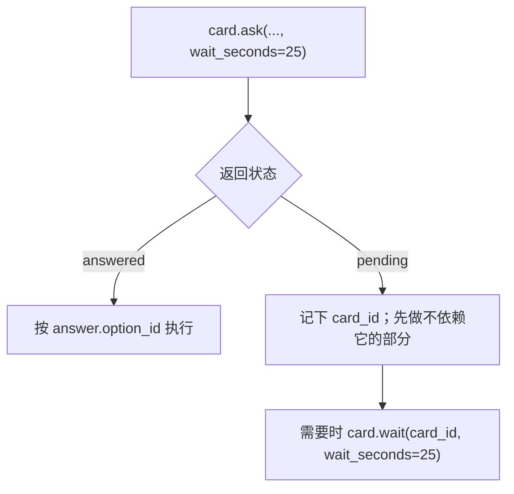

# AIDash MCP 工具手册

> 本手册与 `tools/list` 的 `inputSchema` 同源。两者冲突时以 `tools/list` 为准。
> 契约总则见 `40-build/10-aidash/AGENTS.md`（发布到 harness 仓库时，两份文件都放在该仓库根目录）；本文件只讲“每个工具怎么调”。

---

## 0. 什么时候用

| 你想做的事 | 用哪个工具 |
|---|---|
| 让用户在两三个方案里选一个 | `card.ask` |
| 告诉用户一件事，不需要回复 | `card.post` + `type=info` |
| 生成一段能直接发给同事的话 | `card.post` + `type=handoff` |
| 把分析结论和建议挂起等用户批准 | `task.create(kind="suggestion")` 建草稿任务（不发通知卡） |
| 汇报阶段结果（作为完成证据） | `card.post` + `type=status` |
| 交付产物链接 | `card.post` + `type=artifact` |
| 从任务树里领活干 | `task.claim` |
| 把活干完后回报 | `task.update` + `event=complete` |
| 查项目知识库 | `kb.search` / `kb.get` |
| 开场了解用户现在关心什么 | `digest.get` |

---

## 1. 连接与通用约定

```bash
# 环境变量
export AIDASH_URL="http://127.0.0.1:8787"
export AIDASH_TOKEN="..."          # 只放环境变量，不要写进仓库
```

> 项目级接入以 `40-build/00-platform/config/mcp.json` 为准：`aidash` 服务指向 `http://127.0.0.1:8787/mcp`，`Authorization` 用 `${AIDASH_TOKEN}` 占位。该文件不在仓库根，Claude Code 需要用 `--mcp-config 40-build/00-platform/config/mcp.json` 显式加载。上面的 `export` 只用于在 shell 里手动发 HTTP；两种方式读的是同一个环境变量。

MCP 调用统一是 JSON-RPC 2.0：

```json
{
  "jsonrpc": "2.0",
  "id": 1,
  "method": "tools/call",
  "params": {
    "name": "card.post",
    "arguments": { "...": "本手册各节给出的就是 arguments" }
  }
}
```

通用规则：

- **认证**：`Authorization: Bearer $AIDASH_TOKEN`；令牌不放 URL。
- **时间**：一律 ISO 8601 带时区，如 `2026-10-23T08:00:00.000Z`。
- **幂等**：写操作带 `idempotency_key`（≤128）；卡片作用域是“同通道内”，任务是“全库”。
- **分页**：`page` 默认 1，`page_size` 默认 50、上限 200。
- **返回**：成功时 `structuredContent` 形如 `{ "schema_version": "1.0", ...payload }`；失败是 JSON-RPC error。

---

## 2. 工具参考

### 2.1 `harness.register`（MCP-001）

注册或更新自己。重复注册是更新，不会新增。

| 参数 | 类型 | 必填 | 说明 |
|---|---|---|---|
| `harness_id` | string(≤64) | 是 | 稳定 ID，如 `claude-dev`、`watchdog-a` |
| `name` | string(≤128) | 是 | 显示名 |
| `host` | string(≤128) | 否 | 主机名，不要求 IP |
| `capabilities` | string[] | 否 | 标签，如 `["dev","test"]` |
| `idempotency_key` | string | 否 | |

```json
{ "harness_id": "claude-dev", "name": "Claude 开发机", "host": "devhost", "capabilities": ["dev", "typescript"] }
```

返回 `{harness_id, status, registered_at}`。

**常见错误**：`INVALID_ARGUMENT`（`harness_id` 含空格或超长）。

---

### 2.2 `harness.heartbeat`（MCP-002）

| 参数 | 类型 | 必填 |
|---|---|---|
| `harness_id` | string | 是 |
| `status_hint` | `idle` \| `busy` | 否 |

返回 `{status, last_seen, server_time}`。用 `server_time` 校准本地时钟，不要用本机时间判断租约。

---

### 2.3 `channel.upsert`（MCP-003）

| 参数 | 类型 | 必填 | 说明 |
|---|---|---|---|
| `channel_key` | string(≤200) | 是 | 约定 `host/project/topic`；`project`/`topic` 由第二、三段解析，不单独传 |
| `title` | string(≤200) | 否 | 缺省用 key |
| `workdir` | string(≤500) | 否 | 项目根目录；新通道必须登记，旧通道可后补 |

```json
{
  "channel_key": "devhost/myproj/auth-bug",
  "title": "认证 500 排查",
  "workdir": "F:/work/myproj"
}
```

返回 `{channel_key, id, created, restored}`。归档通道会被自动恢复为 `active`。

- `project` 是主对话，`topic` 是子对话；Web 显示为 `project / topic`。
- `workdir` 只在传入非空值时登记/更正；不传或传 `null` 不会清空已有路径。
- 通道列表视图（`GET /api/channels`）还会返回 `workdir`、`task_count`（全部任务）、`open_task_count`（`pending`/`claimed`/`in_progress`/`blocked`）、`last_mcp_at`（最近一次 MCP 调用时间）和 `agent_online`。
- `agent_online = last_mcp_at 存在且距今 ≤ 阈值`（默认 180 秒，配置项 `AIDASH_OFFLINE_THRESHOLD_SECONDS`）。任何 `tools/call` 都刷新，包括 `task.list` / `card.get` 这类读操作；REST/Web 操作不刷新。它只表示“agent 最近还在调 AIDash”，与未结束任务数、harness 心跳无关。想让通道保持在线就正常调工具；停止调用后最多一个阈值周期就会显示“已停止”。

**常见错误**：`channel_key` 用中文或空格——它同时是 URL 片段，保持 ASCII。`workdir` 不要填令牌、私钥或凭据路径。

---

### 2.4 `card.post`（MCP-004）

通用字段：

| 参数 | 类型 | 必填 | 说明 |
|---|---|---|---|
| `channel_key` | string | 是 | 不存在则自动建通道 |
| `type` | enum | 是 | `info`/`handoff`/`question`/`suggestion`/`status`/`artifact` |
| `title` | string(≤200) | 视类型 | |
| `priority` | `P0`~`P3` | 否 | 默认 `P2` |
| `task_id` | string | 非 `question` 必填 | 关联任务；信息流按任务归属，缺失会被 `INVALID_ARGUMENT` 拒绝 |
| `idempotency_key` | string | 否 | |

各类型必填字段：

| type | 必填 |
|---|---|
| `info` | `title`, `body_md`, `severity` |
| `handoff` | `recipient`, `channel_kind`, `reason`, `message_md` |
| `question` | `title`, `background_md`, `goal_md`, `research_md`, `decision_md`, `options[2~10]` |
| `suggestion` | `analysis_md`, `suggestions[≥1]` |
| `status` | `summary`, `result` |
| `artifact` | `url`, `kind`, `summary` |

> 4.0 起，`info` / `handoff` / `suggestion` / `status` / `artifact` 都必须再带 `task_id`；
> `question` 例外——拍板卡可以不属于任何任务。发卡前先确认任务存在并且在同一通道，
> 否则卡虽然能建，用户却在任务树里找不到它。

返回 `{card_id, status, created_at, enrichment_status}`。

**常见错误**：

- `INVALID_ARGUMENT`：非 `question` 卡缺 `task_id`。先 `task.create`（草稿即可）拿到任务，再发卡。
- `INVALID_ARGUMENT` + `details.pattern`：正文命中令牌/密码/私钥模式。改内容，不要试图拆分绕过。
- `INVALID_ARGUMENT`：`body_md` 超过 64KB 或 `message_md` 超过 16KB。
- `INVALID_ARGUMENT`：`status` / `handoff` 卡带了 `body_md`。正文分别改用 `detail_md`、`message_md`；`body_md` 只用于 `info`。
- `question` 不要用 `card.post` 发——那样没有答案回传通道，用 `card.ask`。如果确实用 `card.post` 发 `question`，四段与选项校验同样会执行，但调用方拿不到有界等待的结果。

---

### 2.5 `card.ask`（MCP-005）

发一张决策卡，并在有限时间内等用户回答。

| 参数 | 类型 | 必填 | 默认 |
|---|---|---|---|
| `channel_key` | string | 是 | |
| `title` | string | 是 | |
| `background_md` | string(≤64KB) | 是 | 议题背景 |
| `goal_md` | string(≤64KB) | 是 | 达到目的或结果 |
| `research_md` | string(≤64KB) | 是 | 调查参考；涉及资源、止损、风险必须先调查 |
| `decision_md` | string(≤64KB) | 是 | 决策项描述 |
| `options` | array(2~10) | 是 | 每项见下方“选项字段” |
| `allow_free_text` | boolean | 否 | false |
| `default_action` | string \| null | 否 | null |
| `due_at` | string \| null | 否 | null |
| `priority` | enum | 否 | `P1` |
| `task_id` | string | 否 | |
| `wait_seconds` | int(0~300) | 否 | 90（MCP 侧实际最多等 25 秒） |
| `idempotency_key` | string | 否 | |

**MCP 等待上限是 25 秒，不是 300 秒。** MCP 客户端常在 30~60 秒就判定工具调用超时，而服务端此时已经把卡片写进库——调用方看到“失败”，用户却在网页上看到一张新卡。所以 MCP 的 `card.ask` / `card.wait` 会在 25 秒时主动返回 `{status:"pending", card_id}`。**`pending` 不是失败**：记下 `card_id`，先做不依赖它的部分，稍后用 `card.wait` / `card.get` 取答案。真正需要长时间等时，分多次 `card.wait`，不要一次挂 300 秒。

**选项字段**：

| 字段 | 类型 | 必填 | 说明 |
|---|---|---|---|
| `id` | string(≤64) | 是 | 卡内唯一 |
| `label` | string(≤200) | 是 | 选项名称 |
| `description` | string(≤4000) | 否 | 一句话说明 |
| `pros_md` | string(≤4000) | 是 | 优点；Markdown |
| `cons_md` | string(≤4000) | 是 | 缺点/代价；没有明显缺点写“无明显缺点” |
| `recommendation_role` | `primary` \| `backup` | 是 | 主推荐 / 备选推荐；一张卡恰好各 1 个 |
| `recommendation` | string \| boolean | 否 | 旧字段，仅为兼容历史数据保留 |

```json
{
  "channel_key": "devhost/myproj/auth-bug",
  "title": "登录 500：先回滚还是先修白名单？",
  "background_md": "议题背景：10:20 起登录接口 500，怀疑网关白名单未放行。",
  "goal_md": "达到目的：尽快恢复用户登录，同时保留根因修复的窗口。",
  "research_md": "调查参考：回滚约 10 分钟恢复；修白名单需运维确认，约 30 分钟；回滚不会丢数据。",
  "decision_md": "决策项：先回滚恢复访问，还是等白名单修复一次解决。",
  "options": [
    {
      "id": "rollback",
      "label": "立即回滚",
      "description": "10 分钟内恢复，问题保留",
      "pros_md": "- 恢复最快\n- 操作路径已验证",
      "cons_md": "- 根因仍在，可能复发\n- 需要重新发布",
      "recommendation_role": "primary"
    },
    {
      "id": "fix",
      "label": "等白名单修复",
      "description": "根因解决，但需 30 分钟",
      "pros_md": "- 直接消除根因\n- 不需要回滚再发布",
      "cons_md": "- 用户受影响时间更长\n- 依赖运维确认",
      "recommendation_role": "backup"
    }
  ],
  "allow_free_text": true,
  "priority": "P0",
  "wait_seconds": 120
}
```

**校验规则**：四段均非空；2~10 个选项；`id` 唯一；每项 `pros_md`/`cons_md` 非空；恰好 1 个 `primary` 和 1 个 `backup`。缺任何一项返回 `INVALID_ARGUMENT`。

两种返回：

```json
{ "status": "answered", "card_id": "cd_x", "answer": { "option_id": "rollback", "free_text": null, "note": "先恢复", "answered_at": "..." } }
```

```json
{ "status": "pending", "card_id": "cd_x", "poll_after_ms": 5000, "expires_at": "..." }
```

拿到 `pending` 后（AGENTS §3.7 的硬规则，不是建议）：

1. 记下 `card_id`，**不要原地反复 `card.wait` 空转**；
2. 扫一遍排期，转去做**不依赖这个答案**的另一条任务线，把等待时间变成产出；
3. 每推进一段用 `card.get` 回看一次；`answered` 就按答案执行，不再重复提问；
4. 只有当排期里**确实没有别的可执行项**时，才 `card.wait` 短等，或把当前任务 `block` 并写清等哪张卡；
5. 决策 `expired` 时下一轮重发，并在背景里说明上次已到期，不要静默丢弃。

**常见错误**：

- `INVALID_ARGUMENT`：四段有缺段/空段、选项少于 2 个或多于 10 个、`id` 重复、某选项缺 `pros_md`/`cons_md`、主推荐或备选推荐不是恰好 1 个。
- `BUSY`：服务端等待配额满。退避后重试，或改用 `wait_seconds=0` 立即拿 `pending`。
- `default_action` 只是记录，不会自动执行（DQ-009）。别指望它兜底。

---

### 2.6 `card.get`（MCP-006）

```json
{ "card_id": "cd_x" }
```

返回完整卡片对象。`NOT_FOUND` 表示 ID 错了或已归档。

---

### 2.7 `card.wait`（MCP-007）

| 参数 | 类型 | 必填 | 默认 |
|---|---|---|---|
| `card_id` | string | 是 | |
| `wait_seconds` | int(0~300) | 否 | 90 |

返回形状同 `card.ask`。卡片已归档 → `CONFLICT`；不存在 → `NOT_FOUND`。

---

### 2.8 `card.list`（MCP-008）

| 参数 | 类型 | 必填 |
|---|---|---|
| `channel_key` | string | 否 |
| `project` | string | 否 |
| `type` | string | 否 |
| `status` | string | 否 |
| `priority` | string | 否 |
| `q` | string | 否 |
| `task_id` | string | 否 |
| `unassigned` | boolean | 否 | `true` 时只返回升级前没有任务的存量卡 |
| `page` / `page_size` | int | 否 |
| `include_archived` | boolean | 否 |
| `include_body` | boolean | 否，默认 `false`；`true` 时返回完整正文 |

返回分页列表，`meta` 里有 `total`、`has_more`；每张卡带 `read_at`（`null` 表示未读）。

- **默认省略正文**：`body_md` / `background_md` / `goal_md` / `research_md` / `decision_md` / `message_md` 默认返回 `null`，只给 `preview_md`（从 body → background → goal 取第一个非空值，约 240 字符）。需要全文时显式传 `include_body=true`；`card.get` 始终返回完整卡片。
- `project` 按主对话过滤，一次返回该项目下全部 `topic` 通道的卡；与 `channel_key` 同时给时取交集。
- `task_id` 用于查某任务的关联卡（含证据卡）。它默认也只会返回 `preview_md`；按任务读完整信息流时要同时传 `include_body=true`（Web 任务信息流已这样做）。
- `unassigned=true` 只用于盘点升级前的存量无归属卡；新卡已不可能进入该集合。
- **用法**：发卡前用它查重，避免同一件事刷屏。

---

### 2.9 `task.create`（MCP-009）

| 参数 | 类型 | 必填 |
|---|---|---|
| `channel_key` | string | 是 |
| `title` | string(≤200) | 是 |
| `description_md` | string(≤2,000,000 字符) | 否 |
| `kind` | `'task'` \| `'suggestion'` | 否（默认 `task`） |
| `category` | string(≤40) \| null | 否（单值分类，空白归一为 `null`） |
| `parent_id` | string \| null | 否 |
| `priority` | enum | 否 |
| `assignee` | string \| null | 否 |
| `tags` | string[] | 否 |
| `due_at` | string \| null | 否 |
| `idempotency_key` | string | 否 |
| `submit` | boolean | 否 |

返回任务对象，默认 `status='draft'`；`submit=true` 时直接为 `pending`。**draft 不可认领**，要 `task.update(event="submit")` 后才进入 `pending`。

执行任务的完整登记顺序：

```text
task.create → task.update(event="submit") → task.claim → task.update(event="start")
```

**建议不要发 `suggestion` 卡**，用 `kind="suggestion"` 的任务（保持 `draft`）：

```text
task.create(kind="suggestion", title="建议：……", description_md="背景/收益/风险/回滚")
  → 不 submit，停在 draft（任务树显示“建议”徽标，等用户批准）
  → 用户批准后：task.update(event="submit") → task.claim → task.update(event="start")
```

为什么不用 `blocked`：`unblock` 必须带 `claim_token`，令牌只活在认领方会话里，用户无法在网页上把阻塞任务重新推进；`draft` 才是用户可一键“提交待认领”的挂起位。

禁止“只发卡不登记任务”——用户在任务树里看不到执行过程，也无法验收。

---

### 2.10 `task.update`（MCP-010）

| 参数 | 类型 | 必填 | 说明 |
|---|---|---|---|
| `task_id` | string | 是 | |
| `event` | enum | 否 | `submit`/`start`/`block`/`unblock`/`complete`/`fail`/`cancel`/`release`/`retry`/`defer`/`undefer`/`flag_risk`/`unflag_risk` |
| `claim_token` | string | 状态事件必填 | 除 `submit`/`cancel`/`retry`/`defer`/`undefer`/`flag_risk`/`unflag_risk` 外 |
| `patch` | object | 否 | `title`/`description_md`/`priority`/`assignee`/`tags`/`category`/`due_at` |
| `reason` | string | `fail`/`block`/`cancel`/`retry`/`defer`/`flag_risk` 必填 | 终态必须能回答“为什么”；`flag_risk` 写清“留了什么坑”；`retry` 写清“为什么重做” |
| `deferred_until` | ISO string | 否 | 仅 `defer`：计划恢复时间 |
| `evidence_card_ids` | string[] | 否 | `complete` 可选；不传则服务端自动查关联卡 |

`event` 与 `patch` 可以同时给，服务端在同一事务里先校验状态、再应用字段。

`retry` 是 `failed` 的专用出口：只允许 `failed → pending`，`reason` 必填，不需要 `claim_token`。它把任务重新放回待认领队列（`fail_reason`/`failed_at`/上一轮租约被清空，`started_at`/`claimed_at` 保留），之后仍需重新 `task.claim` 才能执行；`done`/`cancelled` 不能 `retry`。

**状态时间线**：返回的任务对象带 `claimed_at`、`started_at`、`blocked_at`、`completed_at`、`failed_at`、`cancelled_at`、`blocked_reason`、`fail_reason`、`cancel_reason`、`defer_reason`、`deferred_at`、`deferred_until`，时间字段为 ISO 字符串或 `null`。`defer_reason` 非空即表示“已暂缓”。

**隐患字段**：`risk_note`（隐患说明原文）、`risk_flagged_at`、`risk_resolved_at`、`risk_resolution`（解除时的复盘结论，可选）。四者与 `status` 正交：任务可以是 `done` 且 `risk_note` 非空（带病交付），也可以是 `done` 且 `risk_resolved_at` 非空（事后已补齐）。`risk_resolved_at` 为 `null` 表示隐患仍未解除。`task.copy` 生成的是全新草稿，不继承源任务的隐患四列；`flag_risk`/`unflag_risk` 与 `patch` 同次提交时，字段修改和隐患事件都会生效，不会被静默丢弃。

任务对象同时带 `unread_count`（该任务下未读、未归档卡的数量），任务树用它渲染红点。agent 不需要自己维护未读；它由用户在 Web 端阅读时通过 `POST /api/cards/{id}/read` 消除。

任务对象还带结束通知字段：`end_notice_read_at`（ISO | null）与派生字段 `end_notice_pending`（boolean，等于“任务处于 `done`/`failed`/`cancelled` 且用户尚未确认”）。任务每次进入终态都会清空已读时间，Web 任务树据此给整行加背景与圆点；用户点一下任务行时由 Web 调用 REST `POST /api/tasks/{id}/ack-end-notice` 确认（未结束返回 `CONFLICT`/`TASK_NOT_ENDED`，重复确认幂等且不更新 `updated_at`）。**这是 REST 交互、不在 23 个 MCP 工具里**：agent 不要替用户确认，也不要因为看到 `end_notice_pending=true` 就补发完成通知。

| 事件 | 写入 |
|---|---|
| `claim`（含过期租约接管） | `claimed_at`；续租不改写 |
| `start` | `started_at` |
| `block` | `blocked_at` + `blocked_reason`（取 `reason`） |
| `unblock` | 不清空 `blocked_at`，保留最近一次阻塞历史 |
| `complete` | `completed_at` |
| `fail` | `failed_at` + `fail_reason`（取 `reason`） |
| `retry` | 清空 `failed_at`/`fail_reason`/`claimed_by`/`claim_token`/`claim_expires_at`；`status` 回 `pending`；保留 `started_at`/`claimed_at`；只允许 `failed` |
| `cancel` | `cancelled_at` + `cancel_reason`（取 `reason`，必填）；清空暂缓三列 |
| `defer` | `defer_reason` + `deferred_at`（+ 可选 `deferred_until`）；`status` 不变；仅 `draft`/`pending` |
| `undefer` | 清空暂缓三列；任务未暂缓时报 `CONFLICT TASK_NOT_DEFERRED` |
| `flag_risk` | `risk_note`（取 `reason`，必填）+ `risk_flagged_at`；清空 `risk_resolved_at`（重新标记视为风险再次出现）；`status` 不变 |
| `unflag_risk` | 写 `risk_resolved_at` + `risk_resolution`（取可选 `reason`）；不清空 `risk_note`/`risk_flagged_at`；复盘结论同时落事件 |
| `claim` | 清空暂缓三列（重新开始处理）；不清空隐患 |

```json
{
  "task_id": "tk_01J9Z8",
  "event": "complete",
  "claim_token": "cl_***",
  "evidence_card_ids": ["cd_status_1"]
}
```

暂缓一个还没人认领的任务（不需要 `claim_token`）：

```json
{
  "task_id": "tk_01J9Z8",
  "event": "defer",
  "reason": "等用户确认知识库路径后再做",
  "deferred_until": "2026-10-25T09:00:00.000Z"
}
```

带隐患完成任务：先 `complete`，再补记隐患（终态仍可标记，且不需要 claim_token）：

```json
{
  "task_id": "tk_01J9Z8",
  "event": "flag_risk",
  "reason": "仅验证 Windows，Linux 下的符号链接分支未覆盖"
}
```

事后补齐后用 `unflag_risk` 解除；`reason` 可写复盘结论，例如“风险未发生，当时的取舍正确”：

```json
{ "task_id": "tk_01J9Z8", "event": "unflag_risk", "reason": "Linux 分支已补测通过" }
```

**常见错误**：

- `CONFLICT`：非法转移（如 `done -> start`）。先 `task.list` 读最新状态。
- `CONFLICT`：对非 `failed` 任务调 `retry`。`retry` 只有 `failed -> pending` 一条边；`done`/`cancelled` 不可逆。
- `CONFLICT`（`TASK_NOT_DEFERRED`）：对没有暂缓标记的任务调 `undefer`。
- `CONFLICT`（`TASK_RISK_NOT_FLAGGED`）：对没有隐患的任务调 `unflag_risk`。
- `CONFLICT`（`TASK_RISK_ALREADY_RESOLVED`）：隐患已经解除，重复解除；要重新记一条风险请用 `flag_risk`。
- `CONFLICT`：对 `claimed`/`in_progress`/`blocked` 的任务调 `defer`——执行中的任务要停用 `block`，不是 `defer`。
- `EVIDENCE_REQUIRED`：没先发 status/artifact 卡。补卡后再 complete。
- `FORBIDDEN`：`claim_token` 不是你的，或任务已被回收。

---

### 2.11 `task.list`（MCP-011）

```json
{ "channel_key": "devhost/myproj", "status": "pending", "assignee": "claude-dev", "page": 1, "page_size": 50 }
```

| 参数 | 类型 | 必填 | 默认 |
|---|---|---|---|
| `channel_key` | string | 否 | 全部通道 |
| `status` | enum | 否 | 未结束的六种（见下） |
| `assignee` | string | 否 | |
| `has_risk` | boolean | 否 | `true` = 曾标记过隐患（含已解除），复盘用 |
| `risk_open` | boolean | 否 | `true` = 只看仍未解除的隐患 |
| `include_closed` | boolean | 否 | `false` |
| `include_description` | boolean | 否 | `false` |
| `page` / `page_size` | int | 否 | 1 / 50 |

返回分页任务列表。找活干时优先用它，而不是 `task.tree`（树适合看结构，不适合扫可认领项）。

**默认忽略完成/取消**：不传 `status` 且 `include_closed=false` 时，只返回 `draft/pending/claimed/in_progress/blocked/failed`；`failed` 保留，避免失败任务被藏起来。要复盘历史时，显式传 `status=done` / `status=cancelled`（显式筛选优先），或 `include_closed=true` 取全量。**例外**：传 `has_risk=true` 或 `risk_open=true` 且未显式传 `status` 时自动包含终态——带隐患完成的任务大多已经结束，否则复盘筛选会漏掉主要对象；显式 `status` 仍然优先。

**默认省略描述**：`description_md` 默认返回 `null`，因为描述可能内嵌 base64 截图；需要正文时传 `include_description=true`。

---

### 2.12 `task.tree`（MCP-012）

| 参数 | 类型 | 必填 | 默认 |
|---|---|---|---|
| `channel_key` | string | 是 | |
| `depth` | int | 否 | 2 |
| `root_id` | string | 否 | 全树根 |
| `include_closed` | boolean | 否 | `false` |
| `include_description` | boolean | 否 | `false` |

返回嵌套节点。深度过大时响应体增长快，按需取。

**默认忽略完成/取消**：`done`/`cancelled` 节点会被移除，但它们下面仍在进行的子节点会提升一级继续返回——父任务完成、验收又拆出待办时，不能把活着的子任务一起藏掉。需要完整层级时传 `include_closed=true`。

**默认省略描述**：节点里的 `description_md` 默认是 `null`；需要正文时传 `include_description=true`。

---

### 2.13 `task.claim`（MCP-013）

```json
{ "task_id": "tk_01J9Z8", "harness_id": "claude-dev", "lease_seconds": 900 }
```

返回 `{task, claim_token}`。

**规则**：

- 认领是原子的；并发时只有一个成功，其余得到 `ALREADY_CLAIMED`。
- `claim_token` 必须保存到任务结束；丢了就只能等租约到期。
- 默认租约 900 秒。活干不完要在到期前处理，不要假设会自动续。
- 认领成功会写 `claimed_at`；返回的任务对象带完整状态时间线（`started_at` 在 `task.update(event="start")` 后才有值）。

---

### 2.14 `task.release`（MCP-014）

```json
{ "task_id": "tk_01J9Z8", "claim_token": "cl_***", "reason": "需要更高权限，交回队列" }
```

返回 `{task}`，状态回到 `pending`。放弃时主动释放，比等租约过期更友好。

---

### 2.15 `task.move`（MCP-015）

```json
{ "task_id": "tk_child", "new_parent_id": "tk_other" }
```

移动节点（连同子树）。`new_parent_id=null` 表示移到根。

**常见错误**：`CONFLICT` — 目标在自己的子树里（会形成环）。

---

### 2.16 `task.copy`（MCP-016）

```json
{ "task_id": "tk_template", "new_parent_id": "tk_root" }
```

复制整棵子树，返回 `{tasks[]}`。副本是新 ID，状态回到 `draft`。

---

### 2.17 `kb.search`（MCP-017）

| 参数 | 类型 | 必填 | 默认 |
|---|---|---|---|
| `query` | string(≤200) | 是 | |
| `type` | string | 否 | |
| `tags` | string[] | 否 | |
| `top_k` | int(1~20) | 否 | 5 |

```json
{ "query": "网关 白名单", "top_k": 5 }
```

返回：

```json
{
  "kb_status": "ok",
  "results": [
    { "path": "Wiki/工程/网关白名单.md", "title": "网关白名单", "type": "note", "tags": ["auth"], "snippet": "…<mark>白名单</mark>…", "score": 0.82 }
  ]
}
```

`kb_status` 不是 `ok` 时（如索引未就绪），不要把它当“没有资料”，要在卡片里说明检索不可用。

---

### 2.18 `kb.get`（MCP-018）

```json
{ "path": "Wiki/工程/网关白名单.md" }
```

返回 `{path, title, type, tags, frontmatter, content_md}`。

**常见错误**：`FORBIDDEN` — 路径越界或符号链接；`NOT_FOUND` — 文件不存在。路径必须来自 `kb.search` 的结果，不要自己拼。

---

### 2.19 `digest.get`（MCP-019）

| 参数 | 类型 | 必填 | 默认 |
|---|---|---|---|
| `channel_key` | string | 否 | 全通道 |
| `since` | string | 否 | |
| `limit` | int | 否 | 20 |

返回待决策数、P0/P1 卡、最近状态卡、建议卡摘要。

**开场必调**：它回答“用户现在最关心什么”，比盲扫全部卡片便宜得多。

---

### 2.20 `memory.get`（MCP-020）

| 参数 | 类型 | 必填 |
|---|---|---|
| `project` | string（≤200，单行） | 是 |

返回 `{project, content_md, version, exists, line_count, updated_by, created_at, updated_at}`。没写过时 `exists=false`、`version=0`、`content_md=''`，不是错误。

**什么时候调**：需要看全篇时（整理/重写、或 `memory.search` 命中的行不足以判断上下文）。只是找某条约束时先 `memory.search`，省上下文。

```json
{ "project": "myproj" }
```

---

### 2.21 `memory.append`（MCP-021）

| 参数 | 类型 | 必填 | 默认 |
|---|---|---|---|
| `project` | string | 是 | |
| `lines` | string[]（1~50 行，单行 ≤2000 字符） | 是 | |
| `dedupe` | boolean | 否 | `true` |

返回 `{project, version, appended, skipped_duplicates, skipped_blank, line_count, updated_at, unchanged}`。

```json
{
  "project": "myproj",
  "lines": [
    "- [2026-10-24] [deploy] 发布前先备份 db，再跑迁移",
    "- [auth] 网关白名单未放行时登录接口会 500"
  ]
}
```

- 一行一条长期约束，建议 `- [日期] [key] 内容`，方便下次 `memory.search` 命中；
- 默认按行去重（比较时忽略行首尾空白）；全是重复行时返回 `unchanged=true`，不必再报告；
- **不要**写进度流水、临时状态、令牌/密码。

**常见错误**：`INVALID_ARGUMENT / MEMORY_APPEND_EMPTY` — 全是空行；`SENSITIVE_PATTERN_DETECTED` — 命中令牌/密码模式；`MEMORY_TOO_LARGE` — 追加后超过 64,000 字符。

---

### 2.22 `memory.search`（MCP-022）

| 参数 | 类型 | 必填 | 默认 |
|---|---|---|---|
| `project` | string | 是 | |
| `query` | string（≤200） | 是 | |
| `limit` | int（1~100） | 否 | 50 |

返回 `{project, query, version, total, truncated, matches:[{line_no, line}]}`。大小写不敏感的子串匹配；`line_no` 是 1 基行号；命中行超过 2000 字符时截断加 `…`。

```json
{ "project": "myproj", "query": "deploy", "limit": 10 }
```

**先搜再读**：它只回命中的几行，是开场了解约束最便宜的方式。`truncated=true` 说明命中比 `limit` 多，可缩小 query 或提高 limit。

---

### 2.23 `memory.update`（MCP-023）

| 参数 | 类型 | 必填 |
|---|---|---|
| `project` | string | 是 |
| `content_md` | string（≤64,000 字符） | 是 |
| `expected_version` | int ≥0 | 是 |

返回 `{project, version, changed, line_count, updated_at}`，不回传正文。

```json
{ "project": "myproj", "content_md": "- [a] 第一条\n- [b] 第二条", "expected_version": 3 }
```

- 只用于整理/删除过期条目，或用户已在 Web 上改过、你要接着改；
- 必须先 `memory.get` 拿最新 `version`；
- `MEMORY_VERSION_CONFLICT` → 重新读取并合并，**不要盲目重试**；
- 内容没变时返回 `changed=false`，版本不递增。

**常见错误**：`CONFLICT / MEMORY_VERSION_CONFLICT`（`details.actual_version` 是最新版本）；`MEMORY_TOO_LARGE`；`SENSITIVE_PATTERN_DETECTED`。

---

## 3. 标准工作流

### 3.0 会话开始 / 恢复检查（每次开工先做）

```text
digest.get()                                  # 用户现在关心什么
memory.search(project, key)                   # 先按 key 找长期约束/踩坑；需要全文再 memory.get
task.list(status="in_progress")               # 上一轮干到一半的
task.list(status="claimed")                   # 认领了还没开工的
task.list(status="blocked")                   # 停下来的
task.list(status="pending")                   # 没人接的；看 defer_reason 区分“已暂缓”
  → 能继续：task.claim（同 owner 未过期会续租；认领清空暂缓）→ 继续干
  → 暂不继续（已认领）：task.update(event="block", reason="为什么停 / 等什么 / 谁推进")
  → 暂不继续（未认领）：task.update(event="defer", reason="为什么先不做 / 等什么", deferred_until=...)
  → 已失效：task.update(event="cancel", reason="为什么不做")
```

**不要把“暂时不做”留在裸 `pending`。** `pending` 表示“等着别人认领”；它会让你已经放弃的活看起来还在队列里。未认领的用 `defer` 写上原因，任务树会显示“已暂缓”，和“忘了做”区分开。

**自己在做的任务也不能留在 `pending`。** 开工第一件事是 `claim → start`；交给子代理时，先 `claim` 再转交，或要求子代理启动后立刻 `claim → start`。

**blocked 不是永久死锁。** 租约过期（默认 900 秒）后，`task.claim` 允许任何 harness 接管 `claimed`/`in_progress`/`blocked` 任务。所以“上一轮的 blocked 任务”可以直接尝试 `claim`；`block` 只用于真的被外部条件卡住，并且必须写清解除条件。

### 3.0.1 结束前收尾闸门（强制）

准备结束回合/会话前，必须重新查一遍未结束任务，而不是凭记忆说“应该做完了”：

```text
task.list(status="draft")       # 含建议任务
task.list(status="pending")     # 看 defer_reason 区分“已暂缓 / 没人接”
task.list(status="claimed")
task.list(status="in_progress")
task.list(status="blocked")
```

逐条判定：

- **能自己做** → 立刻 `claim → start → 做 → 证据卡 → complete`，按批继续；
- **要用户拍板** → `card.ask` 发出去，写默认动作，不要用 `pending` 装死；
- **要外部人/机器** → `block`/`defer`，写清等谁、等什么、解除条件；
- **失效** → `cancel` 写原因。

**只要还有“能自己做”的条目，就不允许结束。** `defer` 不是逃生门：能做的事 defer 掉，等于把排期藏起来。结束语必须报数：完成几条、还剩几条、每条卡在谁/什么条件上。

### 3.1 接一个任务

```text
# 已有任务
task.list(status="pending", assignee="<me>")
  → task.claim(task_id, harness_id, lease_seconds=900)
  → task.update(event="start", claim_token=...)
  → 干活
  → card.post(type="status", task_id=..., summary=..., result="success")
  → task.update(event="complete", claim_token=..., evidence_card_ids=[card_id])

# 自己发现的活：先登记，再执行
task.create(channel_key, title, ...)
  → task.update(event="submit")
  → task.claim(...)
  → task.update(event="start", claim_token=...)
  → 同上
```

**禁止只发卡不登记任务。** 任务树是用户看执行过程的唯一入口；没有 `task.*` 记录，证据卡只是孤立的一张卡。

### 3.2 遇到岔路



### 3.3 需要用户转发

```text
card.post(type="handoff", task_id=..., recipient=..., channel_kind="wechat", reason=..., message_md=...)
```

`message_md` 写成对方能直接看懂的一段话：称呼 + 背景 + 具体请求 + 截止时间。

### 3.4 干不动了

```text
task.update(event="block", claim_token=..., reason="缺生产环境只读账号")
```

阻塞要有具体原因和“需要谁做什么”，不要写“卡住了”。

---

## 4. 错误与重试

| code | 是否重试 | 处理 |
|---|---|---|
| `INVALID_ARGUMENT` | 否 | 修参数；敏感模式看 `details.pattern` |
| `UNAUTHORIZED` | 否 | 检查 `AIDASH_TOKEN`，停止 |
| `FORBIDDEN` | 否 | 换主体，不要绕过 |
| `NOT_FOUND` | 否 | 检查 ID |
| `CONFLICT` | 否 | 读最新状态 |
| `ALREADY_CLAIMED` | 是 | 换任务或稍后 |
| `EVIDENCE_REQUIRED` | 否 | 先发证据卡 |
| `RATE_LIMITED` | 是 | 按 `Retry-After` |
| `BUSY` | 是 | 1s/2s/4s，最多 3 次 |
| `INTERNAL` | 否 | 上报 |

写操作重试前确认带了 `idempotency_key`，否则会重复建卡/建任务。

---

## 5. 自检清单

发卡前：

- [ ] 类型选对了吗？（要答案用 `card.ask`，不是 `card.post`）
- [ ] `question` 的四段 `background_md`/`goal_md`/`research_md`/`decision_md` 都写了吗？
- [ ] 每个选项都有 `pros_md` 和 `cons_md`？主推荐、备选推荐各恰好 1 个？
- [ ] 一张卡只讲一件事？
- [ ] `channel_key` 是 `host/project/topic` 且全 ASCII？新通道登记 `workdir` 了吗？
- [ ] 正文没有令牌、密码、私钥？
- [ ] 超过大小限制了吗？

会话开始时：

- [ ] 调过 `digest.get`？
- [ ] 查过 `in_progress` / `claimed` / `blocked` / `pending` 四类任务，并看过 `defer_reason`？
- [ ] 不继续的任务已经 `block`（已认领）或 `defer`（未认领）并写原因，失效的任务已经 `cancel`（写原因）？
- [ ] 自己在做的任务已经 `claim → start`，不是留在 `pending`？

认领前：

- [ ] 任务状态是 `pending`？（`draft` 要先 `submit`）
- [ ] 自己发现的活已经 `task.create` 并 `submit`，不是只发了一张卡？
- [ ] 保存了 `claim_token`？

完成前：

- [ ] 有 status 或 artifact 卡，且关联到本任务、`summary`/`url` 非空？
- [ ] 证据卡是在 `complete` 之前发的？
- [ ] `evidence_card_ids` 传了，或确认服务端能自动关联？

结束前（收尾闸门）：

- [ ] 重新查过 `draft` / `pending` / `claimed` / `in_progress` / `blocked` 五类任务？
- [ ] 没有悬空的 `question`？
- [ ] 还有“能自己做”的条目吗？有就不能结束，继续按批做。
- [ ] 该释放的任务释放了，或已 complete/fail/cancel？
- [ ] 剩余项每条都落到“等用户/等外部”，并且写清了解除条件？
- [ ] 结束语里报数了：完成几条、还剩几条、每条卡在谁/什么条件上？
