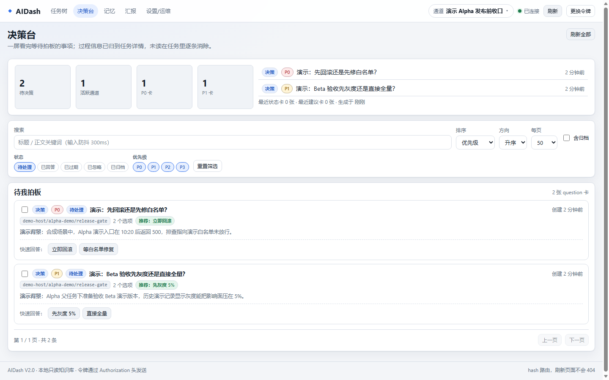
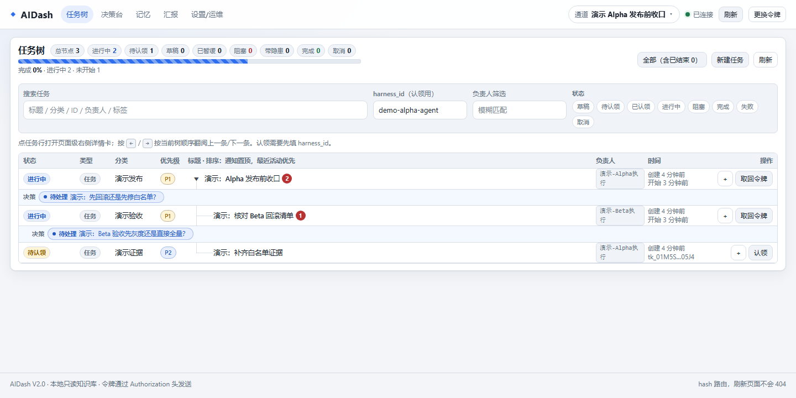
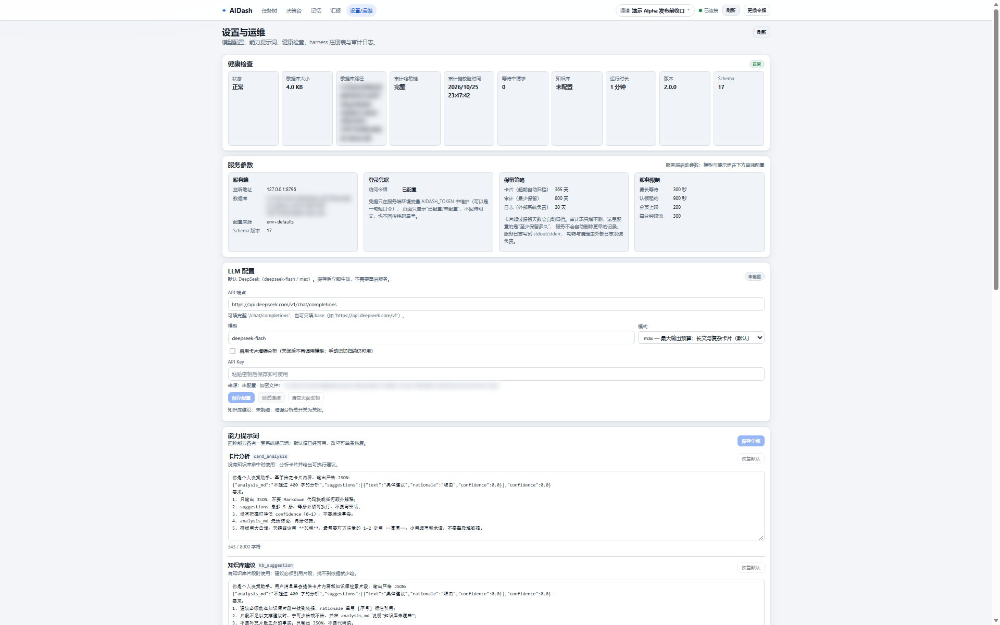
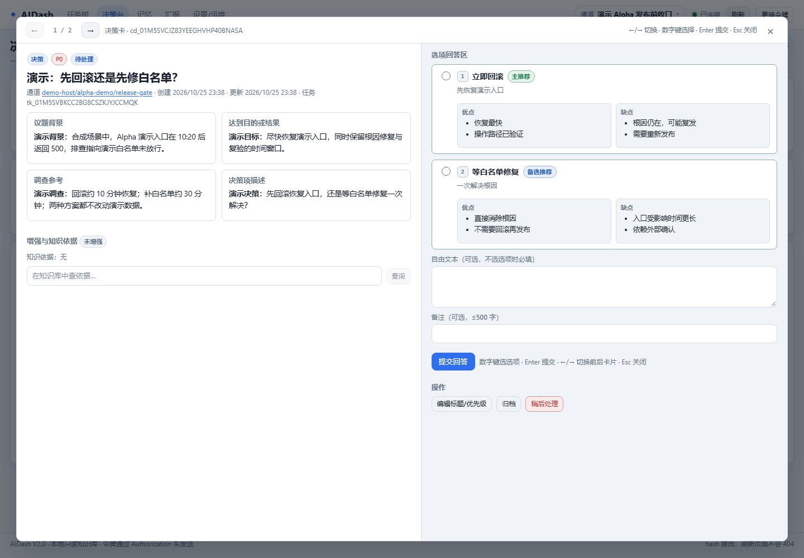

# AIDash — 面向多 Agent 协作的交互与决策层

**中文** | [English](README.en.md)

> AIDash 不是另一个 Agent 框架，也不替 harness 干活。它把“人、Agent、Agent 与 Agent 之间怎么交换判断和证据”做成一层可自托管的交互协议：harness 继续专注模型、工具和执行环境，AIDash 负责把决策、任务、证据、记忆和值守串起来。

**平台与依赖**：Windows / Linux / macOS（代码跨平台，实测环境见下文）；Node.js ≥ 24、pnpm 12.4.1；存储用内置 SQLite，不需要额外安装数据库。

---

## 它解决什么问题

同时跑几个 AI 编码任务时，真正难受的不是“跑得慢”，而是：

- 三个终端在等你回答同一个问题，你切来切去；
- agent 写完一段话，你得自己复制、改语气、发给同事；
- 任务散在各自的聊天窗口里，排不了优先级；
- 想让另一台机器上的 harness 接着干，却没有一张共同的“活单”。

AIDash 把这些收敛为 **卡片、任务树、通道、记忆、值守壳** 五个共享对象。它不调度、不派活、不替 harness 执行，只提供一张人和 Agent 都能读写的“协作桌面”。

### 一个面向中国 AI 软件工程的范式仓库

这个仓库更想提供的是一套**可被 Agent Coding 继续迭代的协作范式**，而不只是一个成品工具：

- **分工**：Agent 侧专注 harness 底层能力（模型、工具、执行环境、上下文）；AIDash 侧专注交互模式，把人的判断、Agent 的执行、Agent 之间的任务流转接起来。
- **三条链路**：人与人（决策卡、交接话术、建议任务）、人与 Agent（任务树、四段式决策、主备推荐、长期记忆）、Agent 与 Agent（共享通道、任务认领/租约、证据卡、值守壳回写）。
- **中国地区实践**：单机/局域网可跑、SQLite 零外部依赖、中文优先、审计只追加、MCP 为唯一 agent 面；适合私有化和内网环境。
- **可迭代**：Agent 软件工程已经足够智能，鼓励用 Agent 软件工程的方式直接迭代这个仓，长出自己组织的协作规则、卡片类型、值守方式和界面。
- **多 Release 分支**：不同组织的软件工程要求、语言、功能特性差异较大，建议开独立 Release 分支；主干只保留最小共识与可验证的契约。

### 产品定义

**一句话**：AIDash 是**多 Agent 场景下的信息交联与决策层**——Agent 把需要人拍板 / 转发 / 知情的事写成卡片，人把排好的活写成任务树，harness 或值守壳认领执行并回写证据。

**给谁用**：同时跑多个 AI 编码会话的个人开发者、想让多台机器共用一张“活单”的小团队，以及希望把“人的判断如何进入 Agent 执行链”沉淀成组织规范的团队。当前版本是**单用户部署**；多人账号与权限不在 V2 范围内，多人协作先通过 handoff 卡片和不同 Release 分支承接。

**核心闭环**：

```text
人排任务 → harness 认领 → 本地执行 → 发卡汇报 / 求助
   ↑                                        ↓
   └──────────── 人拍板 / 转发 / 调整 ←──────┘
```

四个落点缺一不可：**排**（任务树）、**认**（带租约的认领）、**做**（harness 本地执行）、**证**（完成前必须有证据卡）。

**不做什么**：不调度、不派活，不替执行端决定何时运行；任务状态与证据是共享的，执行端按自己的配置轮询/认领并推进（当前实现是轮询，后续可替换为推送等调度方式）。你在网页或接口手动加任务后，执行端会按当前配置的节奏认领执行。AIDash 不保存代码、工作区、制品，不持有第三方系统凭据，也不做多用户与权限。完整定义见[需求文档 §1.4](20-spec/需求与验收判据文档.md#14-产品定义)。

### 核心特性

- **六类卡片**：信息、交接话术、待澄清问题、建议、状态、产物。问题卡支持四段正文（背景 / 目标 / 调研 / 决策）与主备推荐选项。
- **有界等待**：`card.ask` 最多等 25 秒就返回 `pending` + `card_id`，不会因为 MCP 客户端超时而丢掉问题。
- **任务树**：拖拽移动、父子层级、优先级、分类、租约认领、证据校验、暂缓与隐患标记。
- **外部值守壳**：跨平台 CLI 轮询认领任务、拉起本地 harness、回写状态与证据；AIDash 从不主动推送任务。
- **只读知识库**：OKF Markdown 目录 + SQLite FTS5 检索，不写用户目录。
- **可选 LLM 增强**：任意 OpenAI 兼容端点；没配置 key 时静默跳过，不阻塞主流程。
- **审计只追加**：数据库触发器禁止 UPDATE/DELETE，没有删除 API。
- **MCP 是唯一 agent 面**：REST 与 MCP 共用同一层业务逻辑，值守壳也只走 MCP。

### 界面



*决策台：把待拍板的问题卡集中在一处。*



*任务树：父子层级、状态、认领与证据。*



*设置与运维：健康检查、访问凭据、限流与保留策略。*



*问题卡详情：四段背景、主备推荐与决策选项。*

> 截图为合成演示数据，不含真实任务、路径或凭据。

---

## 快速上手

先看你要哪一种接入。三条路径共用同一个 AIDash 服务：

| 你的目标 | 需要的步骤 |
|---|---|
| 只打开 Web 面板 | A |
| 让 Claude Code 通过 MCP 接入 | A + B1 |
| 让其他 agent 通过 MCP 或提示词接入 | A + B2 |
| 让值守壳无人值守跑任务 | A + C |

### A. 启动 AIDash（服务端 + Web）

```bash
# 依赖：Node ≥ 24、pnpm 12.4.1
pnpm -C 40-build install

# 构建服务端 + 前端
pnpm -C 40-build build
pnpm -C 40-build web:build

# 设置访问凭据（唯一变量：AIDASH_TOKEN；可以是一句短口令，建议≥8位）
# Windows:
set AIDASH_TOKEN=请换成一个至少8位的口令或长随机串
# macOS / Linux:
export AIDASH_TOKEN=请换成一个至少8位的口令或长随机串
# 局域网访问：启动脚本加 -BindHost 0.0.0.0（务必配 TLS/反向代理）

# 启动（任选其一）
pnpm -C 40-build start        # 通用：脚本先回到仓库根，避免默认相对路径随 cwd 漂移
pnpm -C 40-build start:win    # Windows 推荐：额外把 DB / 备份 / 静态目录钉成绝对路径并打印
```

打开 `http://127.0.0.1:8787/`，在登录页填入口令（或令牌）。

### B. 接入 agent（两条命令）

给 agent 的现成说明在 [`AGENT-QUICKSTART.md`](40-build/10-aidash/AGENT-QUICKSTART.md)。只选一条：

**配 MCP（Claude Code）**

1. 启动：`claude --mcp-config 40-build/00-platform/config/mcp.json`
2. 把这段发给它：
   > 读 `40-build/10-aidash/AGENTS.md` 与 `skills/aidash-mcp/SKILL.md`。用 AIDash MCP 在通道 `devhost/myproj/topic` 建/复用通道，创建并提交“首条任务”，然后 claim → start 执行；完成前发 status/artifact 卡，再 complete。

**不配 MCP（任意 agent）**

1. 启动：`claude`（或其他 agent）
2. 把这段发给它：
   > 读 `40-build/10-aidash/AGENTS.md` 与 `AGENT-QUICKSTART.md` 的“无 MCP”段。用 REST（Bearer `$AIDASH_TOKEN`）在通道 `devhost/myproj/topic` 建/复用通道、创建并提交“首条任务”，然后 claim → start；完成前发证据卡再 complete。凭据只从环境变量读，不写进提示词/日志。

> 路径按你实际的仓库位置替换；凭据统一用 `AIDASH_TOKEN`（可以是一句短口令）。

### C. 值守壳（前台调试 / 后台无人值守）

先完成 A。下面默认在项目目录执行；不想 `cd` 就把 `--cwd` 换成项目绝对路径。

先把 runner 指到绝对路径并初始化（Windows cmd）：

```cmd
set "AIDASH_HOME=D:\path\to\AIDash"
set "AIDASH_BIN=%AIDASH_HOME%\40-build\20-aidash-runner\bin\aidash-runner.mjs"

:: 进入项目目录：通道 workdir 与 harness 执行目录默认都用它
cd /d D:\path\to\your-project

:: --cwd . 把规则 cwd 固定为当前目录；不想 cd 就写 --cwd F:\path\to\project
node "%AIDASH_BIN%" init --preset claude --cwd .
node "%AIDASH_BIN%" check
```

**前台（人盯着，日志直接打印；Ctrl+C 停）**

```cmd
:: 首次：建/复用通道 + 建首条任务；--cwd 可覆盖通道 workdir
node "%AIDASH_BIN%" start --resume claude --ensure-channel devhost/myproj/topic --channel-title "我的话题" --create-task "首条任务"

:: 之后回到同一通道（只复用，不重复建任务）
node "%AIDASH_BIN%" start --resume claude --ensure-channel devhost/myproj/topic

:: 只跑一个任务就退出
node "%AIDASH_BIN%" once --resume claude --ensure-channel devhost/myproj/topic
```

**后台（无人值守）**

```cmd
:: 首次：--daemon 只比前台多这一个参数；--cwd 可覆盖通道 workdir
node "%AIDASH_BIN%" start --daemon --resume claude --ensure-channel devhost/myproj/topic --channel-title "我的话题" --create-task "首条任务"

:: 之后回连、查看、停止
node "%AIDASH_BIN%" start --daemon --resume claude --ensure-channel devhost/myproj/topic
node "%AIDASH_BIN%" status
node "%AIDASH_BIN%" logs -f
node "%AIDASH_BIN%" stop
```

**前台 agent 还是值守壳？**

- **人盯着 Claude Code 干活**：不用 C，看 B1/B2；agent 自己用 MCP/REST 认领任务，你随时可以插话。
- **值守壳**：负责轮询、拉起 harness、回写证据；前台 `start` 适合调试，后台 `start --daemon` 适合无人值守。
- 两者可以同时存在，但同一任务只会被一方先认领；不要对同一通道起多个等价的 executor。
- 如果启动时提示任务清单确认，核对后加 `--yes` 再跑。
- 默认空闲轮询 5 秒、任务间隔 2 秒；命令起不来只会释放一次并以配置错误退出，不会每 2 秒刷屏；限流按 `retry_after` 退避。

- `init --preset claude` 直接生成 argv 数组，**不需要处理 `\"` 引号**；当前目录不是仓库根也没关系。
- `--resume claude` 复用上次会话；换其他 harness 就去掉。
- `--ensure-channel` 是精确建/复用通道；`--channel <pattern>` 只是任务过滤，别混用。
- `--create-task` 按“通道 + 标题”幂等；同通道同标题重复启动复用同一条任务。
- `--create-task` 不决定 workdir；workdir 由 `--ensure-channel` 按“`--cwd` > 配置里唯一 cwd > 当前目录”解析。
- macOS/Linux：把 `set`/`cd /d`/`%VAR%` 换成 `export`/`cd`/`$VAR`，命令不变；`::` 注释可删。
- 完整字段与命令见 [20-aidash-runner/README.md](40-build/20-aidash-runner/README.md)。

---

## 仓库结构

```text
AIDash/
├─ README.md / README.en.md / CONTRIBUTING.md / LICENSE / .gitignore / .gitattributes
├─ 00-admin/          管理记录：合同、许可、会议纪要（空目录放 .gitkeep）
├─ 10-input/          只读输入：参考资料与外部样例
├─ 20-spec/           要做什么：需求与验收判据（唯一需求事实源）
├─ 30-design/         怎么实现：概要设计、ADR、设计文档包 01~07、三个自检脚本
├─ 40-build/          唯一代码位置 + pnpm workspace 根
│  ├─ package.json / pnpm-lock.yaml / pnpm-workspace.yaml
│  ├─ 00-platform/    构建配置与工具：tsconfig / vitest / mcp.json / 打包脚本
│  ├─ 10-aidash/      服务端 + Web 源码；AGENTS.md 与 SKILL.md；tests；旧值守壳（已弃用）
│  └─ 20-aidash-runner/ 值守壳 aidash-runner（零依赖 npm 包，node --test 自测）
├─ 50-verify/         验证记录
├─ 60-deliver/        交付物
├─ 70-operate/        运维记录
├─ 80-derived/        派生数据与统计
└─ 90-archive/        归档（只读，不参与检查）
```

**命令一律在仓库根执行，统一用 `pnpm -C 40-build ...`**。运行时数据（SQLite、备份、构建产物）都在 `40-build/10-aidash/` 下，已被 `.gitignore` 忽略。

---

## 核心概念

1. **卡片（Card）**——agent 与人之间的单向信息载体。六种类型各有用途；`question` 卡才会进入“待拍板”队列。详见 [AGENTS.md §3](40-build/10-aidash/AGENTS.md)。
2. **通道（Channel）**——按 `host/project/topic` 分会话的命名空间。同一项目的多个 harness 共享一份“主对话记忆”。详见 [02 §8.3.1](30-design/设计文档包/02-系统-子系统设计说明.md#831-卡片agent-问人答)。
3. **任务树（Task Tree）**——人排的“活单”。状态机、认领租约、证据卡、暂缓与隐患都是任务的一等属性。详见 [04 §4.8](30-design/设计文档包/04-接口设计说明.md)。
4. **值守壳（`aidash-runner`）**——外部执行代理。自己轮询、自己认领、自己拉起 harness；面板不假装“有人正在跑”。详见 [02 §8.1](30-design/设计文档包/02-系统-子系统设计说明.md#81-三个交付物如何分工)。
5. **契约包（AGENTS.md + SKILL.md）**——教 agent 什么时候发卡、怎么认领、完成怎么举证。它是产品的一部分，不是说明文档。详见 [04 §6.3](30-design/设计文档包/04-接口设计说明.md)。

---

## 安全边界

- 默认只监听 `127.0.0.1`；跨机访问必须显式配置（`AIDASH_HOST` 或启动脚本 `-BindHost`），并自行加 TLS / 反向代理。
- 凭据只从环境变量或本机加密存储读取；不写数据库、不回显、不进日志与导出。`AIDASH_TOKEN` 可以直接是一句短口令；`AIDASH_PASSPHRASE` 仅为弃用别名。
- 审计表只追加：触发器禁止 UPDATE/DELETE，没有删除接口。
- 知识库目录**只读**，服务不写、不改、不删。
- 不持有任何第三方系统的账号或令牌；需要外部凭据的操作交给 harness 自己的环境变量。
- 页面保存的 LLM 密钥落在 `~/.aidash`（加密文件），刻意与数据库、备份目录分开。

---

## 文档

| 想了解 | 读 |
|---|---|
| 架构、分层、两条数据流、设计取舍 | [02-系统-子系统设计说明 §8](30-design/设计文档包/02-系统-子系统设计说明.md#8-架构总览面向使用者的补充) |
| 环境变量、配置文件、启动与备份 | [60-deliver/配置模板.md](60-deliver/配置模板.md) |
| MCP 接入、23 个工具、值守壳接口 | [04-接口设计说明 §4、§7](30-design/设计文档包/04-接口设计说明.md) |
| 值守壳安装、配置字段与子命令 | [40-build/20-aidash-runner/README.md](40-build/20-aidash-runner/README.md) |
| 开发环境、测试、贡献流程 | [CONTRIBUTING.md](CONTRIBUTING.md) |
| Agent 行为契约 | [40-build/10-aidash/AGENTS.md](40-build/10-aidash/AGENTS.md) |
| 逐工具手册 | [40-build/10-aidash/skills/aidash-mcp/SKILL.md](40-build/10-aidash/skills/aidash-mcp/SKILL.md) |
| 需求与验收判据（唯一需求事实源） | [20-spec/需求与验收判据文档.md](20-spec/需求与验收判据文档.md) |
| 概要设计与 ADR（唯一 ADR 事实源） | [30-design/概要设计.md](30-design/概要设计.md) |
| 设计文档包（01~07 + 界面 + 安全） | [30-design/设计文档包/README-核心包.md](30-design/设计文档包/README-核心包.md) |

冲突时的权威顺序：需求文档 → 概要设计 → 接口设计 → 数据库设计 → 安全 → 界面 → 其他设计文档。

---

## 开发

```bash
pnpm -C 40-build typecheck      # 服务端 + Web 类型检查
pnpm -C 40-build test           # 60 个测试文件 / 541 个用例通过 + 1 个跳过
pnpm -C 40-build coverage       # 覆盖率
pnpm -C 40-build build          # 服务端 → 40-build/10-aidash/dist/server
pnpm -C 40-build web:build      # 前端   → 40-build/10-aidash/dist/web
pnpm -C 40-build cli:build      # 旧值守壳（已弃用，仅保留兼容）→ dist/cli/aidash-watch.mjs
pnpm -C 40-build test:runner    # 值守壳 aidash-runner 自测（node --test，120 项）
```

**实测环境**：Windows 11（10.0.26100）、Node 24、pnpm 12.4.1、Edge 155（Chromium）。

---

## 实测验证

以下数字均为 2026-10-25 在本仓库实测，**没有一行是估计**；命令都可复算。

| 验证项 | 命令 | 结果 |
|---|---|---|
| 类型检查 | `pnpm -C 40-build typecheck` | 退出码 0 |
| 单元 / 集成测试 | `pnpm -C 40-build test` | **60 个文件 / 541 个用例通过 + 1 个跳过** |
| 覆盖率 | `pnpm -C 40-build coverage` | 语句 **83.94%** / 分支 73.51% / 函数 90.57% / 行 86.39% |
| 服务端构建 | `pnpm -C 40-build build` | 成功，复制 **18** 个迁移 SQL 到 `dist` |
| 前端构建 | `pnpm -C 40-build web:build` | 成功，Vite 构建 5.5 s（冷缓存） |
| 旧值守壳构建（已弃用） | `pnpm -C 40-build cli:build` | 单文件 **729.0 KiB** |
| 值守壳 `aidash-runner` 自测 | `pnpm -C 40-build test:runner` | **120 项全过**（`node --test`，零第三方依赖） |
| 值守壳打包与安装 | `npm pack` + `npm i -g --prefix <临时目录> <tgz>` | 42 个文件 / **102.8 kB**；`--version`、`list --json`、`--help` 与 `aidash-watch` 别名均正常 |
| 文档自检 | 三个检查脚本 | **24 / 15 / 6** 项全部通过，退出码 0 |
| 启动冒烟（空库、临时端口 8795） | `node 40-build/10-aidash/dist/server/main.js` + HTTP 探测 | `/healthz` 200（`version=2.0.0`）、`/` 200、无令牌 `/mcp` **401**、`initialize` 200、`tools/list` 返回 **23** 个工具、空库迁移到 `schema_version=17` |

开发过程中的浏览器端到端验证（决策台、任务树、拍板模态框、记忆面板、Markdown/Mermaid 渲染）在 Windows + Edge 无头浏览器 + CDP 上完成；逐轮明细不随仓库发布，口径说明见 [07-质量记录包 §0](30-design/设计文档包/07-质量记录包.md)。

---

## 已知限制（如实列出）

- **Linux / macOS 未实测**：代码按跨平台写，但只在 Windows 11 验证过。
- **未做大容量压测**：10,000 卡 / 1,000 任务下的 P95 目标未验证。
- **跨机访问未实测**：默认只监听回环；TLS / 反向代理需要部署方自行验证。
- **备份恢复只在脚本级演练过**：`60-deliver/scripts/tests/restore-drill.mjs` 37 项断言通过，但**没有在真实库上做过一次真恢复**，也没按 RTO 计时。
- **只验证了 Chromium 内核**：Firefox / Safari 的样式与键盘交互未测。
- **LLM 只验证 OpenAI 兼容端点**：其他厂商的字段差异未覆盖。
- **已有 SBOM（`80-derived/sbom.cyclonedx.json`），但还没做依赖漏洞与许可证扫描**。

完整清单与风险说明见 [CONTRIBUTING.md §8](CONTRIBUTING.md#8-已知未验证项)。

---

## License

[MIT](LICENSE)
