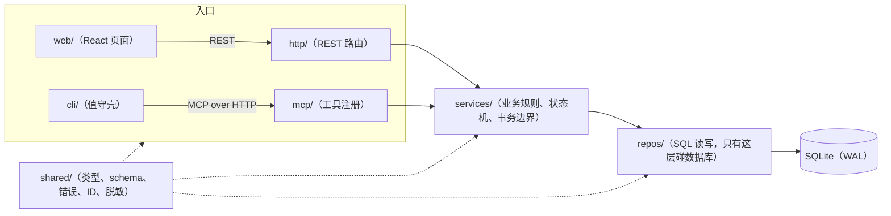
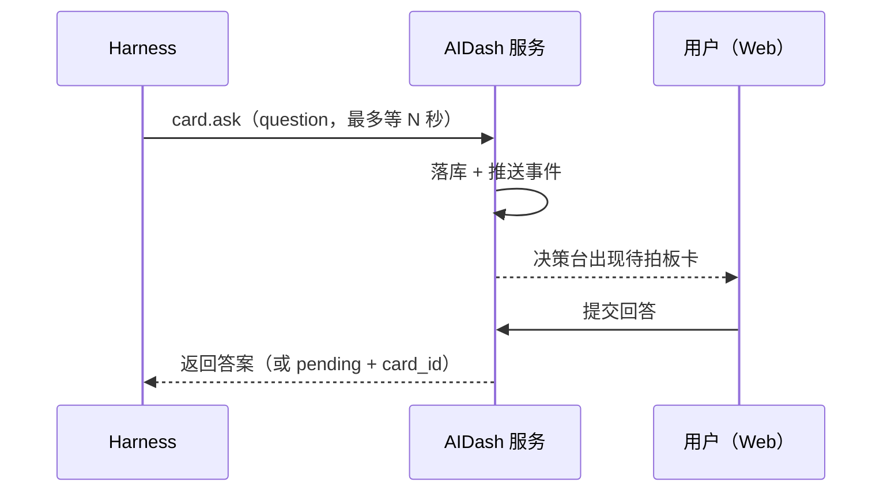
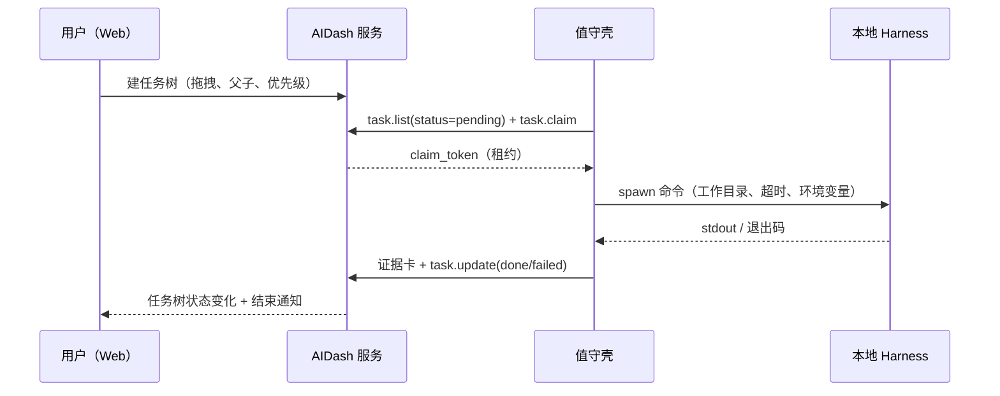

# 架构

> 一句话：一个单进程服务负责“记事实”，一个外部 CLI 负责“干活”，一份契约文件负责“教 agent 怎么用”。三者互不嵌入。

## 1. 三个交付物

| 交付物 | 形态 | 职责 | 必须常驻？ |
|---|---|---|---|
| **AIDash 服务** | Node 单进程 + Web 静态资源 | 卡片、通道、任务树、决策、审计、知识库索引；对外只有 HTTP（REST + MCP） | 是 |
| **值守壳 `aidash-watch`** | 跨平台 Node CLI（单文件可执行） | 轮询可认领任务 → 原子认领 → 拉起本地 harness → 回写状态与证据 | 需要自动执行时 |
| **契约包** | `10-aidash/AGENTS.md` + `10-aidash/skills/aidash-mcp/SKILL.md` | 告诉 harness 什么时候发卡、怎么发、任务怎么认领、完成怎么举证 | 否（纯文件） |

**为什么值守壳不是服务的一部分**：如果执行器长在面板里，面板很容易“以为任务在跑”，实际没有任何进程在干活。拆成独立 CLI 后，任务只有两种状态——有人认领，或者没人认领；没有中间态。

**为什么契约包也算交付物**：它不是文档附件，而是 harness 行为的实际控制面。改一句发卡规则，等于改所有 harness 的行为，所以要像代码一样纳入版本管理。

## 2. 代码分层

三条铁律：

1. **入口不写业务**：`http/` 与 `mcp/` 只做参数校验、错误映射、调用 service；同一业务在 REST 与 MCP 上行为一致，因为共用同一层 service。
2. **只有 `repos/` 碰 SQL**：事务边界在 service，SQL 细节在 repo；换存储时只改 repo。
3. **`shared/` 无副作用**：类型、zod schema、错误码、ID 生成、敏感模式拦截，前后端与 CLI 共用。

## 3. 两条数据流

### 3.1 卡片：agent 问，人答

有界等待是关键：MCP 客户端通常在 30~60 秒就判定工具调用超时。服务端默认 25 秒主动返回 `pending` + `card_id`，调用方可以继续做别的、稍后用 `card.get` 取答案。这样不会出现“客户端报失败、用户却看到新卡”的错位。

### 3.2 任务：人排，机器领

服务端**从不主动推送任务**。执行方自己轮询、自己认领；租约到期没续租，任务自动回到 `pending`。这条规则换来一个确定的事实：任务树上的“进行中”一定对应一个真实存活的执行者。

## 4. 关键设计取舍

| 取舍 | 选择 | 理由 |
|---|---|---|
| 存储 | SQLite + WAL，单文件 | 单用户、单进程；备份就是拷文件；不引入需要运维的数据库 |
| agent 接口 | MCP Streamable HTTP，`/mcp` | stdio 无法跨机；REST 与 MCP 共用 service，不维护两套语义 |
| 值守壳协议 | 只走 MCP，不另开 REST | 少一套客户端与鉴权面（ADR-015） |
| 增强能力 | LLM / 知识库失败不阻塞主流程 | 卡片与任务 100% 可用；建议区显示“未生成”即可 |
| 审计 | 只追加：数据库触发器禁止 UPDATE/DELETE | 审计一旦可改，就不再是审计 |
| 令牌 | 单令牌 Bearer，只从环境变量读 | 单用户场景；多用户体系是负债（DQ-007） |
| 监听 | 默认 `127.0.0.1` | 最小暴露面；跨机访问是部署方的显式选择 |

## 5. 目录结构

| 路径 | 放什么 | 备注 |
|---|---|---|
| `00-platform/` | 构建与工具配置（tsconfig、vitest、MCP 配置模板、打包脚本） | 不含业务代码 |
| `10-aidash/` | 源码、测试、契约文件、启动脚本、迁移 SQL | 唯一代码位置 |
| `20-spec/` | 需求与验收判据 | 需求唯一事实源 |
| `30-design/` | 概要设计、设计文档包、基线模型、检查脚本 | 设计唯一事实源 |
| `docs/` | 面向使用者的文档（本目录） | 指向上游，不重复定义 |

`10-aidash/` 内部：

| 路径 | 内容 |
|---|---|
| `src/shared/` | 类型、schema、错误、ID、脱敏 |
| `src/server/` | `http/`、`mcp/`、`services/`、`repos/`、`workers/`、`db/`（含 17 个迁移 SQL） |
| `src/web/` | React + Vite 前端 |
| `src/cli/` | 值守壳源码 |
| `tests/` | 29 个测试文件（255 个用例） |
| `scripts/` | Windows 启动脚本 |

## 6. 想深入

| 想知道 | 读 |
|---|---|
| 系统边界、部署拓扑、故障域 | [02-系统-子系统设计说明](../30-design/设计文档包/02-系统-子系统设计说明.md) |
| 模块实现、状态机完整转移表 | [03-软件设计说明](../30-design/设计文档包/03-软件设计说明.md) |
| REST / MCP 字段与错误码 | [04-接口设计说明](../30-design/设计文档包/04-接口设计说明.md) |
| 表、索引、迁移、备份 | [05-数据库设计说明](../30-design/设计文档包/05-数据库设计说明.md) |
| 安全要求与边界 | [06-安全性设计支撑材料](../30-design/设计文档包/06-安全性设计支撑材料.md) |
| 架构决策（ADR-001~015） | [概要设计](../30-design/概要设计.md) |
